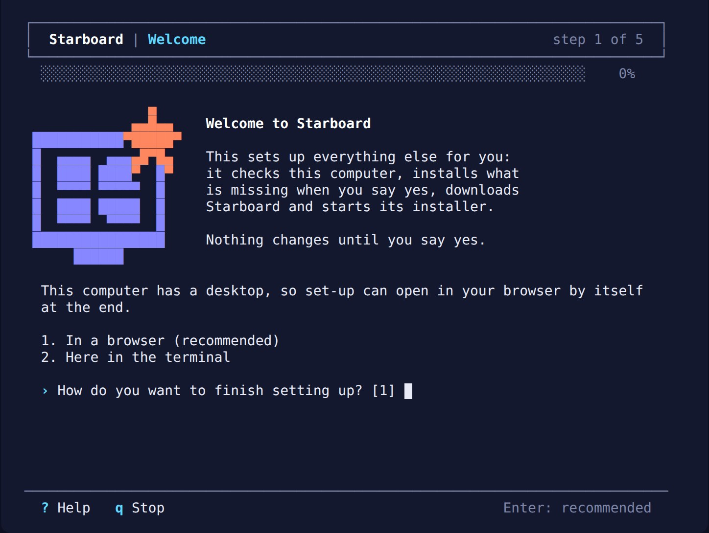
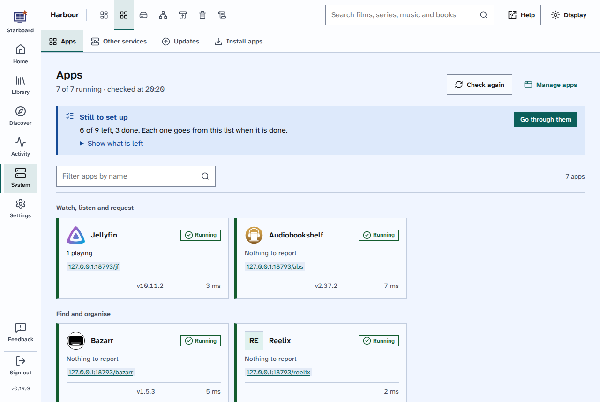
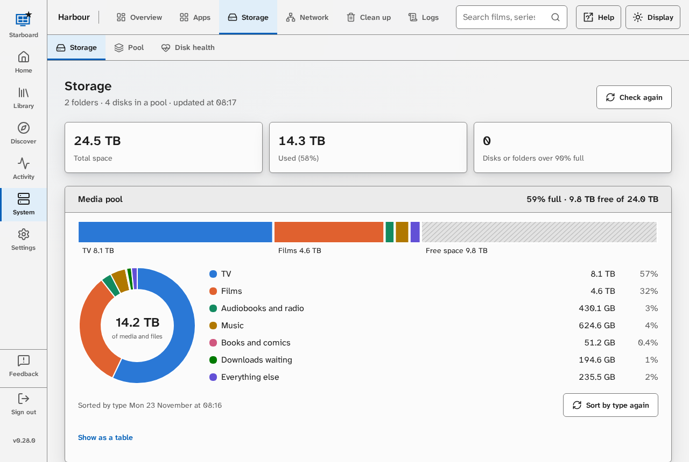
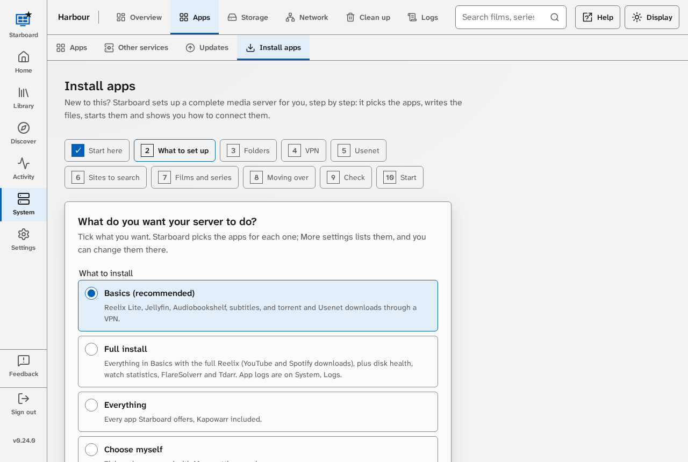
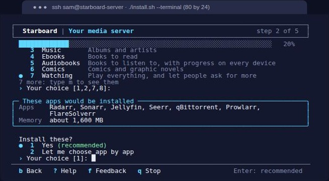
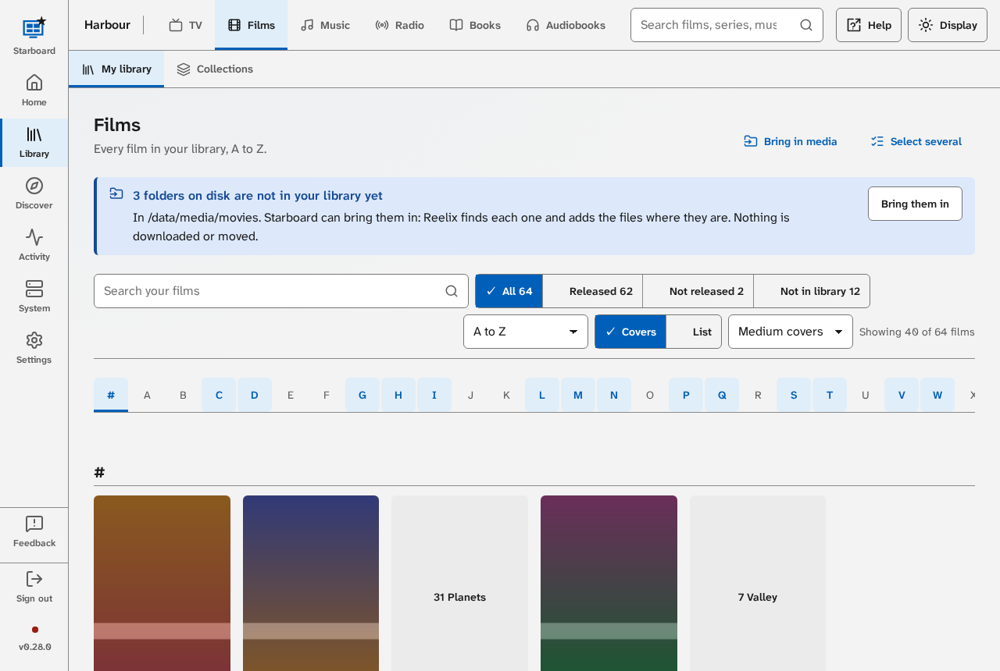
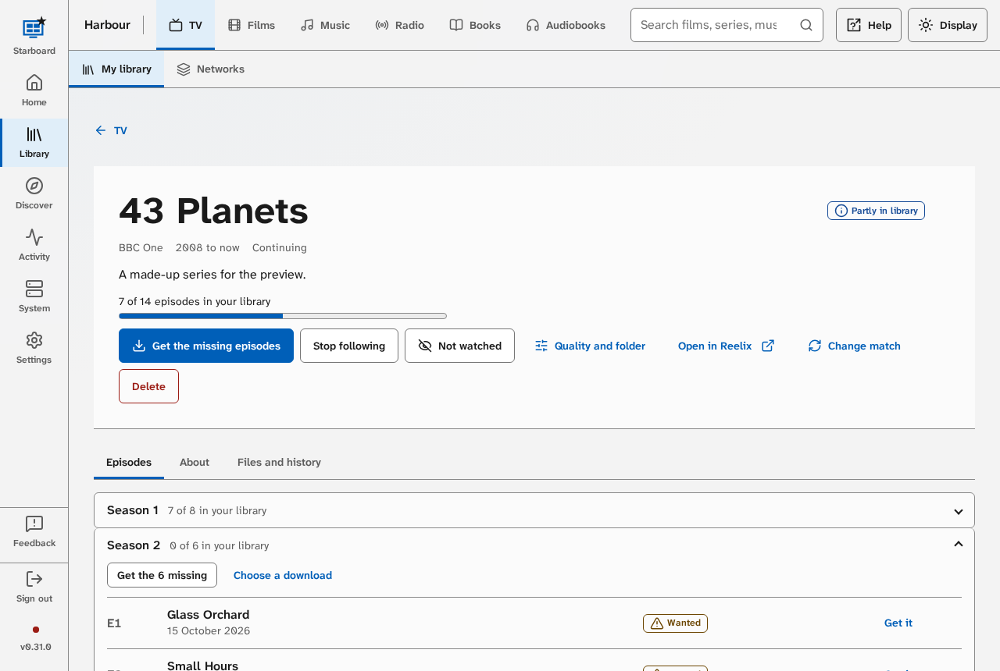
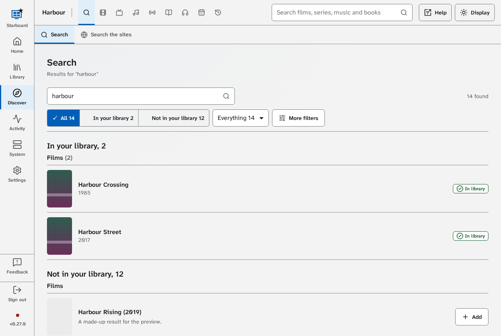
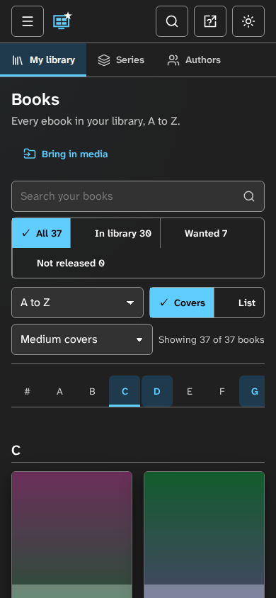

# Starboard

**A complete media server, set up from one place, light enough for an old laptop or a Raspberry Pi.**

Starboard installs and runs a home media server from one accessible dashboard. It sets up the apps that find,
download and sort your films, series, music, books and audiobooks. It also sets up the apps that play them, and the
server underneath.
The **[help centre](https://themightytrex.github.io/starboard/help/index.html)** explains everything in plain steps and has a search.

- [Quick start](#quick-start)
- [What Starboard does](#what-starboard-does)
- [The three installs](#the-three-installs)
- [Reelix](#reelix)
- [Install](#install)
- [Plug-in store](#plug-in-store)
- [Security](#security)

## Quick start

Starboard runs on four Linux systems, in the version named or any later one:

| System | Minimum | Recommended | Step by step |
|---|---|---|---|
| **Linux Mint 22.3 (recommended)** | 2 cores, 4 GB of memory, 40 GB disk | 4 cores, 8 GB, 120 GB SSD | [Start Starboard on Linux Mint](https://themightytrex.github.io/starboard/help/topics/start-on-linux-mint.html) |
| Debian 13 | 2 cores, 2 GB, 20 GB | 4 cores, 4 GB or more, 64 GB SSD | [Start Starboard on Debian](https://themightytrex.github.io/starboard/help/topics/start-on-debian.html) |
| Ubuntu Server 26.04 LTS | 2 cores, 3 GB, 20 GB | 4 cores, 8 GB, 64 GB SSD | [Start Starboard on Ubuntu Server](https://themightytrex.github.io/starboard/help/topics/start-on-ubuntu-server.html) |
| Raspberry Pi OS (64-bit), Trixie | Raspberry Pi 4 with 4 GB | Raspberry Pi 5 with 8 GB, on an SSD | [Start Starboard on Raspberry Pi OS](https://themightytrex.github.io/starboard/help/topics/start-on-raspberry-pi-os.html) |

The figures are for a whole media server. Keep your media on a separate disk. Read
[What you need to run Starboard](https://themightytrex.github.io/starboard/help/topics/what-you-need.html) for more.

Start with the **Run first script**. Open a terminal on one of these systems, with or without a desktop, and run:

```bash
curl -fsSL https://raw.githubusercontent.com/TheMightyTRex/starboard/main/run-first.sh | bash
```

A new Debian has no curl, so the command may say "Command 'curl' not found". Use `wget` instead, which every system here includes.
Do not use the `sudo snap install curl` that Ubuntu suggests, because the snap version cannot save the files the script needs.

```bash
wget -qO- https://raw.githubusercontent.com/TheMightyTRex/starboard/main/run-first.sh | bash
```

If you enter it by hand, enter it exactly. Everything after `TheMightyTRex/starboard/` is case-sensitive, so write
`main/run-first.sh` in small letters with a hyphen, or GitHub answers 404 (not found).

The `|` (vertical bar) sits in different places on different keyboards. On a UK keyboard, hold **Shift** and press the
`\` key next to the left **Shift**, not the `¦` key. The help shows
[where each symbol is](https://themightytrex.github.io/starboard/help/basics/the-terminal.html#symbols-that-are-in-different-places-on-different-keyboards)
on US, UK, German, French and Spanish keyboards. You can also use these two commands, which have no `|`:

```bash
curl -fsSL -o run-first.sh https://raw.githubusercontent.com/TheMightyTRex/starboard/main/run-first.sh
bash run-first.sh
```

The script checks the computer, installs Docker and anything else missing after you say yes, downloads Starboard and
starts its installer. At its first question, enter `a` for accessible mode, which stays on for the whole installation.

**With a desktop: set up in the browser.** When the installer finishes, the set-up page opens in your browser with
the set-up code filled in.

**With no desktop: set up in the terminal.** On the server itself, or over SSH, the script notices there is no desktop.
It then asks every set-up question in the terminal: your password, your apps and your download hours. To choose the
terminal yourself:

```bash
curl -fsSL https://raw.githubusercontent.com/TheMightyTRex/starboard/main/run-first.sh | bash -s -- --terminal
```



**Starting from a bare computer?** Follow the step-by-step guide,
[Get Starboard up and running, from a bare computer](https://themightytrex.github.io/starboard/help/guides/get-up-and-running.html).
It starts with installing Linux, then guides you through either path. First check
[what you need to run Starboard](https://themightytrex.github.io/starboard/help/topics/what-you-need.html).

**Already have Docker and git?** Use the installer, the second way under [Install](#install).

In the help centre: [Quick start guide](https://themightytrex.github.io/starboard/help/guides/quick-start.html) · [From a bare computer](https://themightytrex.github.io/starboard/help/guides/get-up-and-running.html) · [What you need](https://themightytrex.github.io/starboard/help/topics/what-you-need.html) · [The Run first script](https://themightytrex.github.io/starboard/help/topics/run-first.html) · [Set up in the terminal](https://themightytrex.github.io/starboard/help/topics/set-up-in-the-terminal.html)

## What Starboard does

- **One set-up, complete.** Starboard asks what you want: films, series, music, books, audiobooks or live TV. It then
  picks the apps, folders and settings, checks each step, starts the apps and connects them to each other. You can do
  all of this in a browser or entirely in the terminal.
- **One dashboard.** It shows every app's status and your library from Reelix. It also has one search that checks your
  library first, downloads, what is coming up, requests, storage, disk health, alerts and backups.
- **Lightweight first.** Starboard idles in about 16 MB of memory and almost no processor time. You can pause or slow
  every piece of background work.
- **Accessible to everyone.** Starboard follows WCAG 2.2 AA. It works keyboard first, with screen readers, with text
  up to 175% and in high contrast. A plain terminal mode suits software that reads text aloud.
- **Plug-ins.** Add live TV, notifications, backups watch and more from the **[Stallboard plug-in store](https://themightytrex.github.io/stallboard/)**. Each plug-in has its own page, which says what it may do and what it needs.
- **Works with what you have.** Starboard finds the media apps already on your server and adds them. It runs on 64-bit
  Intel, AMD and ARM, such as a Raspberry Pi 4 or 5.

| | |
|---|---|
|  |  |
| **Apps**, with problems first | **Storage**, by type |
|  |  |
| **Install apps** in the browser | **The terminal set-up** |

In the help centre: [Everything Starboard does](https://themightytrex.github.io/starboard/help/topics/everything-starboard-does.html) · [What Starboard is](https://themightytrex.github.io/starboard/help/basics/what-is-starboard.html) · [Set up your dashboard](https://themightytrex.github.io/starboard/help/guides/set-up-your-dashboard.html) · [Display and accessibility](https://themightytrex.github.io/starboard/help/topics/display-and-accessibility.html)

## Your library

The **Library** shows everything Reelix holds: TV, films, music, radio, books and audiobooks. Each kind is a wall of
covers with an A to Z list and filters. Each title has its own page with episodes, albums or reading order.

**Search** checks your library first as you enter words, then lists what Reelix can add, with **Add**, or **Follow** for
radio. Starboard keeps a small list of each kind and reads Reelix again only while you use the Library, so it stays
light on small servers.

| | |
|---|---|
|  |  |
| **The Library**, A to Z | **A series**, with its episodes |
|  |  |
| **Search**, your library first | **On a phone**, dark theme |

In the help centre: [Browse your library](https://themightytrex.github.io/starboard/help/topics/browse-your-library.html) · [Search for and add films, series, music and books](https://themightytrex.github.io/starboard/help/topics/search-and-add.html) · [Follow radio shows and podcasts](https://themightytrex.github.io/starboard/help/topics/follow-radio-shows.html)

## The three installs

**Install apps** sets up a complete media server in one of three installs, or with the apps you choose yourself. Every
install sends downloads through a VPN. An app that needs another app brings it too.

| | Basics | Full install | Everything |
|---|---|---|---|
| For | Most homes: complete and light | Statistics, logs and smaller files | Every app Starboard offers |
| Reelix | Reelix Lite | With YouTube and Spotify downloads | With YouTube and Spotify downloads |
| Apps | Reelix, Jellyfin, Audiobookshelf, Bazarr, qBittorrent, NZBGet, Gluetun | Basics, plus Jellystat, Dozzle, FlareSolverr, Tdarr and disk health (Wizarr and Dispatcharr are add-ons); SABnzbd in place of NZBGet if you choose | Full install, plus Kapowarr |
| Memory when idle | about 0.6 to 1.6 GB | about 1.1 to 2.6 GB | about 1.9 to 3.4 GB |
| Recommended computer | 4 cores, 4 GB, or a Raspberry Pi 5 | 4 cores, 8 GB | 4 or more cores, 8 GB or more |

Change it later, in either direction, in **Settings**, **Apps**, **Your install**.

In the help centre: [What each install has](https://themightytrex.github.io/starboard/help/topics/install-types.html) · [Install apps with Starboard](https://themightytrex.github.io/starboard/help/topics/install-apps.html) · [Change your install](https://themightytrex.github.io/starboard/help/topics/change-your-install.html)

## Reelix

[Reelix](https://github.com/demonzoned/Reelix) is one app that finds, downloads and sorts films, series, music and
books, and takes requests. It does the work of Radarr, Sonarr, Lidarr, Readarr, Prowlarr and Seerr in under 40 MB of
memory. Starboard installs it, sets it up through its own API and shows it like any other app. The set-up covers an
admin account, a key for Starboard, library folders and download apps.

Basics uses **Reelix Lite**. Full install and Everything use Reelix with YouTube and Spotify downloads, and you can
switch either way. Reelix is a separate project with its own licence (GPL-3.0). Starboard talks to it through its API
only.

In the help centre: [What Reelix is](https://themightytrex.github.io/starboard/help/basics/what-is-reelix.html) · [Switch between the two versions](https://themightytrex.github.io/starboard/help/topics/switch-reelix-version.html) · [Move from Radarr, Sonarr and the others](https://themightytrex.github.io/starboard/help/topics/move-your-apps-to-reelix.html)

## Install

Choose one of three ways, with the fewest steps first:

1. **The Run first script** (in Quick start) checks the computer, installs what is missing, downloads Starboard and starts
   the set-up.
2. **The installer,** if you already have Docker with the Compose plugin and git:

   ```bash
   git clone https://github.com/TheMightyTRex/starboard.git
   cd starboard
   ./install.sh
   ```

   It explains each step and asks before giving Starboard any access to your computer. All access is optional. Add
   `--terminal` for the terminal set-up, or `--native` to run without Docker.
3. **The ready-made image,** for amd64, arm64 and 32-bit arm. Download [`compose.image.yaml`](compose.image.yaml), run
   `mkdir -p data && docker compose -f compose.image.yaml up -d`, then open `http://<your server>:8095`.

Update with `./update.sh`. It backs up your settings, installs the newest release, and goes back to the version you
had if the new one does not start.

In the help centre: [Install with the installer](https://themightytrex.github.io/starboard/help/topics/install-with-the-installer.html) · [What the installer asks](https://themightytrex.github.io/starboard/help/topics/what-the-installer-asks.html) · [The ready-made image](https://themightytrex.github.io/starboard/help/topics/install-from-the-ready-made-image.html) · [Update Starboard](https://themightytrex.github.io/starboard/help/topics/update-starboard.html) · [Remove Starboard](https://themightytrex.github.io/starboard/help/topics/remove-starboard.html)

## Plug-in store

Browse the plug-ins for Starboard in the **[Stallboard plug-in store](https://themightytrex.github.io/stallboard/)**. Each plug-in has a page that says what it does, what it needs and what it may change on your server. Add one in **Settings**, **Plug-ins**, **Catalogue**.

## Security

- **One password.** Starboard stores only a hash of it, and the installer's one-time set-up code sets the first one.
  Five wrong attempts lock an address out for 15 minutes. Changes to the computer ask for the password again.
- **Your keys stay on the server.** Only your user can read them, and Starboard never sends them to the browser.
- **Only the access you allow.** Starboard runs as your user in a read-only container with no extra privileges. The
  installer asks for Docker access, folders, disk health and drive pools, and each is optional.
- **Apps from its own list only.** Install apps starts only the apps it offers, with checked folders. Starboard checks
  the set-up file again before anything starts.
- **Home network by default, never the open internet.** To reach Starboard from away, use a VPN or a reverse proxy with
  HTTPS.

Report a problem privately, as the [security policy](SECURITY.md) explains. Read how Starboard was reviewed and tested in
[Security: how Starboard protects you, and how it was tested](docs/SECURITY-AND-TESTS.md).

In the help centre: [How Starboard keeps your server safe](https://themightytrex.github.io/starboard/help/basics/how-starboard-keeps-you-safe.html) · [Choose who can open Starboard](https://themightytrex.github.io/starboard/help/topics/choose-who-can-open-starboard.html) · [Use Starboard away from home](https://themightytrex.github.io/starboard/help/guides/use-starboard-away-from-home.html)

## Develop, credits and licence

[Develop Starboard](docs/DEVELOP.md) explains how to run it from a checkout, test it and keep your details out of the
repository. The design system's help centre builder makes the help centre from [docs/help](docs/help), with the
settings in [help-centre.json](help-centre.json).

[THIRD-PARTY.md](THIRD-PARTY.md) lists Lucide, Atkinson Hyperlegible Next and the data sources Starboard uses, with
their licences. TheMightyTRexUK and contributors make Starboard, under the MIT licence. Atkinson Hyperlegible Next has
the SIL Open Font Licence (`web/fonts/LICENSE-OFL.txt`). The icons come from Lucide, under the ISC licence
(`tools/LICENSE-lucide.txt`).

<!-- footer: download rights -->

---

**Download only what you have the right to.** Use the download apps only for files you have the right to download,
such as open-source software, works in the public domain and your own backups. Downloading films, series, music or
books without the copyright holder's permission is against the law in the UK and most other countries. Starboard
does not host or provide any files, and you are responsible for what you download.

**Need help?** Ask on the [Starboard Discord support server](https://discord.gg/xN9bf2H4vv).

<!-- /footer -->
