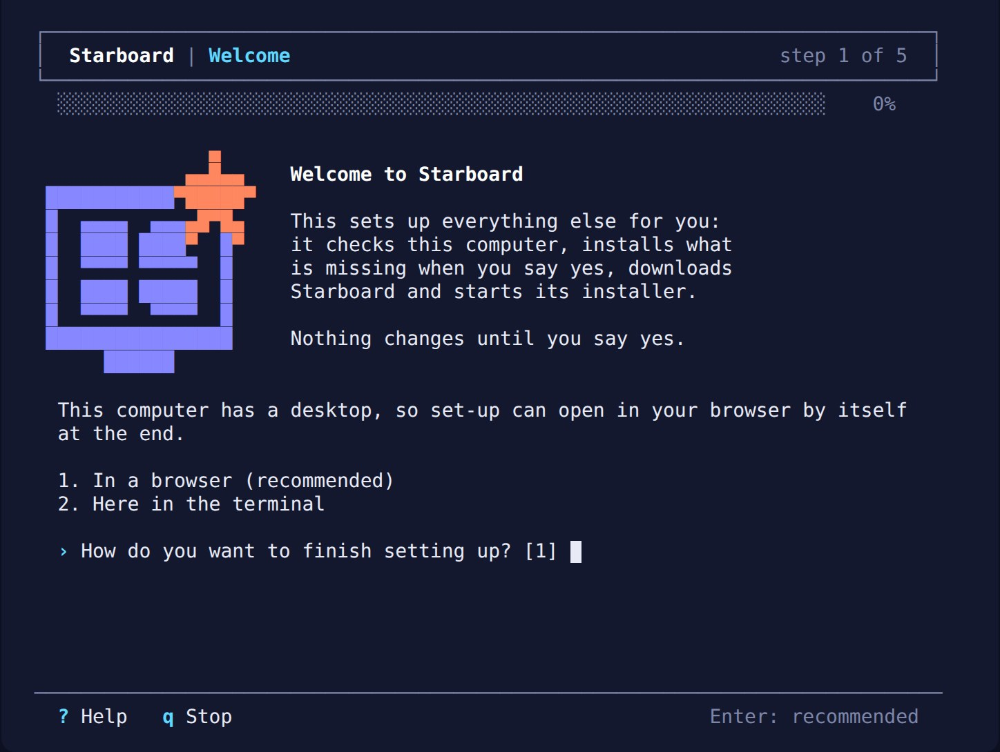
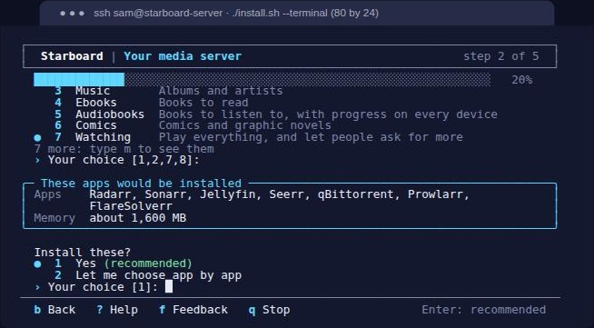

# Starboard

**A complete media server, set up from one place, light enough for an old laptop or a Raspberry Pi.**

Starboard installs and runs a whole home media server: the apps that find, download and sort your films, series,
music, books and audiobooks, the apps that play them, and the server underneath, from one accessible dashboard.
Everything is explained in plain steps in the **[help centre](https://themightytrex.github.io/starboard/help/index.html)**, which has a search.

- [Quick start](#quick-start)
- [What Starboard does](#what-starboard-does)
- [The three installs](#the-three-installs)
- [Reelix](#reelix)
- [Install](#install)
- [Security](#security)

## Quick start

Starboard runs on four Linux systems, in the version named or any later one:

| System | Minimum | Recommended | Step by step |
|---|---|---|---|
| **Linux Mint 22.3 (recommended)** | 2 cores, 4 GB of memory, 40 GB disk | 4 cores, 8 GB, 120 GB SSD | [Start Starboard on Linux Mint](https://themightytrex.github.io/starboard/help/topics/start-on-linux-mint.html) |
| Debian 13 | 2 cores, 2 GB, 20 GB | 4 cores, 4 GB or more, 64 GB SSD | [Start Starboard on Debian](https://themightytrex.github.io/starboard/help/topics/start-on-debian.html) |
| Ubuntu Server 26.04 LTS | 2 cores, 3 GB, 20 GB | 4 cores, 8 GB, 64 GB SSD | [Start Starboard on Ubuntu Server](https://themightytrex.github.io/starboard/help/topics/start-on-ubuntu-server.html) |
| Raspberry Pi OS (64-bit), Trixie | Raspberry Pi 4 with 4 GB | Raspberry Pi 5 with 8 GB, on an SSD | [Start Starboard on Raspberry Pi OS](https://themightytrex.github.io/starboard/help/topics/start-on-raspberry-pi-os.html) |

The figures are for a whole media server. Keep your media on a separate drive. More in
[What you need to run Starboard](https://themightytrex.github.io/starboard/help/topics/what-you-need.html).

Start with the **Run first script**. On one of these systems, with or without a desktop, open a terminal and run:

```bash
curl -fsSL https://raw.githubusercontent.com/TheMightyTRex/starboard/main/run-first.sh | bash
```

If it says "Command 'curl' not found" (a new Debian does not include curl), use `wget`, which every system here includes.
Do not use the `sudo snap install curl` Ubuntu suggests: the snap version cannot save the files the script needs.

```bash
wget -qO- https://raw.githubusercontent.com/TheMightyTRex/starboard/main/run-first.sh | bash
```

Typing it? Type it exactly: everything after `TheMightyTRex/starboard/` is case-sensitive, so `main/run-first.sh`
must be in small letters with a hyphen, or GitHub answers 404 (not found). The `|` (vertical bar) is in different
places on different keyboards: on a UK keyboard it is **Shift**
and the `\` key next to the left **Shift**, not the `¦` key. The help has
[where each symbol is](https://themightytrex.github.io/starboard/help/basics/the-terminal.html#symbols-that-are-in-different-places-on-different-keyboards)
on US, UK, German, French and Spanish keyboards. Or use these two commands, which have no `|`:

```bash
curl -fsSL -o run-first.sh https://raw.githubusercontent.com/TheMightyTRex/starboard/main/run-first.sh
bash run-first.sh
```

It checks the computer, installs Docker and anything else missing after you say yes, downloads Starboard and
starts its installer. Type `a` at its first question for accessible mode, which carries on through the whole
installation.

**With a desktop: set up in the browser.** When the installer finishes, the set-up page opens in your browser by
itself, with the setup code filled in.

**With no desktop: set up in the terminal.** On the server, or connected to it over SSH, the script sees there is
no desktop and asks every set-up question in the terminal instead: your password, your apps and your download
hours. To choose the terminal yourself:

```bash
curl -fsSL https://raw.githubusercontent.com/TheMightyTRex/starboard/main/run-first.sh | bash -s -- --terminal
```



**New to all this?** Follow the beginners' guide,
[Get Starboard up and running, from a bare computer](https://themightytrex.github.io/starboard/help/guides/get-up-and-running.html). It starts with
installing Linux, then takes you through either path step by step. Check
[what you need to run Starboard](https://themightytrex.github.io/starboard/help/topics/what-you-need.html) first. Already have Docker and git?
`git clone https://github.com/TheMightyTRex/starboard.git && cd starboard && ./install.sh` (add `--terminal` for the
terminal set-up).

In the help centre: [Start here](https://themightytrex.github.io/starboard/help/guides/get-up-and-running.html) · [What you need](https://themightytrex.github.io/starboard/help/topics/what-you-need.html) · [The Run first script](https://themightytrex.github.io/starboard/help/topics/run-first.html) · [Set up in the terminal](https://themightytrex.github.io/starboard/help/topics/set-up-in-the-terminal.html)

## What Starboard does

- **One set-up, complete.** It asks what you want (films, series, music, books, audiobooks, live TV), picks the
  apps, folders and settings, checks every step, starts the apps and connects them to each other, in a browser or
  entirely in the terminal.
- **One dashboard.** Every app's status, search across your apps, downloads, what is coming up, requests, storage,
  disk health, alerts and backups.
- **Lightweight first.** Starboard idles in about 16 MB of memory and almost no processor time, and every piece of
  background work can be paused or slowed.
- **Accessible to everyone.** Built to WCAG 2.2 AA: keyboard first, screen readers, text up to 175%, high contrast,
  and a plain terminal mode for software that reads text aloud.
- **Works with what you have.** It finds the media apps already on your server and adds them, and runs on 64-bit
  Intel, AMD and ARM, such as a Raspberry Pi 4 or 5.

| | |
|---|---|
|  |  |
| **Apps**, with problems first | **Storage**, by type |
|  |  |
| **Install apps** in the browser | **The terminal set-up** |

In the help centre: [Everything Starboard does](https://themightytrex.github.io/starboard/help/topics/everything-starboard-does.html) · [What Starboard is](https://themightytrex.github.io/starboard/help/basics/what-is-starboard.html) · [Set up your dashboard](https://themightytrex.github.io/starboard/help/guides/set-up-your-dashboard.html) · [Display and accessibility](https://themightytrex.github.io/starboard/help/topics/display-and-accessibility.html)

## The three installs

**Install apps** sets up a complete media server in one of three installs, or the apps you choose yourself. Every
install sends downloads through a VPN, and apps that need another app bring it with them.

| | Basics | Full install | Everything |
|---|---|---|---|
| For | Most homes: complete and light | Statistics, invites, live TV and smaller files | Every app Starboard offers |
| Reelix | Reelix Lite | With YouTube and Spotify downloads | With YouTube and Spotify downloads |
| Apps | Reelix, Jellyfin, Audiobookshelf, Bazarr, qBittorrent, NZBGet, Gluetun | Basics, plus Jellystat, Wizarr, Dispatcharr, Dozzle, FlareSolverr, Tdarr and disk health; SABnzbd in place of NZBGet if you choose | Full install, plus Storyarr and Kapowarr |
| Memory when idle | about 0.6 to 1.1 GB | about 1.5 to 2.4 GB | about 1.8 to 2.8 GB |
| Recommended computer | 4 cores, 4 GB, or a Raspberry Pi 5 | 4 cores, 8 GB | 4 or more cores, 8 GB or more |

Change it later, either way, in **Settings**, **Apps**, **Your install**.

In the help centre: [What each install has](https://themightytrex.github.io/starboard/help/topics/install-types.html) · [Install apps with Starboard](https://themightytrex.github.io/starboard/help/topics/install-apps.html) · [Change your install](https://themightytrex.github.io/starboard/help/topics/change-your-install.html)

## Reelix

[Reelix](https://github.com/demonzoned/Reelix) is one app that finds, downloads and sorts films, series, music and
books, and takes requests: the work of Radarr, Sonarr, Lidarr, Readarr, Prowlarr and Seerr, in under 40 MB of
memory. Starboard installs it, sets it up through its own API (admin account, a key for Starboard, library folders
and download apps) and shows it like any other app. Basics uses **Reelix Lite**; Full install and Everything use
Reelix with YouTube and Spotify downloads, and you can switch either way. Reelix is a separate project with its own
licence (GPL-3.0); Starboard talks to it through its API only.

In the help centre: [What Reelix is](https://themightytrex.github.io/starboard/help/basics/what-is-reelix.html) · [Switch between the two versions](https://themightytrex.github.io/starboard/help/topics/switch-reelix-version.html) · [Move from Radarr, Sonarr and the others](https://themightytrex.github.io/starboard/help/topics/move-your-apps-to-reelix.html)

## Install

Three ways, from simplest:

1. **The Run first script** (above): checks the computer, installs what is missing, downloads Starboard and starts
   the set-up.
2. **The installer,** if you already have Docker with the Compose plugin and git:

   ```bash
   git clone https://github.com/TheMightyTRex/starboard.git
   cd starboard
   ./install.sh
   ```

   It explains each step and asks before giving Starboard any access to your computer. Every kind of access is
   optional. Add `--terminal` for the terminal set-up, or `--native` to run without Docker.
3. **The ready-made image,** for amd64, arm64 and 32-bit arm: download [`compose.image.yaml`](compose.image.yaml),
   then `mkdir -p data && docker compose -f compose.image.yaml up -d`, and open `http://<your server>:8095`.

Update with `./update.sh`: it backs up your settings, installs the newest release, and goes back to the version you
had if the new one does not start.

In the help centre: [Install with the installer](https://themightytrex.github.io/starboard/help/topics/install-with-the-installer.html) · [What the installer asks](https://themightytrex.github.io/starboard/help/topics/what-the-installer-asks.html) · [The ready-made image](https://themightytrex.github.io/starboard/help/topics/install-from-the-ready-made-image.html) · [Update Starboard](https://themightytrex.github.io/starboard/help/topics/update-starboard.html) · [Remove Starboard](https://themightytrex.github.io/starboard/help/topics/remove-starboard.html)

## Security

- **One password,** stored only as a hash, with the installer's one-time setup code for the first one. Five wrong
  attempts lock an address out for 15 minutes, and changes to the computer ask for the password again.
- **Your keys stay on the server,** readable by your user only, and are never sent to the browser.
- **Only the access you allow.** Starboard runs as your user in a read-only container with no extra privileges.
  Docker access, folders, disk health and drive pools are each optional and asked for by the installer.
- **Apps from its own list only.** Install apps starts only the apps it offers, with checked folders, and the set-up
  file is checked again before anything starts.
- **Home network by default, never the open internet.** Use a VPN or a reverse proxy with HTTPS to reach it from
  away.

Report a problem privately as [SECURITY.md](SECURITY.md) explains. How it was reviewed and tested:
[docs/SECURITY-AND-TESTS.md](docs/SECURITY-AND-TESTS.md).

In the help centre: [How Starboard keeps your server safe](https://themightytrex.github.io/starboard/help/basics/how-starboard-keeps-you-safe.html) · [Choose who can open Starboard](https://themightytrex.github.io/starboard/help/topics/choose-who-can-open-starboard.html) · [Use Starboard away from home](https://themightytrex.github.io/starboard/help/guides/use-starboard-away-from-home.html)

## Develop, credits and licence

How to run it from a checkout, test it and keep your details out of the repository: [docs/DEVELOP.md](docs/DEVELOP.md).
The help centre is built from [docs/help](docs/help) by the design system's help centre builder, with the settings in [help-centre.json](help-centre.json).

Pillow, Lucide, Atkinson Hyperlegible Next and the data sources Starboard uses are listed, with their licences, in
[THIRD-PARTY.md](THIRD-PARTY.md). Starboard is MIT licensed, by TheMightyTRexUK and contributors. Atkinson
Hyperlegible Next is under the SIL Open Font Licence (`web/fonts/LICENSE-OFL.txt`); icons are from Lucide, under the
ISC licence (`tools/LICENSE-lucide.txt`).

<!-- footer: download rights -->

---

**Download only what you have the right to.** Use the download apps only for files you have the right to download,
such as open-source software, works in the public domain and your own backups. Downloading films, series, music or
books without the copyright holder's permission is against the law in the UK and most other countries. Starboard
does not host or provide any files, and you are responsible for what you download.

<!-- /footer -->
