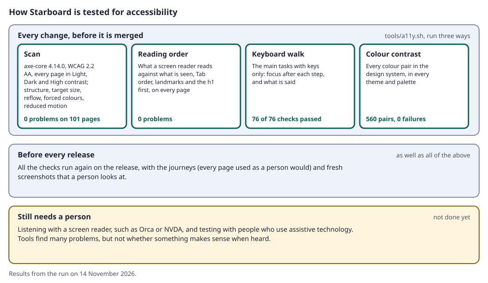
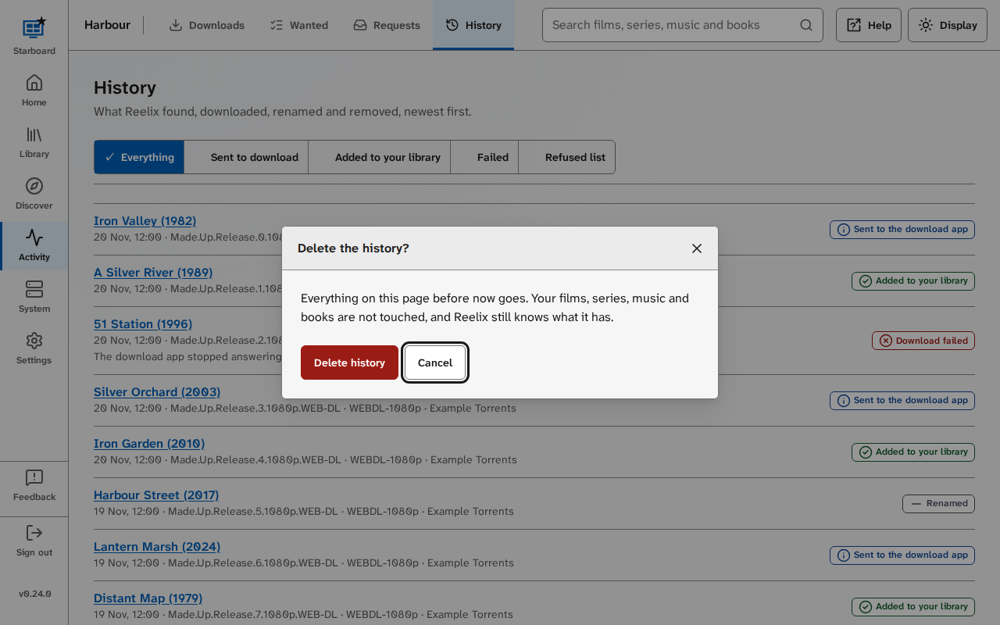
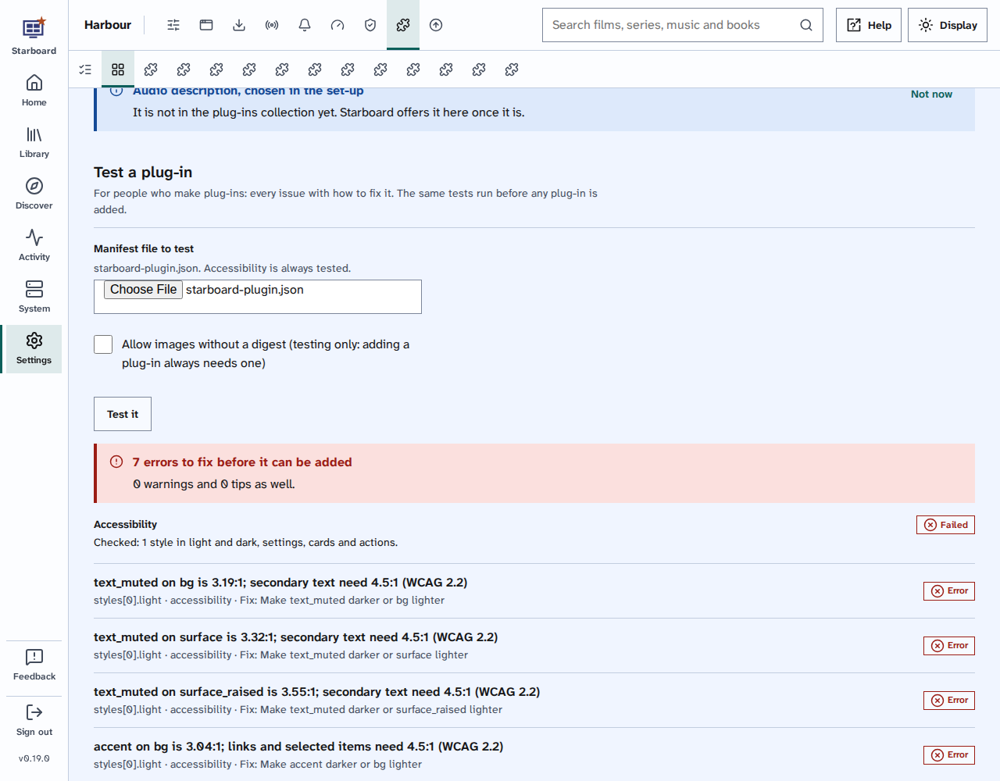

[Help centre](../README.md) · Accessibility · reference
<!-- help: a11y / checks -->

# How Starboard is tested for accessibility

We test Starboard against WCAG 2.2 level AA. The tests are automated checks on every page, a check of the reading
order, a walk of the main tasks with the keyboard alone, and a contrast check of every colour. They run on every
change before we merge it, and again before every release. This page says what each check does and what checks
cannot catch.



The diagram shows the same steps as the sections on this page, with the latest results. The figures and their dates are in
[Latest test results](latest-test-results.md).

## When would you use it

- You want to know whether Starboard will work with your tools before you install it.
- You want to know how a result was reached, or repeat a check yourself.
- You make plug-ins and want to know what Starboard checks.

## The standard accessibility test

Every accessibility test of Starboard is all four of these parts, never a scan alone. They run against an example
server with made-up data, so nothing real is read.

| Part | What it checks | How it runs |
|---|---|---|
| The scan | Every page against WCAG 2.2 AA with axe-core, in Light, Dark and High contrast; page structure; target size; reflow at 320 pixels wide and at 175% text; Windows' contrast themes; reduced motion; the side menu and header at every text size | `tools/a11y.sh` and `LAYOUT=1 tools/a11y.sh` |
| Reading order | What a screen reader reads against what is shown, on every page, at computer and phone widths, and in each design of the Apps page | `ORDER=1 tools/a11y.sh` |
| Keyboard walk | The main tasks with keys only, checking where focus is and what is said after every step | `TASKS=1 tools/a11y.sh` |
| Colour contrast | Every text and control colour pair in every theme and colour palette | The design system's `tools/contrast.py` |

### The scan

- **Rules:** axe-core runs every WCAG 2.0, 2.1 and 2.2 rule at levels A and AA on each page, three times: in the
  Light theme, the Dark theme and High contrast.
- **Structure:** the check expects one level 1 heading, headings in order, a header, navigation and main
  content, **Skip to main content** as the first Tab, a page title, a polite live region, the page's language, a
  label for every field and a name for every button.
- **Keyboard:** the check goes through up to 45 Tab stops on each page. It checks that the focus outline shows,
  that focus never lands on something hidden, that nothing traps it, and that the sticky header never covers it.
- **Size:** every button, tick box and choice is at least 24 by 24 pixels.
- **Reflow:** nothing needs sideways scrolling at 320 pixels wide, or at 175% text.
- **Slide-outs:** focus moves into **Display and accessibility**, stays inside with Tab, and goes back to
  **Display** after Escape.
- **Windows' contrast themes:** the focus outline stays visible in forced colours.
- **Reduced motion:** with reduced motion asked for, nothing on the Apps page moves for longer than 50 milliseconds.
- **Menus at large text:** the check covers the side menu and the header on eight pages. It uses 100%, 125%, 150% and
  175% text, with and without wider spacing, in Light, Dark and High contrast. It uses windows 1280 and 1366 pixels
  wide and at phone width, and windows 600 and 700 pixels tall. It fails if a word breaks in the middle, a name runs
  past an edge, items overlap, a menu item or the search box is cut off, or the page scrolls sideways. The scan's own
  reflow rule cannot find a menu that cuts off its own items, so this part checks for exactly that.

### Reading order

A screen reader reads, and Tab moves, in the order of the page's code. The page shows its own order. The check
compares the two on every page, at computer and phone widths. It counts as a finding anything that a screen reader
reads later but the page shows clearly earlier, and any Tab that jumps back up a column. It also checks that the landmarks come in order and that the page's
level 1 heading is the first thing in the main content.

### Keyboard walk

The check does the main tasks with keys alone, as a screen reader user would. After each step, it records where
focus is and what was said. The tasks include: sign in, skip to the main content, search, open a film, change a
setting, change an accessibility option in Settings, edit an app in a slide-out, make and revoke a key, show more of
a list, delete a file, select several items, the Live TV channel lists, release notes, copies of backups, a
plug-in's notices, tables, cards, recommendations and settings, and each **Reduce motion** choice against the
device's own setting.



### Colour contrast

The design system checks every pair of text and background, control border and focus outline. It checks them in
Light, Dark, High contrast and High contrast dark, and in light and dark for every one of the own style colour
palettes. The ratios are 4.5 to 1 for text and 3 to 1 for borders and the focus outline.

### Plug-ins

Plug-ins are checked too, by the plug-in tester, before any plug-in can be added. Its accessibility tests are never left
out: every style's colours in light and dark, and the labels, hints, card titles and button words people
read.



### The help centre

The help is checked for its writing rules and links by `tools/check-help.py`. Every picture in it has a text
description, and every diagram says the same thing in words.

## When the checks run

- **Every change:** the scan, reading order and keyboard walk run before we merge a change, with the unit tests,
  the journeys (every page used as a person would) and the help checks. Before the change goes in, we fix each
  finding, or check it by hand and show that it comes from the test itself.
- **Every change to colours:** the contrast check runs, and must show 0 failures.
- **Before every release:** all of them run again on the release, with fresh screenshots that a person checks.
  We list the results with each release in
  [Security: how Starboard protects you, and how it was tested](https://github.com/TheMightyTRex/starboard/blob/main/docs/SECURITY-AND-TESTS.md#security-checks-for-each-release).

## What automated checks cannot catch

Tools find many problems, but not all. They cannot tell:

- whether something makes sense when heard, such as a label that is correct but confusing
- whether people can follow the order of a task, or a message is clear
- how a particular screen reader, browser and device behave together
- whether alt text describes a picture well
- what people who use assistive technology every day find hard

That needs people. Listening with a screen reader, and testing with people who use assistive technology, has not
been done yet. Read [Limits and known gaps](limits-and-known-gaps.md).

## Run the checks yourself

The checks are in Starboard's repository and need Docker. From the repository's folder, this runs the scan:

```bash
bash tools/a11y.sh
```

This runs the reading order check:

```bash
ORDER=1 bash tools/a11y.sh
```

This runs the keyboard walk:

```bash
TASKS=1 bash tools/a11y.sh
```

This checks the side menu and header at every text size:

```bash
LAYOUT=1 bash tools/a11y.sh
```

Each one starts its own example server with made-up data, and prints one line for each finding and a summary.

## Find out more

- [Use menus that show icons only](menus-with-icons.md): the tab rows that condense, with how they are tested
- [Latest test results](latest-test-results.md)
- [Limits and known gaps](limits-and-known-gaps.md)
- [Accessibility in Starboard](overview.md)
- [Test and publish a plug-in](../developers/test-and-publish-a-plugin.md)

<!-- footer: download rights -->

---

**Download only what you have the right to.** Use the download apps only for files you have the right to download.
Examples are open-source software, works in the public domain and your own backups. Downloading films, series, music or
books without the copyright holder's permission is against the law in the UK and most other countries. Starboard
does not host or provide any files, and you are responsible for what you download.

**Need help?** Ask on the [Starboard Discord support server](https://discord.gg/xN9bf2H4vv).

<!-- /footer -->
