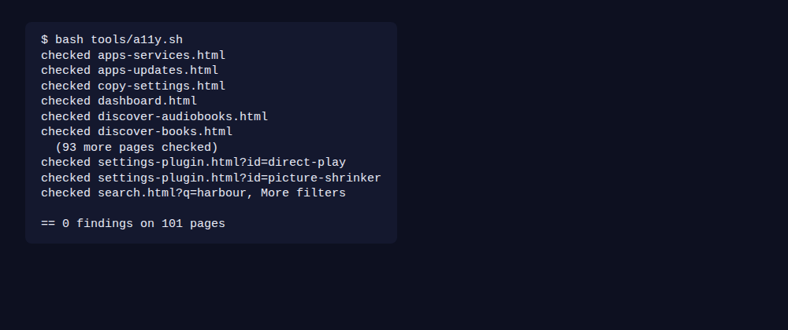
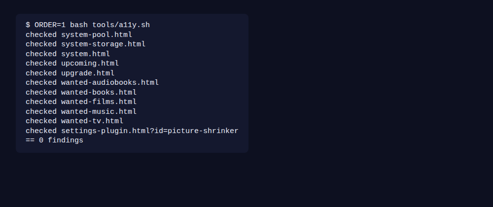
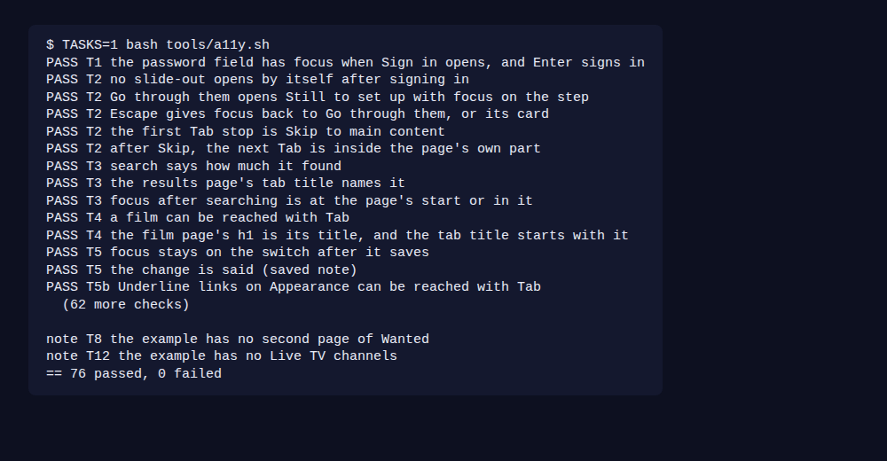
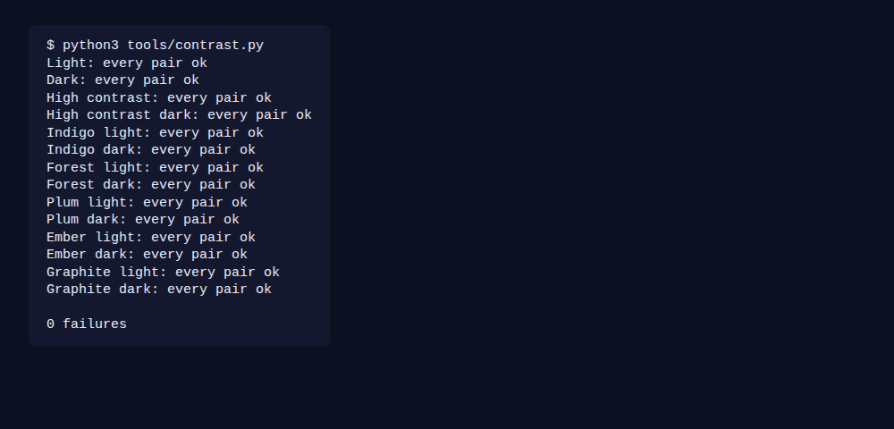

[Help centre](../README.md) · Accessibility · reference
<!-- help: a11y / checks -->

# Latest accessibility test results

The most recent accessibility checks of Starboard, for Starboard 0.18.0, found no problems: the scan of every
page, the reading order, the layout check and the colour contrast check all passed, and every keyboard task passed. This page gives the figures, with their
dates, and the results of earlier runs. How each check works is in
[How Starboard is tested](how-starboard-is-tested.md).

## When would you use it

- You want to know how Starboard did in its latest accessibility checks.
- You want to compare a release with an earlier one.

## Results for Starboard 0.18.0, 15 November 2026

These checks ran on 15 November 2026, on the code released as Starboard 0.18.0, against the example server with
made-up data.

| Check | What was checked | Result |
|---|---|---|
| The scan (axe-core 4.14.0, WCAG 2.2 AA) | 101 pages, plus Search with its filters open, each in Light, Dark and High contrast; structure, keyboard, target size, reflow, forced colours and reduced motion | 0 problems, after checking System, Backup again on its own (see below) |
| Reading order | 93 pages at computer and phone widths, and the Apps page in each of its four card designs | 0 problems |
| Keyboard walk | The main tasks with keys only: 90 checks of where focus is and what is said | 90 of 90 checks passed |
| Layout | The side menu and header at every text size and spacing, in each theme, in short windows and at phone width: 1,536 states | 0 problems |
| Colour contrast | 560 colour pairs in 14 themes and palettes | 0 failures |

## Results by release

| When | Scan | Reading order | Keyboard walk |
|---|---|---|---|
| Starboard 0.18.0, 15 November 2026 | 0 problems on 101 pages, after checking one page again on its own | 0 problems | 90 checks passed |
| 14 November 2026, before the layout fixes | 0 problems on 101 pages | 0 problems | 76 checks passed |
| Starboard 0.17.0, 14 November 2026 | 0 problems on 99 pages | 0 problems, after checking two pages again on their own | 67 checks passed |
| 13 November 2026 | 0 problems on 93 pages | 0 problems | 49 checks passed |
| 12 November 2026, the first full check | 48 problems found and fixed; 4 left, checked by hand and shown to come from the test itself | 8 problems found and fixed | 23 checks passed |

On 0.18.0 the scan found one 320 pixel sideways scroll on System, Backup while the computer was busy, the same
timing effect seen before; the page passed when checked again on its own. The layout check is new in 0.18.0: it
covers the four problems fixed in this release (the side menu and header at large text, short windows and Reduce
motion Off) and found none.

Two findings on 0.17.0, a 4 pixel sideways scroll on System, Backup and one Tab step on Library, Films, came from
timing while the computer was busy; both pages passed when checked again on their own.

## What the first full check fixed

The first full check, on 12 November 2026, found 48 problems on 73 pages, and all were fixed:

- **Headings:** 11 pages went from a level 1 heading straight to level 3. Their lists now have a level 2 heading
  for screen readers.
- **Missing main heading:** pages opened without an item had no level 1 heading. They now have one.
- **Small targets:** ticks and choices were 22 pixels, and some name buttons 20 pixels tall. They are now at least
  24 by 24 pixels.
- **Sideways scrolling:** a long folder path pushed one page sideways at 320 pixels. Words now wrap.

The reading order check the same day found and fixed 8 more: focus lost after a part of a page was drawn again,
whole lists read aloud on every change, a slide-out that opened by itself, forms in slide-outs that did not start
in their first field, confirm boxes that started on their close button, a notice before the page's heading, and
**Show more** leaving focus behind.

## Find out more

- [How Starboard is tested](how-starboard-is-tested.md)
- [Limits and known gaps](limits-and-known-gaps.md)
- [Accessibility in Starboard](overview.md)
- [Security: how Starboard protects you, and how it was tested](https://github.com/TheMightyTRex/starboard/blob/main/docs/SECURITY-AND-TESTS.md#security-checks-for-each-release)

<!-- footer: download rights -->

---

**Download only what you have the right to.** Use the download apps only for files you have the right to download,
such as open-source software, works in the public domain and your own backups. Downloading films, series, music or
books without the copyright holder's permission is against the law in the UK and most other countries. Starboard
does not host or provide any files, and you are responsible for what you download.

<!-- /footer -->
