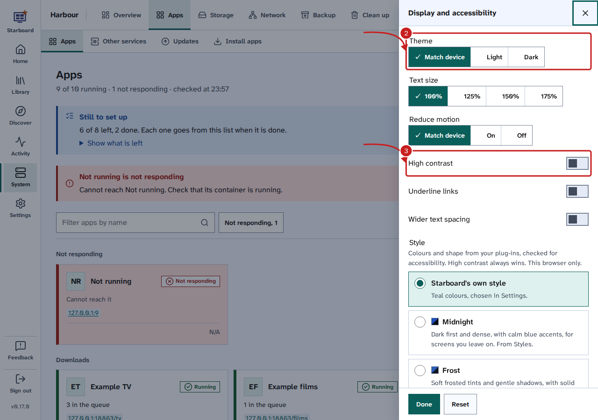
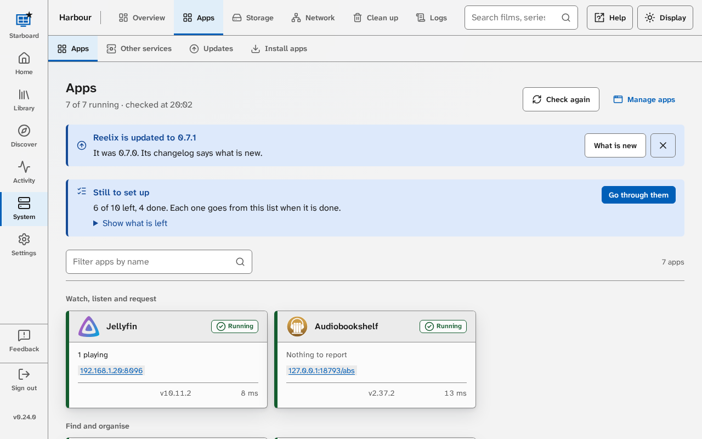
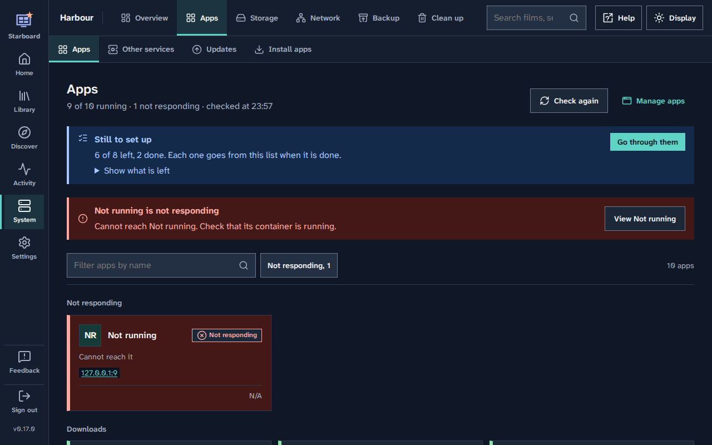
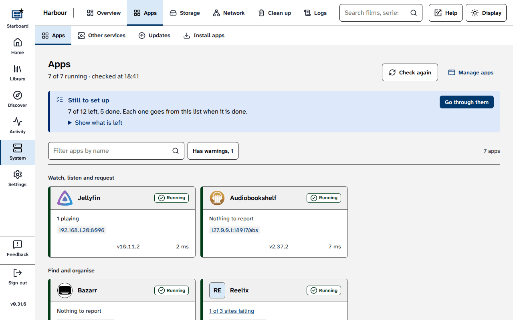
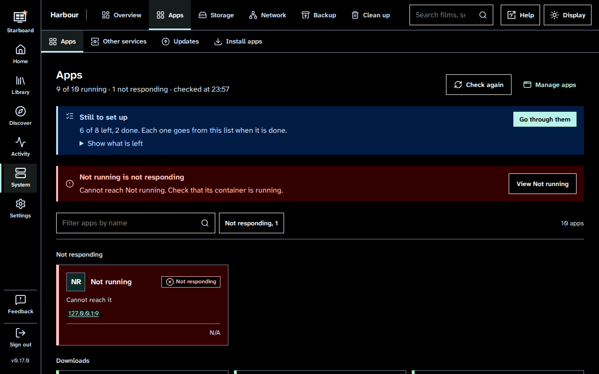

[Help centre](../README.md) · Accessibility · how-to
<!-- help: a11y / change -->

# Choose light, dark or high contrast

**Theme** sets Starboard's colours to light or dark, or to match your device, and **High contrast** makes text,
borders and the focus outline stronger in either. Both are in **Display**, apply at once, and are kept in the
browser you use.

## Who it helps

- **Dark theme:** people who find a bright page tiring or glaring, people with light sensitivity or migraine, and
  anyone using Starboard in a dark room.
- **High contrast:** people with low vision or colour vision differences, and anyone in bright light or using a
  display with poor contrast.

## Steps

1. Select **Display**, the last button in the header. The **Display and accessibility** slide-out opens.
2. Under **Theme**, choose one:
   - **Light** (the default) and **Dark** stay as they are, whatever the device does.
   - **Match device** follows the light or dark setting of your phone or computer, and changes when it does.
3. To make everything stronger, activate **High contrast**. Deactivate it to go back.
4. Select **Done**, or press Escape.

The same choices are in **Settings**, then **General**, then **Appearance**, under **Accessibility**. **Reset** in
Display puts every choice back to its default.

## Light and dark

Both themes meet the WCAG 2.2 AA contrast levels: at least 4.5 to 1 for text, and 3 to 1 for the edges of controls
and the focus outline. They are checked for every colour pair in the design system.

## What high contrast changes

- Text is near-black on white, or white on black in the dark theme. Secondary text is darker or lighter to match.
- Every card, field and button gets a solid black or white border, and shadows are taken away.
- The focus outline turns magenta in the light theme and yellow in the dark theme.
- Charts change to stronger colours, and states keep their words and icons.
- Styles from plug-ins are set aside while it is active. The accent colour stays, in a stronger shade.

## Styles and colours for everyone

- **Styles from plug-ins:** a style changes Starboard's colours and shape. Starboard checks every style for
  contrast in light and dark before it can be chosen. Read
  [Choose a style from a plug-in](../topics/display-and-accessibility.md#choose-a-style-from-a-plug-in).
- **Accent colour:** Starboard's own style is Mica, with a Blue accent. Another accent (Teal, Dusk, Lime, Rose,
  Amber or Graphite) can be chosen for everyone on the server, in **Settings**, then **General**, then **Appearance**.
  Dusk, Lime, Rose and Amber also tint the page and its cards in light and dark; high contrast keeps white or black.
  Every one of them passes the same contrast checks, in light, dark and high contrast.

## Things to note

- Theme and high contrast are kept in this browser only. Each phone, computer and browser has its own.
- With Windows' own contrast themes (forced colours), Starboard leaves the colours to Windows and keeps the focus
  outline visible.
- Pictures, such as covers, keep their own colours in every theme.

## Find out more

- [Accessibility in Starboard](overview.md)
- [Change text size, theme and other display settings](../topics/display-and-accessibility.md)
- [Underline links](underline-links.md)
- [Latest test results](latest-test-results.md)

<!-- footer: download rights -->

---

**Download only what you have the right to.** Use the download apps only for files you have the right to download,
such as open-source software, works in the public domain and your own backups. Downloading films, series, music or
books without the copyright holder's permission is against the law in the UK and most other countries. Starboard
does not host or provide any files, and you are responsible for what you download.

<!-- /footer -->
