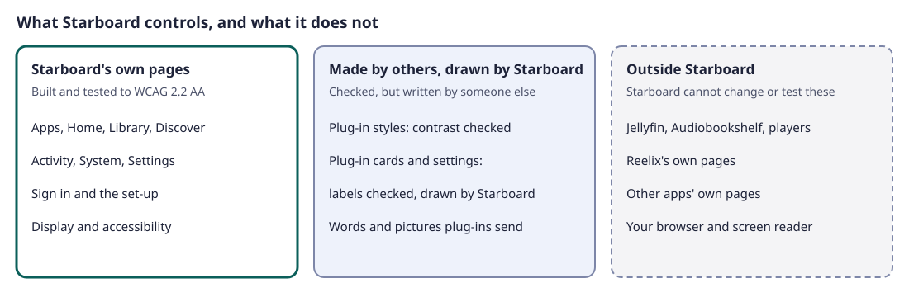
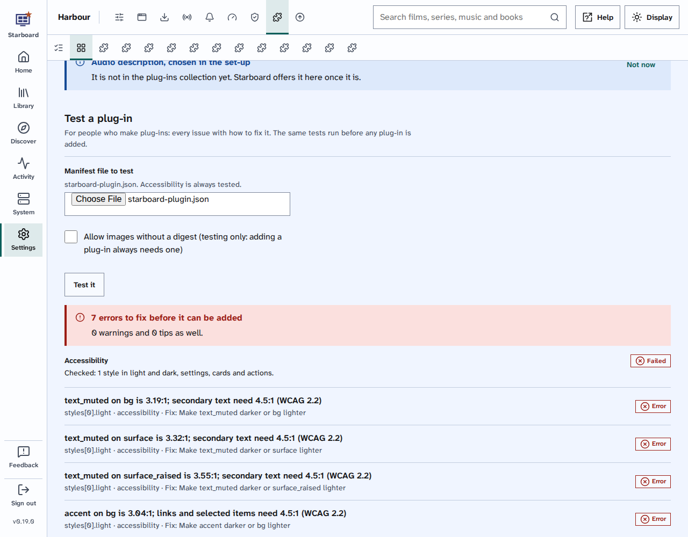
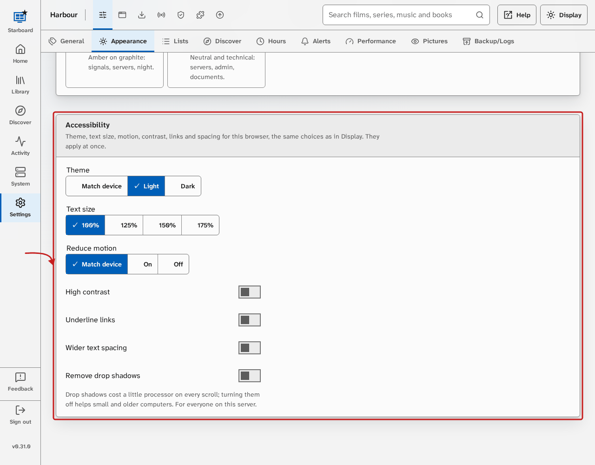

[Help centre](../README.md) · Accessibility · reference
<!-- help: a11y / checks -->

# Accessibility limits and known gaps

Starboard is built and tested to WCAG 2.2 AA, but some things are not tested yet, some are outside Starboard's
control, and some are still open. This page lists them honestly, so you know what to expect. If something here
stops you, or you find something that is not listed, [report a problem](tell-us-about-a-problem.md).

## When would you use it

- You want to know whether Starboard will work for you before relying on it.
- Something is hard to use, and you want to know whether it is known.

## What is not tested yet

- **Real screen readers:** Starboard has not yet been listened to with NVDA, JAWS, VoiceOver, TalkBack or Orca by a
  person. The automated checks read what a screen reader would be given, not at what each one says.
- **People who use assistive technology:** no testing yet with people who use screen readers, switch access, voice
  control or magnifiers every day.
- **Browsers:** the automated checks run in Chromium, the engine of Chrome and Edge. Firefox and Safari are not part
  of the checks.
- **Zoom at 400%:** checked through a page 320 pixels wide, which is what 400% zoom gives on a computer, but not by
  zooming each page on its own.
- **Voice control and switch access:** expected to work, as everything works by keyboard and every control has a
  visible name, but not tried.
- **The set-up in the terminal:** its accessible mode gives plain numbered lines for screen readers, but it has not
  been tried with a screen reader by a person.
- **Two keyboard tasks need more example data:** **Show more** on Wanted and the Live TV channel lists are skipped
  by the keyboard walk, because the example server has no second page of Wanted and no Live TV channels.
- **The checks are not yet on GitHub:** they run before every change is merged and before every release, on a
  computer with Docker, but not yet in GitHub's own checks on each pull request.

## Display settings

- **Kept per browser, not per account:** the Display and accessibility choices are kept in the browser you use. They
  do not follow you to another phone, computer or browser, and a private window or clearing your browser's data
  forgets them.
- **The device's own text size:** Starboard follows the browser's text size, but not every phone passes its own
  text size setting to web pages. Use **Text size** in **Display** instead.

## What Starboard cannot control

- **Starboard's own pages** are built and tested to WCAG 2.2 AA: Apps, Home, Library, Discover, Activity, System,
  Settings, Sign in, the set-up and Display and accessibility.
- **Made by others, but drawn and checked by Starboard:**
  - **Plug-in styles:** Starboard checks every colour pair of a style for contrast, in light and dark, and writes
    the style itself. High contrast, text size, spacing, underlined links and reduced motion always win over it.
  - **Plug-in cards and settings:** Starboard draws them the same way as its own, and the plug-in tester checks
    their labels and titles. The words and pictures a plug-in sends, such as a card's text or a logo's description,
    are written by its maker, and may not be as clear.
- **Outside Starboard's control:**
  - **Jellyfin, Audiobookshelf and their players,** where you watch and listen, including subtitles and audio
    description in the player.
  - **Reelix's own pages.** Starboard runs Reelix behind its own pages, so you should not need them, but they have not
    been checked for accessibility.
  - **Other apps' own pages,** opened from **Apps**, and any page a plug-in adds of its own, such as Tdarr's.
  - **Your browser, screen reader, magnifier and device,** and how they work together.

## Open issues

These are known and on the list to do:

- **Installing without a terminal:** the first step of an install is a command in a terminal. A way to install with
  no terminal, such as ready-made templates for Unraid, TrueNAS or Synology, is not built yet.
- **Plain words for every error:** some errors from Docker and the installer are still shown as they come, and can
  be hard to understand.
- **Time to come back:** a long install should survive a break; this is only partly done.
- **A profile for each person:** one place to set subtitles, audio language, audio description and a simpler mode
  for each person who watches is not built yet.
- **An accessible remote:** a page of player controls that says what changes is not built yet.
- **Subtitles and audio description:** Bazarr and the Audio description plug-ins help today; choosing subtitles and
  described versions by default is only partly done.

The choices on this page, and in **Display**, are kept in this browser only.

## Find out more

- [Tell us about an accessibility problem](tell-us-about-a-problem.md)
- [How Starboard is tested](how-starboard-is-tested.md)
- [Latest test results](latest-test-results.md)
- [Accessibility in Starboard](overview.md)
- [What Starboard does not do](../comparisons/what-starboard-does-not-do-yet.md)

<!-- footer: download rights -->

---

**Download only what you have the right to.** Use the download apps only for files you have the right to download,
such as open-source software, works in the public domain and your own backups. Downloading films, series, music or
books without the copyright holder's permission is against the law in the UK and most other countries. Starboard
does not host or provide any files, and you are responsible for what you download.

<!-- /footer -->
