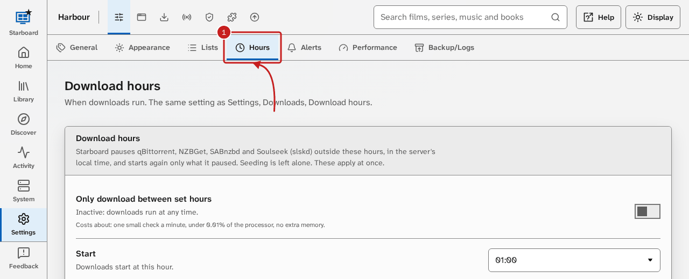
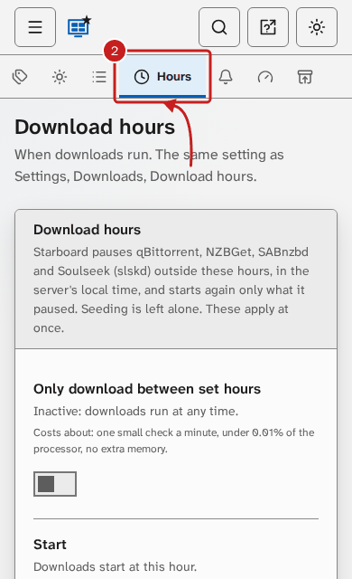
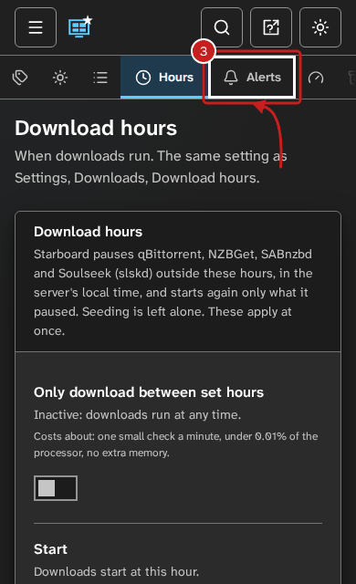

[Help centre](../README.md) · Accessibility · how-to
<!-- help: a11y / change -->

# Use menus that show icons only

Some pages have a row of tabs under the header, such as the tabs in **Settings**, then **General**. When the names do
not fit, Starboard shows icons only, and the tab you are on keeps its name. Starboard measures the row, so a narrow
phone, bigger text and wider spacing all give the right result.

## What you see

- **The names fit:** every tab shows its icon and its name.
- **The names do not fit:** every tab shows its icon, and the tab you are on shows its name beside its icon. A bar under
  that tab marks it as the current one.
- **Still too wide:** the row scrolls sideways. A soft fade on one edge shows that there are more tabs. The tab you are
  on is brought into view.

Each tab is at least 44 pixels wide, the size of a fingertip. The side menu does not change: it always shows icon and name.

## Steps

1. On a computer, look at the row under the header. Each tab shows its icon and its name.
   
2. On a phone, or with a bigger **Text size**, the same row shows icons only. The tab you are on, **Hours**, keeps its name.
   Scroll the row sideways to reach the tabs at the ends.
   
3. To use the keyboard, press **Tab** until a tab has focus. Press **Left arrow** and **Right arrow** to move along the
   row, **Home** for the first tab and **End** for the last. The tab with focus shows its name, and **Enter** opens it.
   

## For a screen reader

The row is a navigation area with its own name, such as **General**. Each tab is a link, and the link for the current
page is announced as the current page. Every tab keeps its name as text, so a screen reader reads the name even when only
the icon shows. The icon itself is not read.

## Things to note

- Pointing at an icon, or moving to it with the keyboard, shows its name as a tooltip. A phone has no tooltip, so
  the tab you are on always shows its name.
- In Windows contrast themes the current tab also has an outline, so you can find it without colour.
- A row never wraps onto a second line and never makes a tab smaller than 44 pixels.

## Find out more

- [Use only a keyboard](use-only-a-keyboard.md)
- [Use a screen reader](use-a-screen-reader.md)
- [Change text size and spacing](text-size-and-spacing.md)
- [On a phone or tablet](on-a-phone-or-tablet.md)

<!-- footer: download rights -->

---

**Download only what you have the right to.** Use the download apps only for files you have the right to download.
Examples are open-source software, works in the public domain and your own backups. Downloading films, series, music or
books without the copyright holder's permission is against the law in the UK and most other countries. Starboard
does not host or provide any files, and you are responsible for what you download.

**Need help?** Ask on the [Starboard Discord support server](https://discord.gg/xN9bf2H4vv).

<!-- /footer -->
