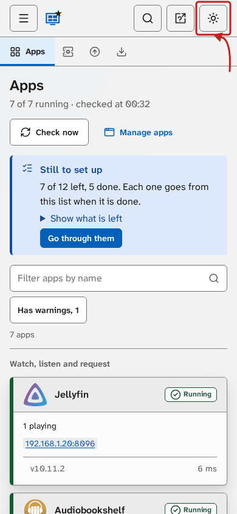
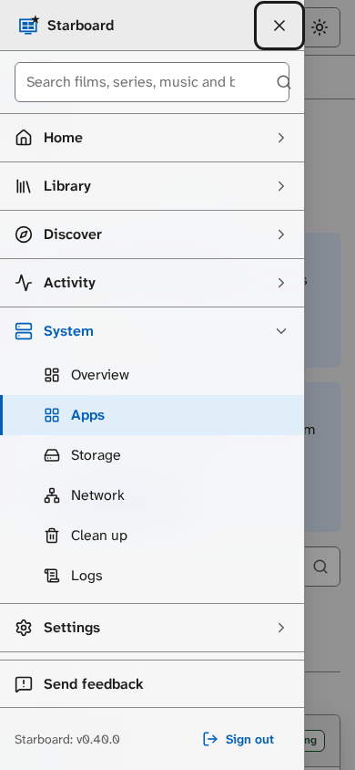
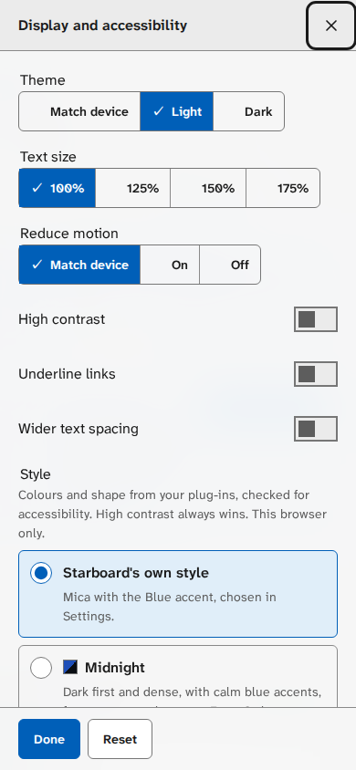

[Help centre](../README.md) · Accessibility · how-to
<!-- help: a11y / ways -->

# Use Starboard on a phone or tablet

Starboard works in the browser on a phone or tablet, with touch, with the device's screen reader (VoiceOver or
TalkBack), and with its own text size, zoom and motion settings. On a narrow display it changes to a phone layout:
one column, with the menu under **Menu**.

## When would you use it

- You use Starboard from your phone or tablet, on your home network or away from home.
- You use VoiceOver, TalkBack, Switch Control or Voice Access on the device.
- You want to know which of your device's own settings Starboard follows.

## The phone layout

- **Menu:** the side menu moves under **Menu** in the header. Each part of Starboard is a section that folds open,
  and the part you are in starts open. **Close menu** or Escape closes it.
- **Search:** the search button in the header opens the search field.
- **Display:** stays in the header, and opens the same **Display and accessibility** choices across the width.
- **Large targets:** every button and row is at least 44 pixels high, so it fits a fingertip.

## Your device's own settings

| Device setting | What Starboard does |
|---|---|
| Dark mode | Starboard is light unless you choose. With **Theme** on **Match device**, Starboard is dark when the device is. |
| Reduce motion | With **Reduce motion** on **Match device**, the default, Starboard stops sliding and smooth scrolling. |
| Pinch to zoom | Never blocked. |
| VoiceOver and TalkBack | Every control has a name, pages have headings and landmarks, and messages are said politely. Read [Use a screen reader](use-a-screen-reader.md). |
| A keyboard or switch | Works as on a computer. Read [Use only a keyboard](use-only-a-keyboard.md). |
| The device's text size | A browser may or may not pass it on to web pages. Use **Text size** in **Display** instead, up to 175%. |

## Things to note

- **Display** settings are kept in each browser, so set them on the phone or tablet as well as on the computer.
- Wide tables become a list of cards on a phone, with each value named.
- Every page is checked at 320 pixels wide, narrower than most phones, for anything that needs sideways scrolling.
- You can add Starboard to the home screen of a phone; it then opens in its own window. Read
  [Open Starboard from a phone or another computer](../topics/open-from-another-device.md).

## Find out more

- [Accessibility in Starboard](overview.md)
- [Zoom and large screens](zoom-and-large-screens.md)
- [Use Starboard away from home safely](../guides/use-starboard-away-from-home.md)

<!-- footer: download rights -->

---

**Download only what you have the right to.** Use the download apps only for files you have the right to download,
such as open-source software, works in the public domain and your own backups. Downloading films, series, music or
books without the copyright holder's permission is against the law in the UK and most other countries. Starboard
does not host or provide any files, and you are responsible for what you download.

**Need help?** Ask on the [Starboard Discord support server](https://discord.gg/xN9bf2H4vv).

<!-- /footer -->
