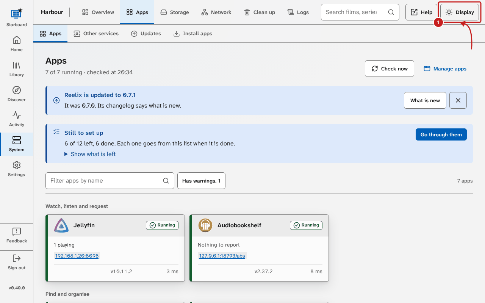
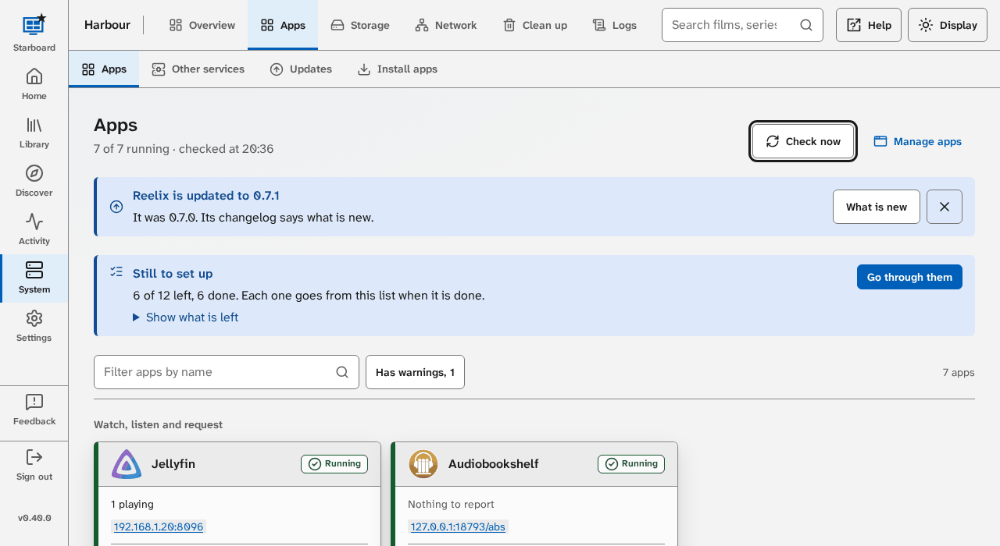
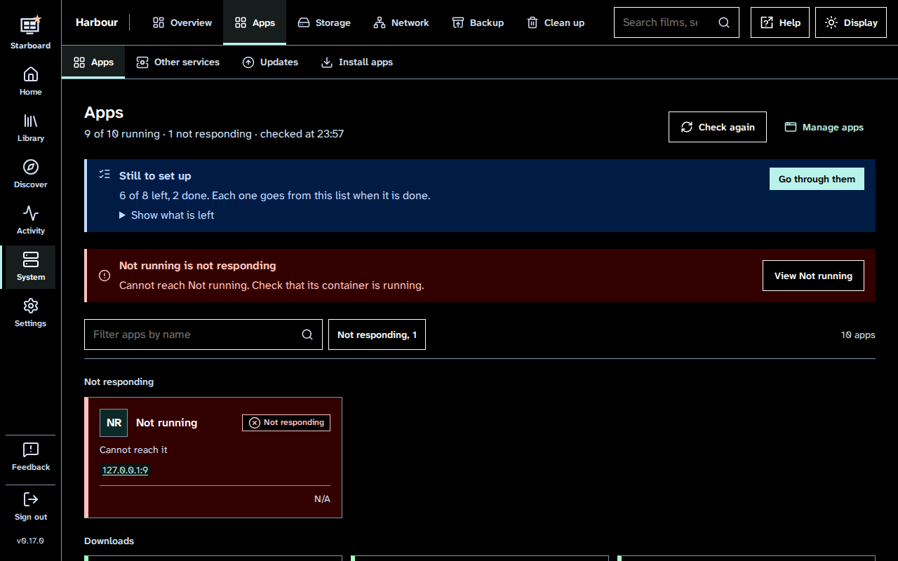
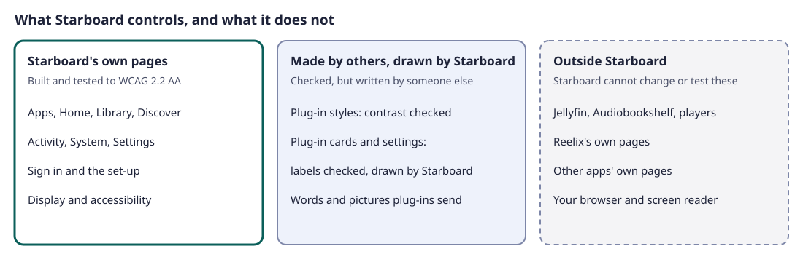

[Help centre](../README.md) · Accessibility · overview
<!-- help: a11y / change -->

# Accessibility in Starboard

We built Starboard so that everyone can use it. You can use it with a mouse, a keyboard alone, a screen reader,
voice control, large text or zoom, on a computer, a phone or a television. We build and test it to WCAG 2.2 level AA
(the Web Content Accessibility Guidelines), the standard most public services use. This page says what Starboard
does. It links to every accessibility article: how to change Starboard for you, the ways to use it, and how we check
it.

Most of the choices are in **Display**, the last button in the header of every page, including Sign in and the
set-up. Read [Change text size, theme and other display settings](../topics/display-and-accessibility.md).

## What Starboard does for everyone

These are always on. Nothing needs to be activated.

- **Readable type:** every page uses Atkinson Hyperlegible Next, a typeface designed for readers
  with low vision. It comes with Starboard.
- **Strong colours:** text and controls meet the WCAG 2.2 AA contrast levels in every theme. The ratio is at least
  4.5 to 1 for text, and 3 to 1 for the edges of controls and the focus outline.
- **Large controls:** buttons and fields are 44 pixels high, and nothing anyone needs to select is smaller than 24
  by 24 pixels.
- **Keyboard first:** everything works with the keyboard, with a thick focus outline that the sticky header never
  covers, and **Skip to main content** as the first Tab on every page.
- **Screen readers:** every page has landmarks, one main heading and headings in order. Starboard says short messages, such as
  **Saved**, without moving you, and it says problems beside the field they are about.
- **Never by colour alone:** states are shown in words with an icon, and the second line of a chart is dashed.
- **Charts as tables:** each chart has a sentence that says what it shows, and **Show as a table**.
- **Nothing moves by itself:** no slide-out opens on its own, and focus never jumps to the top of the page after a
  save or a delete.

## Change it for you

Each of these is in **Display**, applies at once and is kept in your browser.

- [Text size and spacing](text-size-and-spacing.md): text from 100% to 175%, and wider spacing between lines,
  letters and words.
- [Light, dark and high contrast](light-dark-and-high-contrast.md): the theme, and stronger colours and borders.
- [Reduce motion](reduce-motion.md): no sliding, shimmering or smooth scrolling.
- [Underline links](underline-links.md): every link underlined, not shown by colour alone.

## Ways to use it

- [Use only a keyboard](use-only-a-keyboard.md): the keys, the skip link, the focus outline, and how slide-outs and
  dialogs keep and give back focus.
- [Use a screen reader](use-a-screen-reader.md): landmarks, headings, what is said, forms, tables, charts and
  plug-in cards.
- [Zoom and large screens](zoom-and-large-screens.md): browser zoom up to 400%, text size, and televisions.
- [On a phone or tablet](on-a-phone-or-tablet.md): the phone layout and menu, touch, and your device's own
  settings.

## How it is tested

- [How Starboard is tested](how-starboard-is-tested.md): the tools and steps, and when they run.
- [Latest test results](latest-test-results.md): the figures from the most recent runs, with their dates.
- [Limits and known gaps](limits-and-known-gaps.md): what is not tested, what Starboard cannot control, and
  open issues.
- [Tell us about an accessibility problem](tell-us-about-a-problem.md): tell us about anything that is hard to use with your tools or needs.

The diagram sorts the pages and tools you use into three groups. We build and test Starboard's own pages to WCAG 2.2 AA.
Others make plug-in styles and cards, but Starboard checks and draws them. Jellyfin, Audiobookshelf and
their players, Reelix's own pages, other apps' own pages, and your browser and screen reader are outside
Starboard's control. Read [Limits and known gaps](limits-and-known-gaps.md).

## Find out more

- [Change text size, theme and other display settings](../topics/display-and-accessibility.md)
- [Set up everything with the Run first script](../topics/run-first.md), which has an accessible mode for the
  terminal
- [Send feedback about a page](../topics/send-feedback.md)
- [What Starboard is](../basics/what-is-starboard.md)

<!-- footer: download rights -->

---

**Download only what you have the right to.** Use the download apps only for files you have the right to download.
Examples are open-source software, works in the public domain and your own backups. Downloading films, series, music or
books without the copyright holder's permission is against the law in the UK and most other countries. Starboard
does not host or provide any files, and you are responsible for what you download.

**Need help?** Ask on the [Starboard Discord support server](https://discord.gg/xN9bf2H4vv).

<!-- /footer -->
