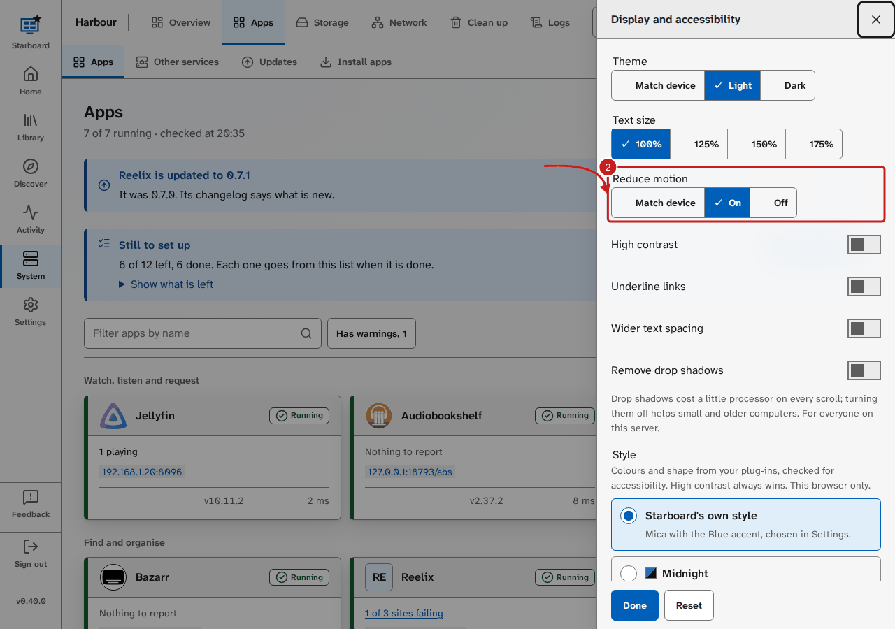
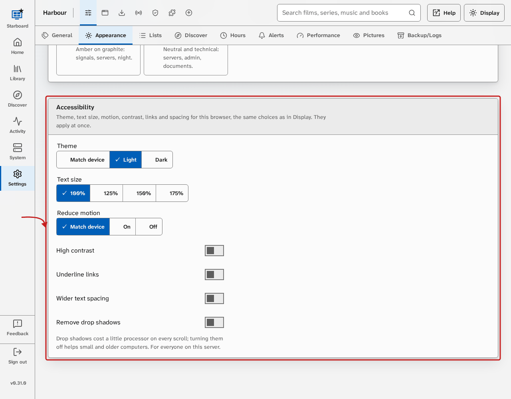
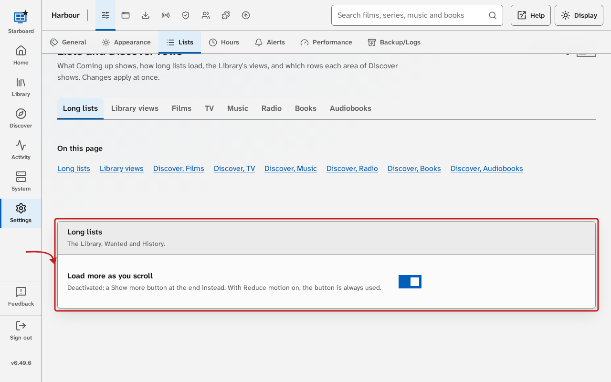

[Help centre](../README.md) · Accessibility · how-to
<!-- help: a11y / change -->

# Reduce motion

**Reduce motion** stops things sliding, shimmering and scrolling smoothly in Starboard. It is in **Display**, applies
at once, and is kept in the browser you use. By default it follows your device's own reduced motion setting.

## Who it helps

- People with vestibular disorders, who can feel dizzy or sick from movement on a page.
- People who find movement distracting, such as some people with attention or reading difficulties.
- Anyone on a slow device.

## Steps

1. Select **Display**, the last button in the header. The **Display and accessibility** slide-out opens.
2. Under **Reduce motion**, choose one:
   - **Match device** (the default) follows the reduced motion setting of your phone or computer.
   - **On** always reduces motion in Starboard, whatever the device says.
   - **Off** always shows the standard movement in Starboard, whatever the device says.
3. Select **Done**, or press Escape.

The same choice is in **Settings**, then **General**, then **Appearance**, under **Accessibility**.

## What it changes

A still picture cannot show movement, so this list says what changes when motion is reduced:

| Without reduced motion | With reduced motion |
|---|---|
| Slide-outs and the phone menu slide in from the side. | They appear in place. |
| Messages slide into the corner. | They appear in place. |
| The loading line under the header runs across. | It fades in and out across its whole width, so you still know something is loading. |
| Placeholders shimmer while a list loads. | They stay still. |
| Rows of covers and the letter row scroll smoothly. | They jump straight to the place. |
| Long lists load more as you near the end. | They wait for you to select **Show 40 more**. |

Nothing that tells you something is lost: only the movement goes.

## Long lists

The Library, Wanted and History load the next 40 by themselves as you near the end. With reduced motion, they
always wait for **Show 40 more** instead. To have the button for everyone on the server, whatever their motion
setting, turn off **Load more as you scroll** in **Settings**, then **General**, then **Lists**, under
**Long lists**.

## Things to note

- Reduce motion is kept in this browser only. Each phone, computer and browser has its own.
- **Off** brings back all movement in Starboard, even when your device asks for reduced motion.

## Find out more

- [Accessibility in Starboard](overview.md)
- [Change text size, theme and other display settings](../topics/display-and-accessibility.md)
- [Browse your library](../topics/browse-your-library.md)

<!-- footer: download rights -->

---

**Download only what you have the right to.** Use the download apps only for files you have the right to download.
Examples are open-source software, works in the public domain and your own backups. Downloading films, series, music or
books without the copyright holder's permission is against the law in the UK and most other countries. Starboard
does not host or provide any files, and you are responsible for what you download.

**Need help?** Ask on the [Starboard Discord support server](https://discord.gg/xN9bf2H4vv).

<!-- /footer -->
