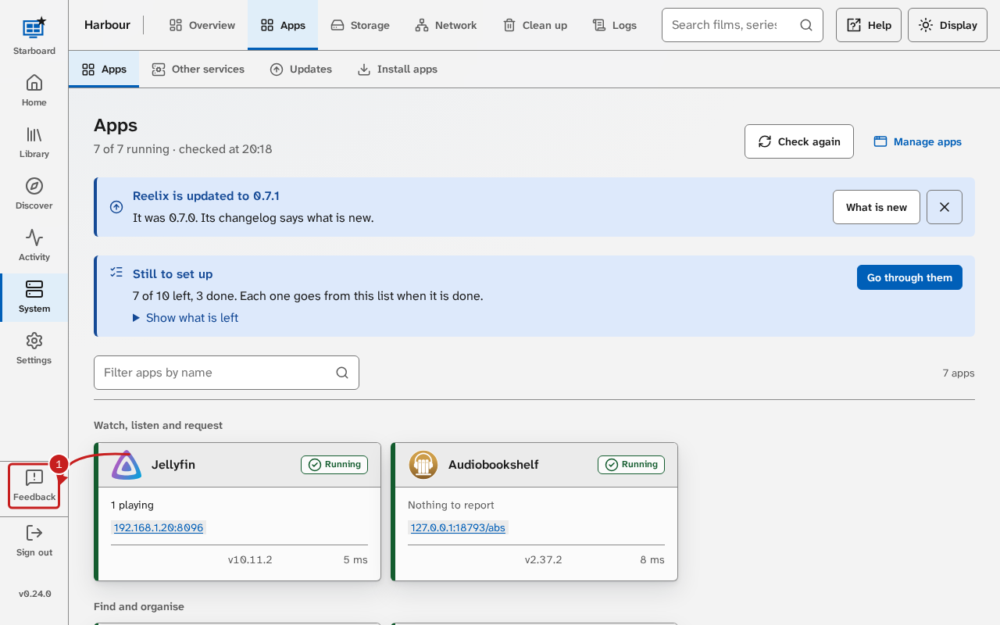
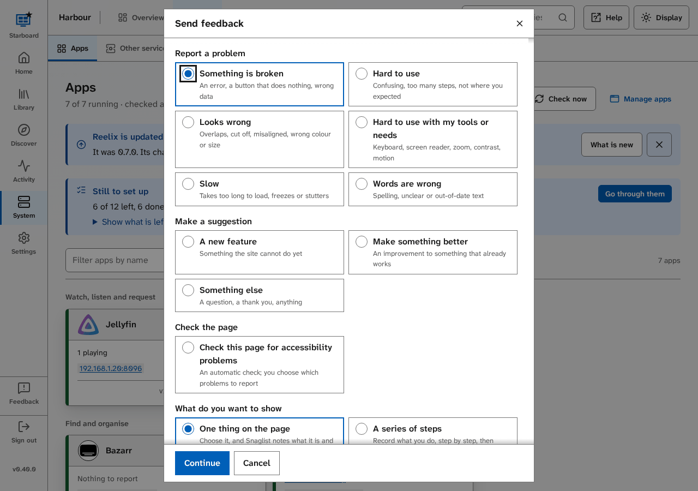
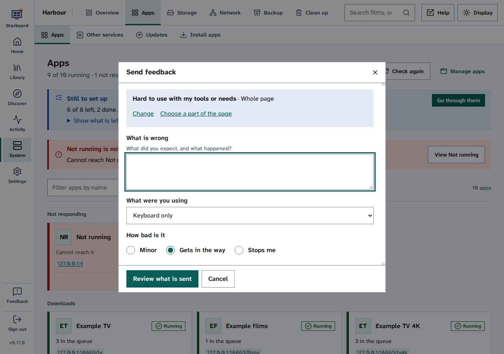
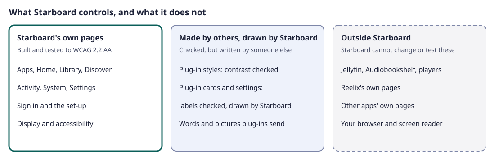

[Help centre](../README.md) · Accessibility · how-to
<!-- help: a11y / checks -->

# Tell us about an accessibility problem

If part of Starboard is hard to use with your tools or needs, such as a keyboard, a screen reader, zoom, contrast or
motion, tell us with **Feedback** in the side menu. It says which page and which part of it, and keeps nothing
personal. You can also have the page checked automatically and choose which problems to send.

## Before you begin

- You are signed in to Starboard, and **Send feedback** is active. It is active unless someone turned it off in
  **Settings**, then **General**, then **Backup/Logs**. Read [Send feedback about a page](../topics/send-feedback.md).

## Steps

1. On the page with the problem, select **Feedback** in the side menu. On a phone, open **Menu** and select
   **Send feedback**. With a keyboard, Tab from the start of the page: **Feedback** comes after the side menu's
   links.
   
2. Choose **Hard to use with my tools or needs**. To have the page checked for you instead, choose **Check this page
   for accessibility problems**.
   
3. Choose what to show: **One thing on the page**, **A series of steps** or **Describe it in words**. With a
   keyboard or screen reader, **Describe it in words** needs no pointing.
4. Under **What is wrong**, say what you expected and what happened. Under **What were you using**, choose what you
   use, such as **Keyboard only**, **A screen reader**, **Zoom or large text**, **Voice control**, **Switch access** or
   **High contrast or forced colours**. Then choose **How bad is it**.
   
5. Select **Review what is sent**. All of it is shown, and you can clear anything you would rather not send.
6. Choose where it goes: **Open in GitHub**, **Save in Starboard**, **Copy as Markdown**, **Download** or **Show as a
   QR code**.

## What helps us fix it

- What you were trying to do, and what happened instead.
- What you use: the screen reader, browser and device, with their versions if you know them, and any settings such
  as zoom, text size or high contrast.
- Whether it happens every time.

## Things to note

- What is sent never holds your password, API keys, cookies or anything entered in the page's fields. The page title
  and the text on the page are copied as they are, so check it before you send it.
- **Open in GitHub** posts it as an issue on Starboard's GitHub page, from your own GitHub account, where anyone can
  read it.
- Problems with Jellyfin, Audiobookshelf or another app's own pages belong with that app. Read
  [Limits and known gaps](limits-and-known-gaps.md#what-starboard-cannot-control).
- Before sending, it may help to read [Accessibility limits and known gaps](limits-and-known-gaps.md) to find out whether the problem
  is already known.

## Find out more

- [Send feedback about a page](../topics/send-feedback.md)
- [Limits and known gaps](limits-and-known-gaps.md)
- [Accessibility in Starboard](overview.md)

<!-- footer: download rights -->

---

**Download only what you have the right to.** Use the download apps only for files you have the right to download.
Examples are open-source software, works in the public domain and your own backups. Downloading films, series, music or
books without the copyright holder's permission is against the law in the UK and most other countries. Starboard
does not host or provide any files, and you are responsible for what you download.

**Need help?** Ask on the [Starboard Discord support server](https://discord.gg/xN9bf2H4vv).

<!-- /footer -->
