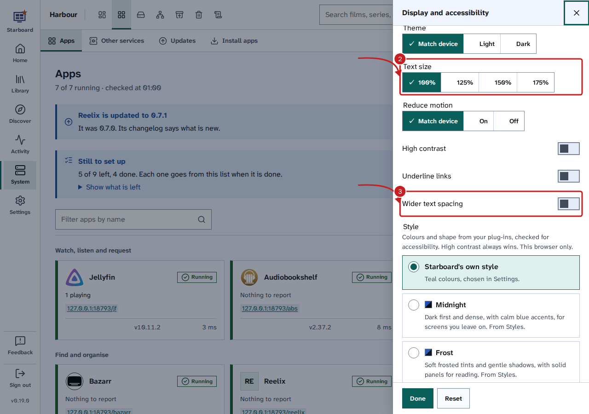
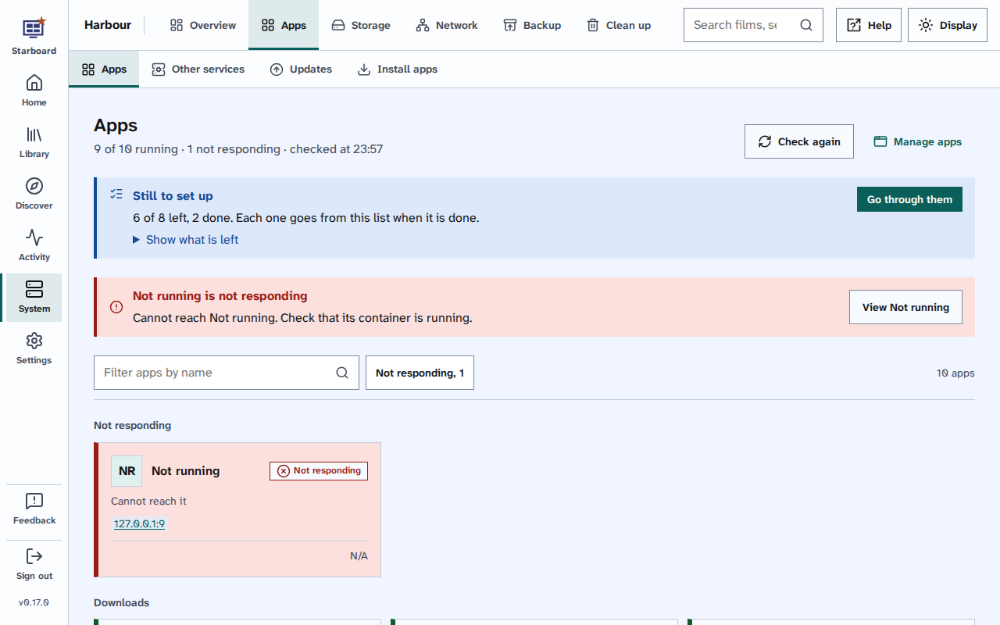
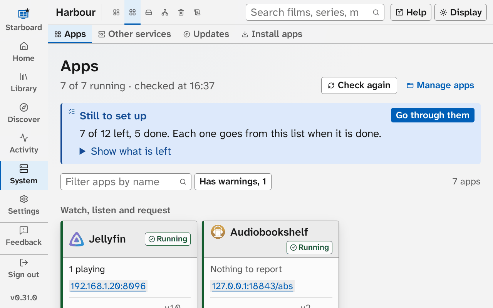
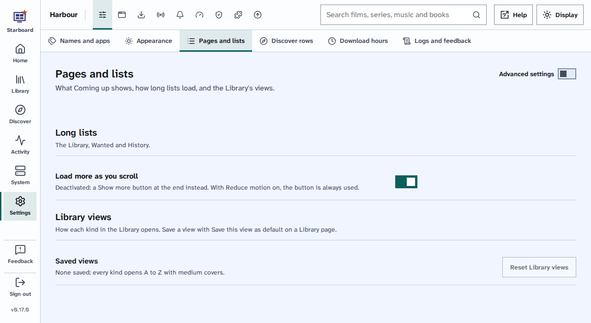
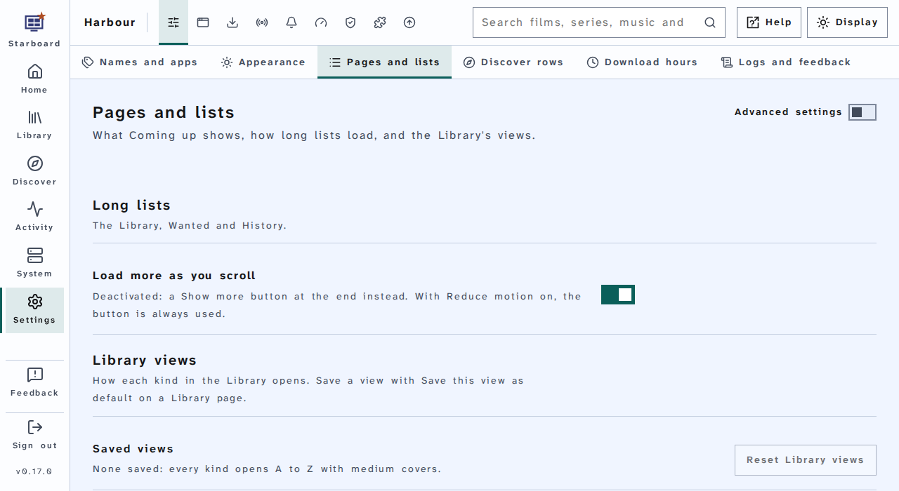
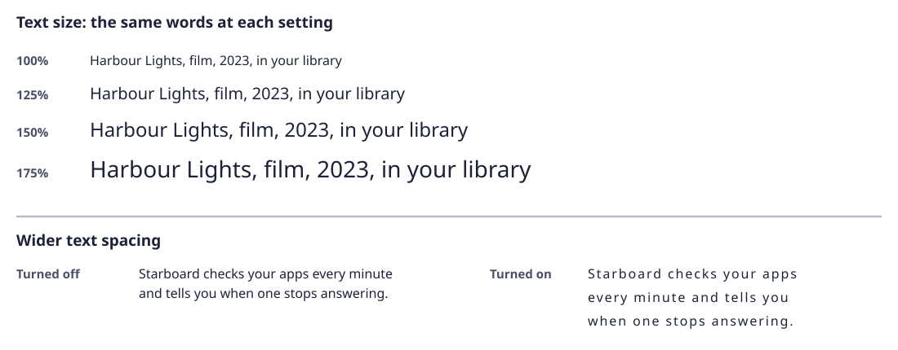

[Help centre](../README.md) · Accessibility · how-to
<!-- help: a11y / change -->

# Change text size and spacing

**Text size** makes all of Starboard's text up to 175% bigger, and **Wider text spacing** adds space between lines,
letters and words. Both are in **Display**, apply at once, and are kept in the browser you use.

## Who it helps

- **Text size:** people with low vision, people who read better with larger text, and anyone reading from a
  distance, such as from a television.
- **Wider text spacing:** people with dyslexia, people with low vision, and anyone who finds crowded text hard to
  follow.

## Steps

1. Select **Display**, the last button in the header. The **Display and accessibility** slide-out opens.
2. Under **Text size**, choose **100%**, **125%**, **150%** or **175%**. The text changes behind the panel at once.
3. To add space between lines, letters and words, activate **Wider text spacing**. Deactivate it to go back.
4. Select **Done**, or press Escape.

To go back, choose **100%** and deactivate **Wider text spacing**, or select **Reset** to put every Display choice
back to its default. The same choices are in **Settings**, then **General**, then **Appearance**, under
**Accessibility**.

## What text size changes

Text size makes every word bigger: headings, menus, buttons, forms and lists. Controls grow with their words. The
page is laid out again to fit, so you do not need to scroll sideways. 100% is the default.

## What wider text spacing changes

Wider text spacing sets the space between lines to 1.8 times the text size, between letters to 0.12 of the text
size, and between words to 0.16 of the text size. These are at least the amounts in WCAG 2.2's text spacing check.
Text takes more room, so pages are a little longer.

The graphic shows the line "Harbour Lights, film, 2023, in your library" at each of the four sizes, each larger
than the last, then a sentence with normal spacing beside the same sentence with wider spacing, which takes three
lines instead of two.

The side menu grows wider with the text, so its names stay whole. When the header has too little room, it gives way
in steps: its menu shows icons only, the search box becomes the **Search** button, **Help** and **Display** show
their icons, and last, the menu moves under **Menu**. Nothing is cut off, and every name is still read out by a
screen reader and shown as a tooltip.

## Things to note

- These settings are kept in this browser only. Each phone, computer and browser has its own. A private window
  may forget them when it closes.
- Text size and browser zoom work together. Text size keeps the layout and changes only the text; zoom makes
  everything bigger, pictures included. Read [Zoom and large screens](zoom-and-large-screens.md).
- Starboard's typeface, Atkinson Hyperlegible Next, is designed for clear reading, so there is no separate font
  setting.
- Every page is checked at 175% text for anything that needs sideways scrolling. Read
  [How Starboard is tested](how-starboard-is-tested.md).

## Find out more

- [Accessibility in Starboard](overview.md)
- [Change text size, theme and other display settings](../topics/display-and-accessibility.md)
- [Zoom and large screens](zoom-and-large-screens.md)
- [Light, dark and high contrast](light-dark-and-high-contrast.md)

<!-- footer: download rights -->

---

**Download only what you have the right to.** Use the download apps only for files you have the right to download,
such as open-source software, works in the public domain and your own backups. Downloading films, series, music or
books without the copyright holder's permission is against the law in the UK and most other countries. Starboard
does not host or provide any files, and you are responsible for what you download.

**Need help?** Ask on the [Starboard Discord support server](https://discord.gg/xN9bf2H4vv).

<!-- /footer -->
