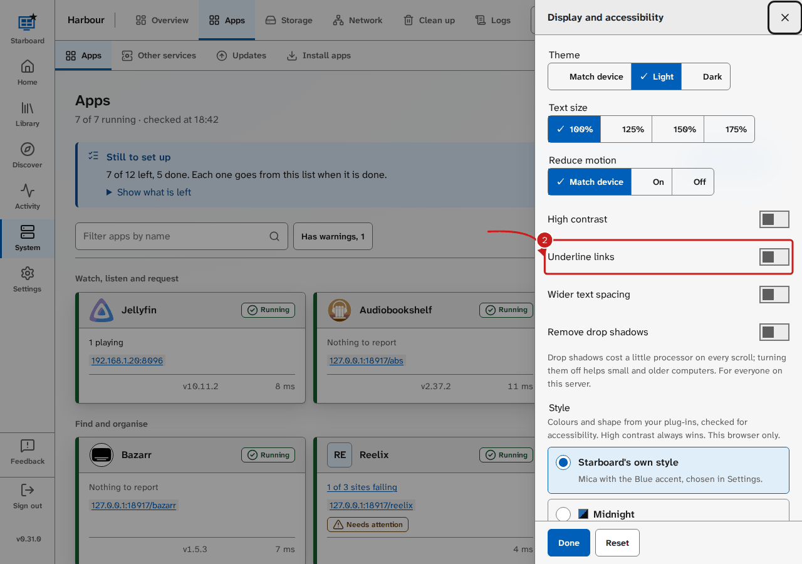
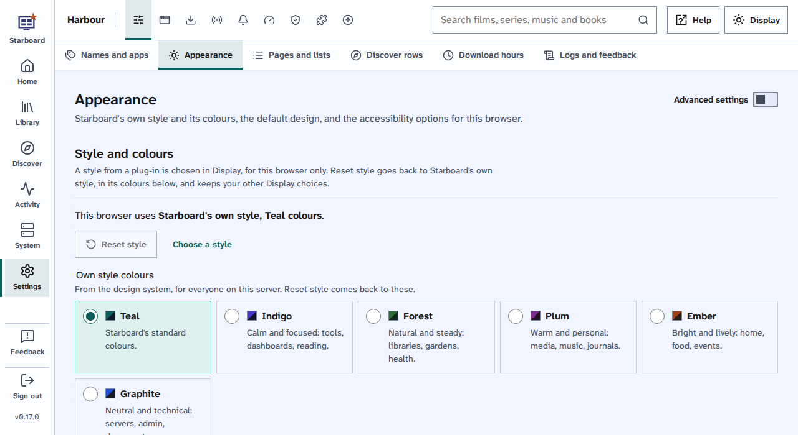
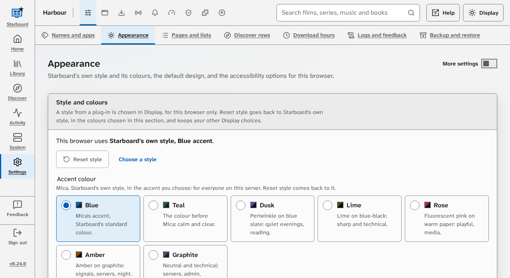

[Help centre](../README.md) · Accessibility · how-to
<!-- help: a11y / change -->

# Underline links

**Underline links** puts a line under every link in Starboard, so a link is shown by its line as well as its colour.
It is in **Display**, applies at once, and is kept in the browser you use.

## Who it helps

- People who find some colours hard to tell apart, including people with colour vision differences.
- People with low vision, or using a display with poor contrast.
- Anyone who wants to tell at a glance what is a link.

## Steps

1. Select **Display**, the last button in the header. The **Display and accessibility** slide-out opens.
2. Turn on **Underline links**. Every link on the page behind is underlined at once.
3. Select **Done**, or press Escape.

To stop underlining links, turn off **Underline links** the same way, or select **Reset** to put every Display
choice back to its default. The same switch is in **Settings**, then **General**, then **Appearance**, under
**Accessibility**: Space turns it on or off. Focus stays on it, and **Saved** is said.

## What it changes

Links are shown in the accent colour. With **Underline links** active, every link also has a line under it,
including links styled as buttons, such as **Manage apps**.

## Things to note

- Underline links is kept in this browser only. Each phone, computer and browser has its own.
- It also works with styles from plug-ins: a style can never take the underline away.

## Find out more

- [Accessibility in Starboard](overview.md)
- [Light, dark and high contrast](light-dark-and-high-contrast.md)
- [Change text size, theme and other display settings](../topics/display-and-accessibility.md)

<!-- footer: download rights -->

---

**Download only what you have the right to.** Use the download apps only for files you have the right to download.
Examples are open-source software, works in the public domain and your own backups. Downloading films, series, music or
books without the copyright holder's permission is against the law in the UK and most other countries. Starboard
does not host or provide any files, and you are responsible for what you download.

**Need help?** Ask on the [Starboard Discord support server](https://discord.gg/xN9bf2H4vv).

<!-- /footer -->
