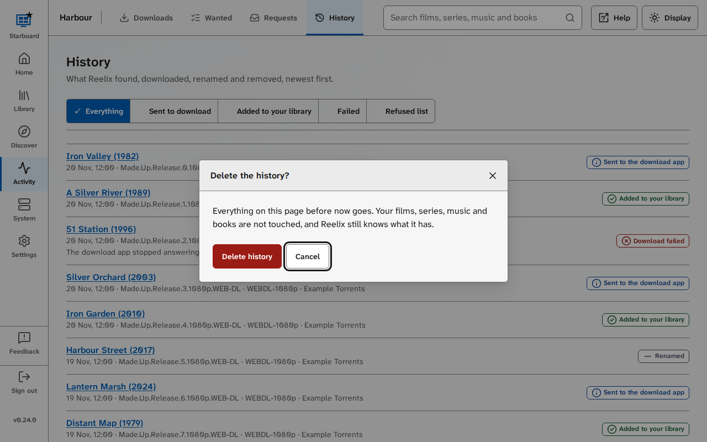
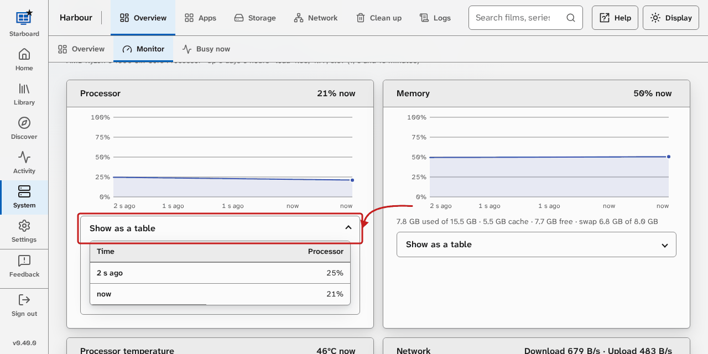
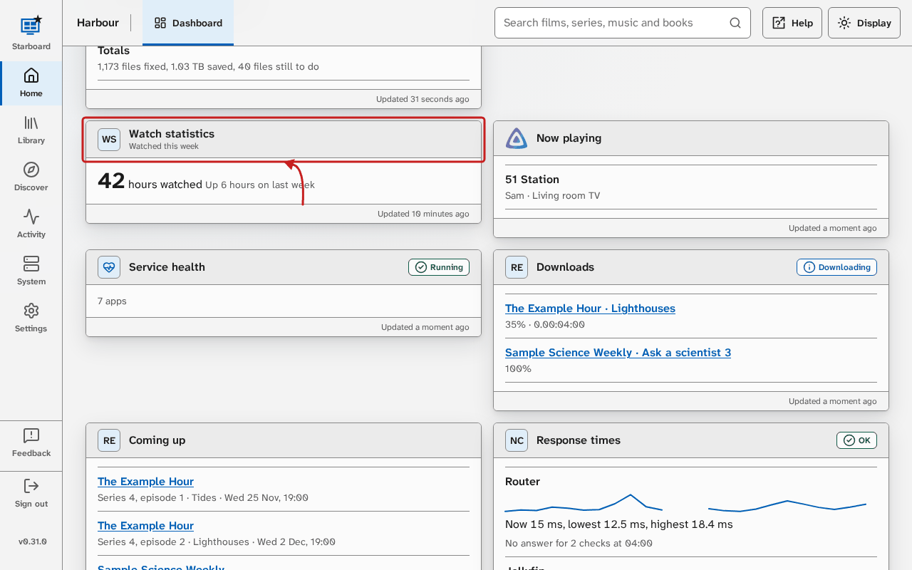

[Help centre](../README.md) · Accessibility · how-to
<!-- help: a11y / ways -->

# Use a screen reader

Starboard is built to work with screen readers, such as NVDA and JAWS on Windows, VoiceOver on a Mac, iPhone or
iPad, TalkBack on Android and Orca on Linux. Nothing needs to be activated. This page says how the pages are laid
out and what you hear.

## When would you use it

- You use a screen reader and want to know how Starboard's pages are built, so you can move round them quickly.
- You want to know what Starboard says after you do something, and what it keeps quiet.

## How each page is laid out

- **Page titles:** each tab's title names the page, then Starboard, such as "Apps · Starboard".
- **Skip link:** **Skip to main content** is the first thing on every page.
- **Landmarks:** a header, the side menu (named **Side menu**), the main content and a footer, in that order.
- **Headings:** one level 1 heading per page, at the start of the main content, then headings in order with no
  levels skipped. Lists with no visible heading have one for screen readers only, so the headings list shows every
  part of the page.
- **Reading order:** what you hear follows what is shown, top to bottom and left to right. Notices come after the
  page's heading, never before it.
- **Language:** every page is marked as British English, so words are said correctly.

## What you hear

- **Short messages:** said politely, without moving you, such as "Saved", "23 films missing", "12 more shown",
  "40 more shown" or "Display settings reset".
- **Quiet lists:** a whole list is never read out when it changes. Lists that refresh by themselves, such as
  Activity and the cards on Home, are updated in place without interrupting you.
- **Problems:** a problem with a field is shown beside it, said at once, and tied to the field, so it is read again
  when you come back to it.
- **States:** a state is said in words, such as **Works**, **Not answering** or **Warning**, never shown by colour
  alone.
- **Switches and choices:** every switch, tick box and choice has its label, and a hint under a field is read with
  it.
- **Buttons with only an icon:** each has a name, such as **Close Display and accessibility**.
- **Pictures:** a cover or logo has its title or name as its text, or is skipped when the name is already beside
  it. Decorative pictures, such as the small drawing of each design, are skipped.

## Slide-outs and dialogs

Slide-outs and dialogs are named by their heading, take focus when they open, keep it inside, and give it back when
they close. A dialog that would delete something starts on **Cancel**. Read
[Use only a keyboard](use-only-a-keyboard.md#slide-outs-and-dialogs).

## Tables and charts

Tables have a caption and header cells, so a screen reader names the column and row of each cell. On a phone, wide
tables are shown as a list of cards instead, with each value named.

Each chart, such as those on **System**, then **Monitor**, has a sentence that says what it shows. It can be reached
with Tab: the Left and Right arrow keys then move from reading to reading, with Home and End for the first and last.
Under each chart, **Show as a table** shows every reading as a table, so no value depends on pointing at the chart.

## Plug-in cards on Home

Every card a plug-in adds to **Home** is drawn by Starboard, the same way: a band with the plug-in's name as a level
2 heading, then its state and when it last updated. The state starts with "Status:" and the time with "Updated",
for screen readers only, so each makes sense on its own. Cards update quietly in place.

## Things to note

- The set-up in the terminal has an accessible mode: plain numbered lines with no boxes or colour. Read
  [Set up everything with the Run first script](../topics/run-first.md).
- Jellyfin, Audiobookshelf and other apps opened from Starboard have their own pages, which Starboard does not
  control.
- Starboard is checked with automated tools and keyboard walks, but has not yet been listened to with each
  screen reader. Read [Limits and known gaps](limits-and-known-gaps.md).

## Find out more

- [Accessibility in Starboard](overview.md)
- [Use only a keyboard](use-only-a-keyboard.md)
- [How Starboard is tested](how-starboard-is-tested.md)
- [Tell us about an accessibility problem](tell-us-about-a-problem.md)

<!-- footer: download rights -->

---

**Download only what you have the right to.** Use the download apps only for files you have the right to download.
Examples are open-source software, works in the public domain and your own backups. Downloading films, series, music or
books without the copyright holder's permission is against the law in the UK and most other countries. Starboard
does not host or provide any files, and you are responsible for what you download.

**Need help?** Ask on the [Starboard Discord support server](https://discord.gg/xN9bf2H4vv).

<!-- /footer -->
