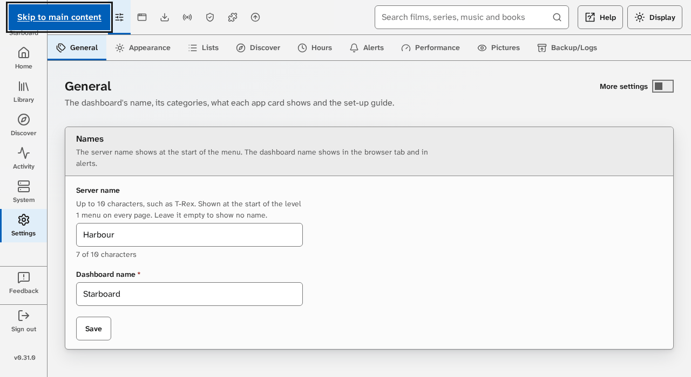
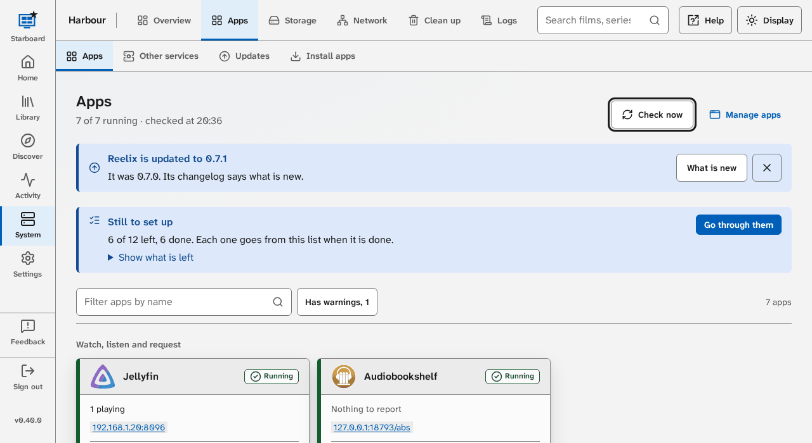
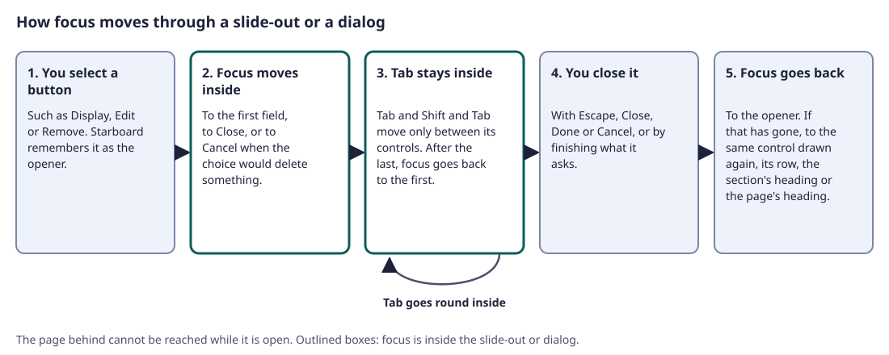
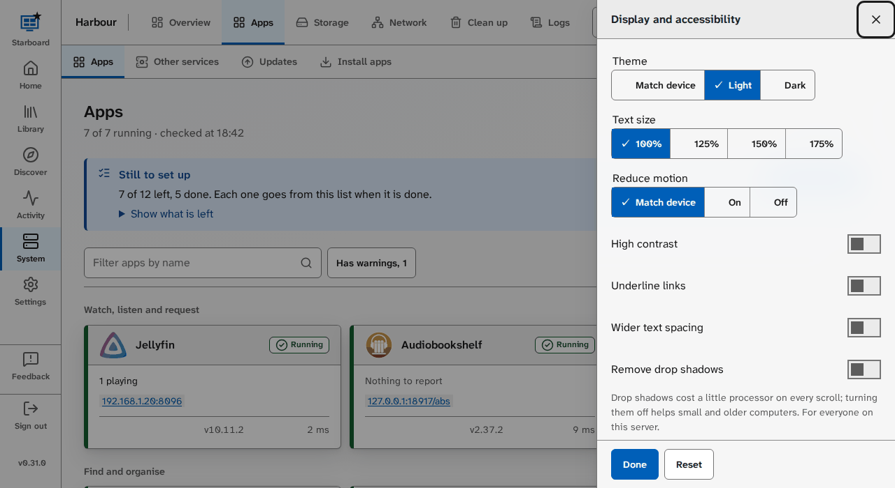
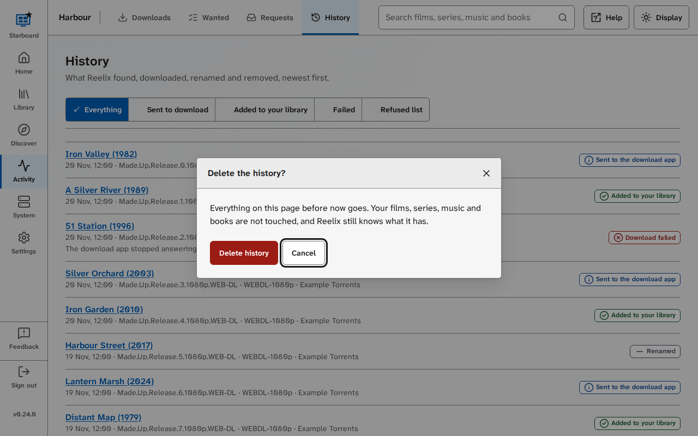

[Help centre](../README.md) · Accessibility · reference
<!-- help: a11y / ways -->

# Use only a keyboard

Everything in Starboard works with a keyboard alone, and with switch access or voice control that acts as a
keyboard. Nothing needs to be activated: it is how every page is built. This page lists the keys, and says how focus
moves through slide-outs and dialogs and after you do something.

## When would you use it

- You want to use Starboard without a mouse or touch.
- You use switch access, voice control or another tool that sends keys.
- You want to know where focus goes after you open, save or delete something.

## Keys that work everywhere

| Key | What it does |
|---|---|
| Tab | Moves to the next link, button or field. Shift and Tab moves back. |
| Enter | Follows a link, or selects a button. In a form, Enter saves or sends it. |
| Space | Selects a button, ticks a box, or activates or deactivates a switch. |
| Arrow keys | Move between the choices in a group, such as **Light** and **Dark**, between tabs, between letters in the letter row, between items in a menu, and between the readings of a chart. |
| Home and End | Go to the first or last tab, letter, menu item or reading of a chart. |
| Escape | Closes a slide-out, a dialog, a menu, the search on a phone or a help text, and gives focus back to what opened it. |

Starboard has no shortcuts of a single letter, so nothing clashes with the keys of a screen reader or voice
control. In the folder picker, the arrow keys move and open folders, and typing a letter jumps to a folder.

## Skip to main content

The first Tab on any page shows **Skip to main content** at the start of the page. Press Enter to jump past the
side menu and the header, straight to the page's own content. The next Tab is the first thing in that content.

## The focus outline

Whatever has keyboard focus has a thick outline, 3 pixels wide with a small gap, in the theme's focus colour. With
**High contrast** active, it is magenta in the light theme and yellow in the dark theme. Windows' own contrast
themes keep it too. The sticky header never covers what has focus: the page keeps the header's height clear when it
scrolls.

Every button and field is 44 pixels high, and nothing anyone needs to select is smaller than 24 by 24 pixels.

## Slide-outs and dialogs

A slide-out is a panel that opens from the side, such as **Display and accessibility** or **Edit**. A dialog is a
box that asks before doing something, such as **Delete the history?**. Both work the same way:

1. You select a button, such as **Display**, **Edit** or **Remove**. Starboard remembers it.
2. Focus moves inside: to the first field when it asks for something, to **Close** when it shows something, or to
   **Cancel** when the choice would delete or remove something, so pressing Enter by mistake does no harm.
3. Tab and Shift and Tab move only between its controls. After the last one, focus goes back to the first. The
   page behind cannot be reached while it is open.
4. Escape, **Close**, **Done** or **Cancel** closes it, as does finishing what it asks.
5. Focus goes back to the button that opened it. If that button has gone, for example after removing the thing it
   belonged to, focus goes to the same control drawn again, then its row, then the heading of its section, and
   last the page's heading.

Nothing opens by itself when a page loads: a slide-out opens only when you ask for it.

## Focus after you do something

Many parts of a page are drawn again after a save, a delete or a refresh. Focus is never lost to the top of the
page: it stays on the same control drawn again, or moves to the nearest thing that is still there. For example:

- **Show 40 more:** focus moves to the first new item.
- **Load more as you scroll:** focus stays where it is.
- **A list that refreshes by itself,** such as Activity every 15 seconds: the row you are on stays where it is.
- **Remove or delete:** focus moves to the next row, or to the section's heading when none is left.
- **A setting:** focus stays on the switch or choice, and **Saved** shows beside it.

## Things to note

- Rows of covers that scroll sideways are reached with Tab, one cover at a time; the arrows beside a row are for a
  mouse and are left out of the Tab order.
- Lists you can put in order have **Move up** and **Move down** as well as dragging.
- Every main task is walked with the keyboard alone before each change is merged. Read
  [How Starboard is tested](how-starboard-is-tested.md).

## Find out more

- [Accessibility in Starboard](overview.md)
- [Use a screen reader](use-a-screen-reader.md)
- [Zoom and large screens](zoom-and-large-screens.md)
- [Report a problem](tell-us-about-a-problem.md)

<!-- footer: download rights -->

---

**Download only what you have the right to.** Use the download apps only for files you have the right to download,
such as open-source software, works in the public domain and your own backups. Downloading films, series, music or
books without the copyright holder's permission is against the law in the UK and most other countries. Starboard
does not host or provide any files, and you are responsible for what you download.

<!-- /footer -->
