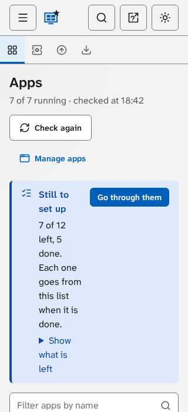
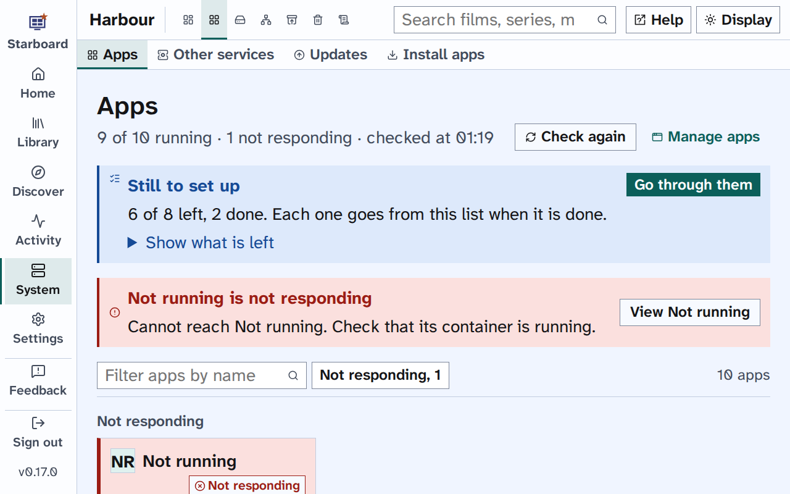
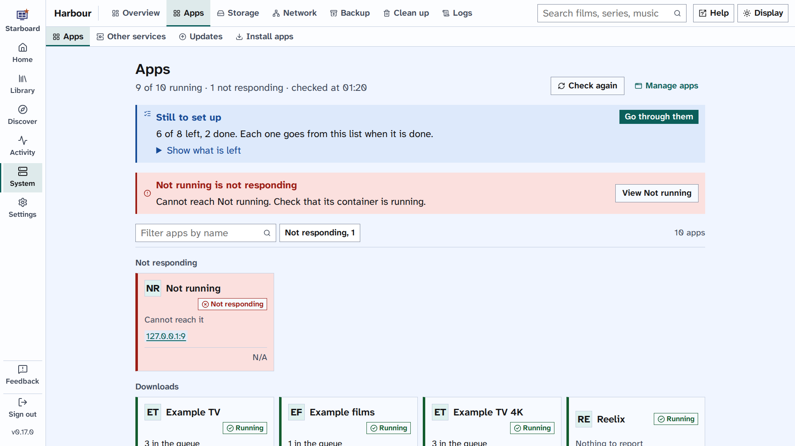

[Help centre](../README.md) · Accessibility · reference
<!-- help: a11y / ways -->

# Zoom and large screens

Starboard works with your browser zoomed in up to 400%, with its own **Text size** up to 175%, and with both
together. It also fills large displays, such as a television. Nothing needs to be activated for zoom: every page
lays itself out again to fit.

## When would you use it

- You zoom the browser in to read, or use a magnifier.
- You want bigger text without changing the layout.
- You use Starboard on a television or a large monitor, from further away.

## Zoom in the browser

Press Ctrl and + to zoom in, Ctrl and minus to zoom out, and Ctrl and 0 to go back to 100%. On a Mac, use Command
instead of Ctrl. Zoom makes everything bigger, pictures included.

As you zoom in, the page needs less width:

- Cards and rows move into fewer columns.
- At the width of a phone, the side menu moves under **Menu** in the header, and the search under the search
  button.
- At 400% zoom on a computer, the page is 320 pixels wide. Every page is checked at that width, and nothing needs
  sideways scrolling, apart from inside a wide table or a row of covers, which scroll on their own.

## Text size

**Text size** in **Display** makes only the text bigger, up to 175%, and keeps the layout. Every page is also
checked at 175% for anything that needs sideways scrolling. Read [Change text size and spacing](text-size-and-spacing.md).

## Large screens and televisions

On a wide display, Starboard uses the width: more cards in each row, and Settings across the whole page. From
across a room, set **Text size** to 150% or 175% in **Display** on that browser; it is kept for that device only,
so your phone and computer keep their own sizes.

## Things to note

- Pinch to zoom on a phone or tablet is never blocked.
- A magnifier, such as Windows Magnifier or Zoom on a Mac, works as on any web page. Problems are shown beside the
  field they are about, and saved notes beside the control you used, so they are near where you are looking.
- Zoom in your browser is kept by the browser for each site, and Starboard's text size is kept in the browser too.
- Zoom up to 400% is checked through the 320 pixel width; it has not yet been tried on its own on every page. Read
  [Limits and known gaps](limits-and-known-gaps.md).

## Find out more

- [Accessibility in Starboard](overview.md)
- [Change text size and spacing](text-size-and-spacing.md)
- [On a phone or tablet](on-a-phone-or-tablet.md)
- [Open Starboard from a phone or another computer](../topics/open-from-another-device.md)

<!-- footer: download rights -->

---

**Download only what you have the right to.** Use the download apps only for files you have the right to download,
such as open-source software, works in the public domain and your own backups. Downloading films, series, music or
books without the copyright holder's permission is against the law in the UK and most other countries. Starboard
does not host or provide any files, and you are responsible for what you download.

<!-- /footer -->
