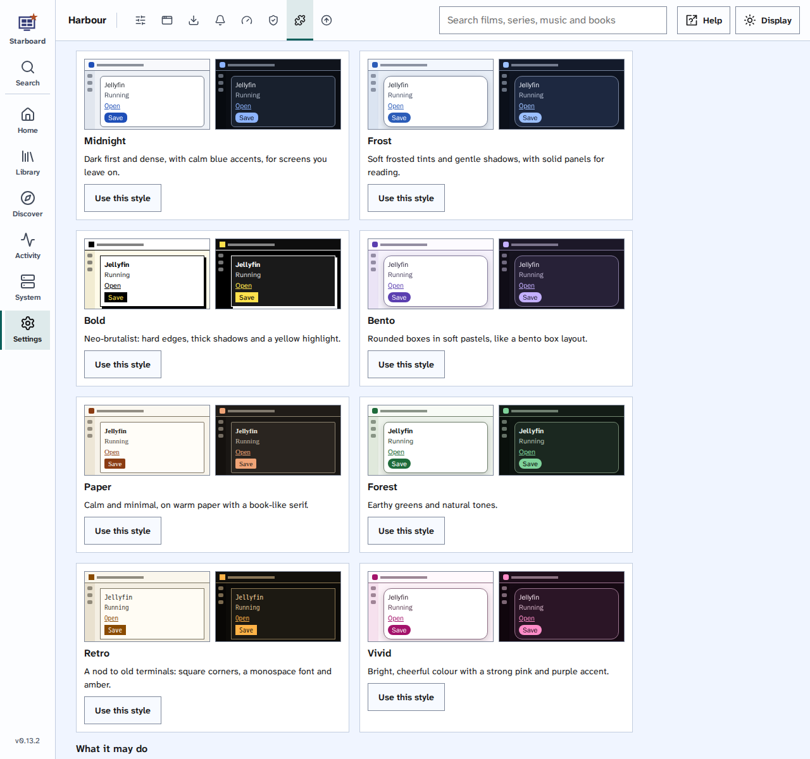

[Help centre](../README.md) · The basics

# The plug-in collection

The plug-ins you can add to Starboard, what each one does, and what it may do on your server. Each one has passed
Starboard's plug-in tester, accessibility included. To add one, read [Add a plug-in](../topics/add-a-plugin.md).

## Styles

Eight styles for Starboard, chosen from current interface trends and checked for accessibility in light and dark.

| Style | What it looks like |
|---|---|
| Midnight | Dark first and dense, with calm blue accents, for screens you leave on |
| Frost | Soft frosted tints and gentle shadows, with solid panels for reading |
| Bold | Hard edges, thick shadows and a yellow highlight |
| Bento | Rounded boxes in soft pastels |
| Paper | Calm and minimal, on warm paper with a book-like serif |
| Forest | Earthy greens and natural tones |
| Retro | Square corners, a monospace font and amber, like old terminals |
| Vivid | Bright pink and purple |

- **What it may do:** add styles to **Display**. Risk: low.
- **What it runs:** nothing. No container, no code and no network access.
- **How to add it:** run its installer, `python3 install.py`, or choose its `starboard-plugin.json` in
  **Settings**, **Plug-ins**.
- **Version:** 1.0.0. Made by TheMightyTRexUK. Licence: MIT.
- **Choosing a style:** in **Settings**, **Plug-ins**, the Styles section shows a picture of each style, light and
  dark, with **Use this style**. **Display**, **Style** has the same choice.

Frost keeps its panels solid. See-through panels change the contrast of the text on them with whatever is behind,
so no style in the collection uses them.

## Live TV

Free TV channels and guides for Jellyfin's Live TV, from Samsung TV Plus, Pluto TV and Free-TV, numbered like Sky.
It comes with Starboard: add it in **Settings**, **Plug-ins**, under **Built into Starboard**.

- **What it may do:** reach the internet and your home network (to fetch guides and test channels), and use
  Jellyfin's API key, kept by Starboard (to add the channels to Jellyfin). Risk: medium and high.
- **What it runs:** one container on Starboard's own image, read only, limited to 192 MB of memory, writing only to
  the Live TV folder you gave the installer.
- **Its card:** when it last ran and what it did. **Run Live TV now** builds everything straight away.
- **How to set it up:** read [Set up free Live TV in Jellyfin](../topics/set-up-live-tv.md).

## Coming next

- **Example plug-ins** for people who want to make their own: a card for the dashboard, a settings form, and one
  that runs through your VPN.

## Make your own

A plug-in is a folder with a `starboard-plugin.json`. [Write a plug-in](write-a-plugin.md) explains the manifest,
styles and dashboard cards, and how to use AI to write one. Test it in **Settings**, **Plug-ins**, **Test a
plug-in**, which lists every issue with how to fix it, accessibility always included.

## Find out more

- [Write a plug-in](write-a-plugin.md)
- [Add a plug-in](../topics/add-a-plugin.md)
- [What a plug-in can change](what-plugins-can-change.md)

<!-- footer: download rights -->

---

**Download only what you have the right to.** Use the download apps only for files you have the right to download,
such as open-source software, works in the public domain and your own backups. Downloading films, series, music or
books without the copyright holder's permission is against the law in the UK and most other countries. Starboard
does not host or provide any files, and you are responsible for what you download.

<!-- /footer -->
