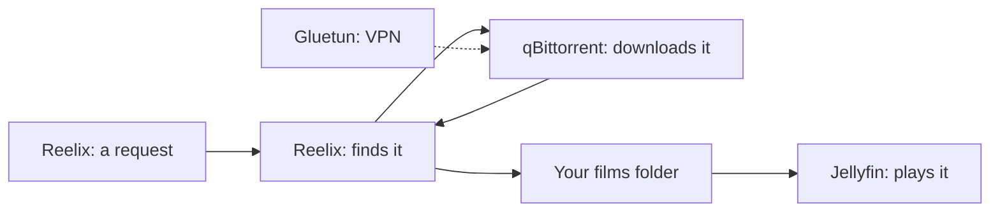

[Help centre](../README.md) · The basics

# The apps Starboard works with

A home media server is a team of small apps, each with one job. Some find what you want, some download it, and
some play it. Starboard installs them, sets them up and shows them all in one place.

## The finder: Reelix

Reelix keeps a list of the films, series, books, audiobooks, music and radio you want. It searches sites for them,
sends the best copy to a download app, then renames the file and moves it into your library. The people you share
with can ask for things in it too. Read [What Reelix is](what-is-reelix.md).

Reelix does the work of older apps: Sonarr, Radarr, Lidarr, Readarr, Prowlarr and Seerr. Starboard still works with
them if you run them. Read [Move from Radarr, Sonarr and the others to Reelix](../topics/move-your-apps-to-reelix.md).

## The downloaders: qBittorrent and NZBGet

- **qBittorrent** downloads torrents.
- **NZBGet** downloads from Usenet, a paid service that works differently from torrents. **SABnzbd** does the same
  job, if you prefer it.

Starboard shows what they are downloading, and can make them download only at certain hours.

## The protector: Gluetun

Gluetun sends the download apps' traffic through your VPN (virtual private network), so your downloads are private.
Starboard shows whether the VPN is connected.

## The players: Jellyfin and Audiobookshelf

- **Jellyfin** plays your films, series and music on your television, phone, tablet or computer, and remembers
  where you stopped. Starboard works most closely with it, and offers extras such as free Live TV.
- **Audiobookshelf** plays audiobooks and podcasts, and remembers where each person is in each book.

Starboard can also find **Plex** and **Emby**, and copy watch history or listening progress from them.

## The helpers

- **Bazarr** finds subtitles.
- **Jellystat** shows who watched what, and when.
- **Tdarr** converts the library to smaller files.
- **Dozzle** shows every app's log in the browser.
- **FlareSolverr** gets past browser checks on some search sites.

Some installs have more. Read [Basics, Full install and Everything](../topics/install-types.md#the-apps-in-each).

## How they fit together

Here is the journey of one film, from a request to your television:

1. Someone asks for "Harbour Street" in Reelix.
2. Reelix searches the sites you chose and picks the best copy.
3. Reelix sends the download to qBittorrent, which runs through Gluetun's VPN.
4. When the download finishes, Reelix moves the film into your films folder.
5. Jellyfin sees the new film and shows it on your television.

The diagram shows the same journey: Reelix takes the request and finds the film, qBittorrent downloads it behind
Gluetun, Reelix puts it in your films folder, and Jellyfin plays it from there.

## What this means for Starboard

When you add an app by hand, Starboard asks which kind it is. These are the kinds it knows:

- Sonarr, Radarr, Lidarr and Readarr
- Prowlarr
- Bazarr
- Jellyfin
- qBittorrent, NZBGet and SABnzbd
- Gluetun (VPN)
- Soulseek (slskd)
- Seerr, Jellyseerr or Overseerr
- Audiobookshelf
- Other app, for anything else, such as Plex or Emby, which Starboard shows as a link to its page

You do not need all of them. If you have none yet, Starboard can install a set for you: read
[Install apps with Starboard](../topics/install-apps.md).

## Find out more

- [Add an app](../topics/add-an-app.md)
- [Search for apps already on your server](../topics/search-for-new-apps.md)
- [Build a media server from nothing](../guides/build-a-media-server-from-nothing.md)
- [What an API key is](what-is-an-api-key.md)

<!-- footer: download rights -->

---

**Download only what you have the right to.** Use the download apps only for files you have the right to download,
such as open-source software, works in the public domain and your own backups. Downloading films, series, music or
books without the copyright holder's permission is against the law in the UK and most other countries. Starboard
does not host or provide any files, and you are responsible for what you download.

<!-- /footer -->
