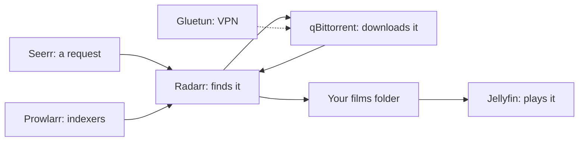

[Help centre](../README.md) · The basics

# The apps Starboard works with

A home media server is usually a team of small apps, each with one job. Some find what you want, some download it,
and some play it. It works like a restaurant: the waiter takes your order, the kitchen buys and cooks, and the
dining room serves. Starboard is the manager who can see the whole restaurant at once.

## The finders: Sonarr, Radarr, Lidarr and Readarr

These apps keep a list of what you want and look out for it. When a new episode or a film you asked for becomes
available, they find it, send it to be downloaded, then rename it and put it in the right folder. People call them
the "arr" apps, because of their names.

- **Sonarr** looks after TV series.
- **Radarr** looks after films.
- **Lidarr** looks after music, by artist.
- **Readarr** looks after books, by author.

Starboard's **Search** looks in all four at once, and adds what you choose to the right one.

## The searcher: Prowlarr

Prowlarr keeps the list of places the finders search, called indexers, in one place. Without it, you would set up
every indexer in Sonarr, Radarr and the others separately. Prowlarr sets them up once and shares them.

## The downloaders: qBittorrent and SABnzbd

The finders do not download anything themselves. They hand the job to a download client:

- **qBittorrent** downloads torrents.
- **SABnzbd** downloads from Usenet, a paid service that works differently from torrents.

You need one or both, depending on where your downloads come from. Starboard shows what they are downloading, and can
make them download only at certain hours.

## The protector: Gluetun

Gluetun is a VPN (virtual private network) client. It sends your download client's traffic through a VPN service, so
your downloads are private. Starboard shows whether the VPN is connected.

## The players: Jellyfin, Plex and Emby

These apps play your films, series and music on your television, phone, tablet or computer, with posters, and they
remember where you stopped. You need only one.

- **Jellyfin** is free and open source. Starboard works most closely with it: it shows what is playing, what was
  added and whether Jellyfin needs a restart, and it offers extras such as free Live TV.
- **Plex** and **Emby** do the same job. Starboard can find them on your server and add them to the **Apps** page,
  and it can copy watch history or listening progress from them when you move to Jellyfin or Audiobookshelf.

## The library for listening: Audiobookshelf

Audiobookshelf plays audiobooks and podcasts, and remembers where each person is in each book. Starboard can copy
listening progress into it from other players.

## Requests: Seerr, Jellyseerr and Overseerr

A request app lets the people in your home ask for a film or series from their phone. You approve or decline each
request, and the approved ones go to Sonarr or Radarr. Seerr, Jellyseerr and Overseerr are versions of the same app:
use whichever you have. Starboard lists requests and lets you approve or decline them.

## Subtitles: Bazarr

Bazarr finds subtitles for the films and series Sonarr and Radarr bring in.

## How they fit together

Here is the journey of one film, from a request to your television:

1. Someone asks for "Harbour Street" in Seerr, and you approve it.
2. Seerr passes the request to Radarr.
3. Radarr asks Prowlarr's indexers where to find it.
4. Radarr sends the download to qBittorrent, which can run through Gluetun's VPN.
5. When the download finishes, Radarr moves the film into your films folder.
6. Jellyfin sees the new film and shows it on your television.

The diagram shows the same journey: a request goes from Seerr to Radarr, Radarr uses Prowlarr's indexers, sends the
download to qBittorrent behind Gluetun, puts the finished film in your films folder, and Jellyfin plays it from there.

## What this means for Starboard

When you add an app, Starboard asks which kind it is. These are the kinds it knows:

- Sonarr, Radarr, Lidarr and Readarr
- Prowlarr
- Bazarr
- Jellyfin
- qBittorrent and SABnzbd
- Gluetun (VPN)
- Seerr, Jellyseerr or Overseerr
- Audiobookshelf
- Other app, for anything else, such as Plex or Emby, which Starboard shows as a link to its page

You do not need all of them. Starboard works with whichever you have. If you have none yet, Starboard can install a
set for you.

## Find out more

- [Add an app](../topics/add-an-app.md)
- [Search for apps already on your server](../topics/search-for-new-apps.md)
- [Install apps with Starboard](../topics/install-apps.md)
- [Build a media server from nothing](../guides/build-a-media-server-from-nothing.md)
- [What an API key is](what-is-an-api-key.md)

<!-- footer: download rights -->

---

**Download only what you have the right to.** Use the download apps only for files you have the right to download,
such as open-source software, works in the public domain and your own backups. Downloading films, series, music or
books without the copyright holder's permission is against the law in the UK and most other countries. Starboard
does not host or provide any files, and you are responsible for what you download.

<!-- /footer -->
