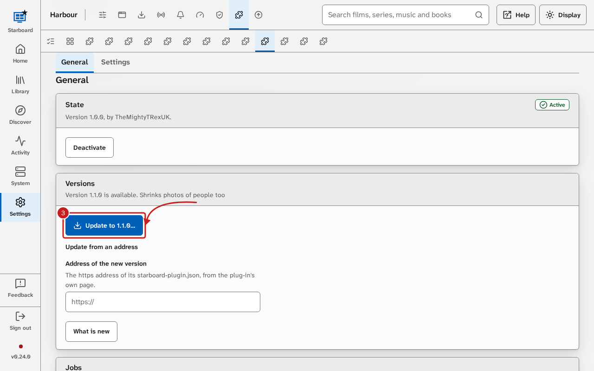
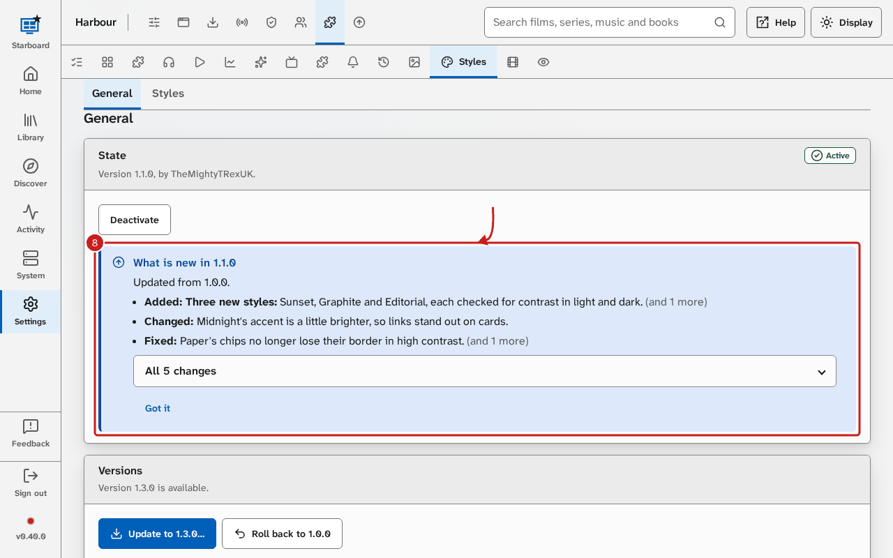
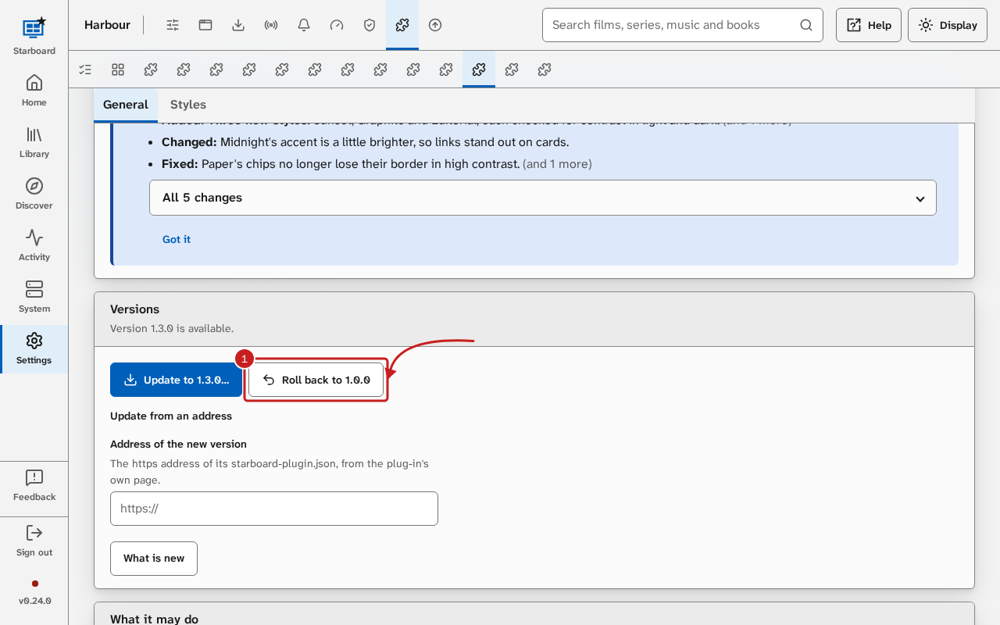

[Help centre](../README.md) · Developers
<!-- help: dev / plugins -->

# Our promise to plug-in developers

A plug-in you write for Starboard 1 keeps working while Starboard stays on version 1. This page says exactly what we
promise, how a feature is retired, how your plug-in says what it needs, and what people are shown if it stops. It applies to the
plug-in API and to the public API at `/api/v1`.

## What never breaks inside version 1

- **Routes.** An address that answers today keeps its address, method, scope and the fields it answers, with the same meaning.
- **Manifests.** A manifest Starboard accepts today is accepted later. We never remove, rename or require a field, card
  type, setting type, event or container option.
- **Permissions and scopes.** A permission keeps its meaning. A key scope keeps what it opens.
- **What your plug-in reads.** The files in `/run/starboard` and the `STARBOARD_` names keep their names and shape.
- **What Starboard sends your plug-in.** The health check, events, card paths and update steps keep their form.
- **Cards.** A card answer that draws today still draws.
- **Errors.** An error code keeps its meaning. A new code may appear, so treat one you do not know as a general failure.
- **Limits.** A limit only gets looser. The one exception is a security fix (read Security fixes).

## What we may add

New routes, answer fields, optional inputs, permissions, scopes, events, card types, setting types, manifest fields and
error codes. Your plug-in must ignore anything it does not know. A list of choices in an answer may get new values.

## What we do not promise

The appearance of Starboard's pages, the words on them, the order of fields in an answer, the exact text of an error, timing, and
anything the reference pages do not describe. A feature marked as a preview may change in a minor release.

## How a feature goes

1. **We announce it.** The [API changelog](api-changelog.md) gets a Deprecated entry that names what replaces the feature.
   The plug-in tester warns when your manifest uses it, with the day it stops.
2. **It keeps working, and warns.** The public API adds a `Deprecation` header and a `Sunset` date to each answer, and
   `GET /api/v1/` lists the feature under `deprecations`. A plug-in that uses a retiring feature shows a warning on its page, with the day it stops. Starboard also counts, on this computer only, which key still calls a retiring route, so the owner removes a feature only when nobody uses it.
3. **We wait.** At least 12 months and two Starboard releases for the plug-in API. At least 6 months for the public API. We
   may wait longer. We never wait less.
4. **We remove it only in version 2.0.** A removed address answers `410 gone` and names what replaces it. We do not plan a
   version 2.0 until it is needed.

A security fix is the one exception, and it has its own rules in Security fixes.

## How your plug-in says what it needs

- **`starboard_api` is required.** It is a range such as `>=1.14 <2.0`. Name the lowest version that has what you use. The
  top, `<2.0`, means "made for version 1".
- **Version 2.0 stops only what it must.** A plug-in that uses nothing removed keeps running. One that does is stopped.
- **Optional parts are asked for by name, not by version number.** `requires` already names the system a plug-in needs
  (Jellyfin, Plex or Emby, Reelix). Named capabilities for other optional parts are in plug-in API 1.22 (`capabilities`).
- **Read your key file for each call.** Starboard makes a new key each time your plug-in starts or updates.

## What people are shown if your plug-in stops

If this Starboard cannot run a plug-in, Starboard stops it when it starts. People are shown **Needs an update**, with a
warning shape and a reason in words, such as "It uses the permission jellyfin:key, which this Starboard does not have."

The plug-in stays installed. Starboard keeps its settings, data and key, and never starts it again by itself. **Check for
an update** finds the newest version that works with this Starboard, and **Activate** works again once one fits.

**Roll back** goes to the version before, with one select.

## Security fixes

A fix for a flaw may break an older plug-in at once, in a patch release, when keeping the old behaviour leaves a hole open.
We then say so the same day in the changelog under Security, in Starboard, and in the plug-in tester, name the fixed
version, and give the reason. A plug-in the fix stops is shown as **Needs an update** like any other.

## Check your plug-in

Run the plug-in tester on your manifest ([Test and publish a plug-in](test-and-publish-a-plugin.md)). Starboard's own tests
also run 74 older manifests from the plug-in collection against each new Starboard, and fail a change that removes
anything from the API without these steps.

## Find out more

- [API changelog](api-changelog.md): every change, with its type.
- [Plug-in manifest reference](plugin-manifest-reference.md): `starboard_api` and every field.
- [Write a plug-in that updates safely](update-a-plugin-safely.md): settings that move with a version.

<!-- footer: download rights -->

---

**Download only what you have the right to.** Use the download apps only for files you have the right to download.
Examples are open-source software, works in the public domain and your own backups. Downloading films, series, music or
books without the copyright holder's permission is against the law in the UK and most other countries. Starboard
does not host or provide any files, and you are responsible for what you download.

**Need help?** Ask on the [Starboard Discord support server](https://discord.gg/xN9bf2H4vv).

<!-- /footer -->
