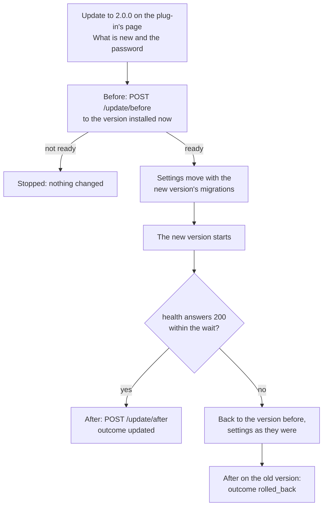

[Help centre](../README.md) · Developers
<!-- help: dev / plugins -->

# Write a plug-in that updates safely

People update plug-ins from the plug-in's page, or with Starboard's API. This guide makes a plug-in's update safe:
it finishes its work before the update, moves its own settings to the new version, proves the new version works, and
goes back by itself if it does not. Everything here is in plug-in API 1.14 and is optional. It takes about 30
minutes, with a plug-in you have already made.

Read [Make your first plug-in](make-a-plugin.md) first if you have not made one. Every field is in
[Updates](plugin-manifest-reference.md#updates) in the manifest reference.

## Before you begin

- A plug-in with a container and a `health` path, and its source.
- Its next version, with a new number in `version`, such as `2.0.0`.
- A Starboard whose plug-in API is 1.14 or later, for testing. **About** in **Settings**, **Updates** shows its version.
- `starboard_api` set to `">=1.14 <2.0"` in the new version, as these fields need it.

## What happens when someone updates



## 1. Say what changed

Add the new version to `changes`, newest first, before you publish it. People read it before they update, under
**What is new since**, and after, on the plug-in's **State**. Say when a setting moves or goes.

```json
"changes": [
  {"version": "2.0.0", "date": "2026-11-20",
   "changed": ["**Check every** is now in minutes, and 30 unless you chose a time"],
   "removed": ["Old mode: the new way is always used"]},
  {"version": "1.0.0", "date": "2026-11-10", "added": ["The first version"]}
]
```

## 2. Move the settings

Starboard keeps each person's settings by key. When a key changes, write a migration step in the new version, so
nobody loses what they chose. Name the version that made the change.

```json
"update": {
  "migrations": [
    {"version": "2.0.0", "rename": {"minutes": "every_minutes"}, "remove": ["old_mode"],
     "defaults": {"every_minutes": 30}}
  ]
}
```

- `rename` moves the value to the new key. The new key must be in `settings`.
- `remove` drops a key the new version no longer has.
- `defaults` changes a default for people who never chose their own value: someone still on 1.0.0's default of 15
  gets 30; someone who chose 5 keeps 5.
- Keep every older step when you make the next version. Someone updating from 1.0.0 to 3.0.0 gets each step between,
  oldest first.

Starboard keeps the settings from before with the version before, so **Roll back** puts them back exactly.

## 3. Get ready, then tidy up

If the plug-in does work in the background, such as a job that converts files, give it a step before the update. The
step finishes the work or pauses it, then answers.

```json
"update": {
  "before": {"path": "/update/before", "time_limit_seconds": 60},
  "after": {"path": "/update/after", "time_limit_seconds": 30}
}
```

In the program, answer both as `POST`:

```python
def do_POST(self):
    if self.path == "/update/before":
        if JOB.running and not JOB.pause(timeout=50):
            return self.answer(200, {"ok": False, "said": "A film is half converted. Try again in a few minutes"})
        return self.answer(200, {"ok": True, "said": "Paused, ready to update"})
    if self.path == "/update/after":
        body = json.loads(self.rfile.read(int(self.headers.get("Content-Length") or 0)) or b"{}")
        JOB.resume()  # after an update, or after Starboard went back to this version
        return self.answer(200, {"ok": True, "said": f"Started again after {body.get('outcome')}"})
```

- `before` runs on the version installed now, so a step you add in 2.0.0 runs from the update after 2.0.0.
- Answer `{"ok": false}` with a short reason when it is not safe to update. Nothing is changed, and people are shown the
  reason.
- `after` hears `outcome`: `updated` on the new version, or `rolled_back` on the old one when the update did not
  work. Start the work again either way.
- Keep both steps safe to run twice.

## 4. Prove the new version works

Make `health` answer 200 only when the plug-in can really do its work: its settings read, its folder writable, its
database open. Give it time to start:

```json
"health": "/health",
"update": {"health_wait_seconds": 90}
```

Starboard asks every 3 seconds, for up to 90 seconds here (60 when left out). If the new version does not start or
does not answer 200 in time, Starboard goes back to the version before by itself, with its settings as they were, and
says why on the plug-in's **State** and in an alert.

## 5. Test the update before you publish

1. Run the plug-in tester on the new manifest. It checks the `update` object and warns when `changes` has nothing for
   this version:

   ```bash
   python3 -m starboard.plugin_tester --dev path/to/starboard-plugin.json
   ```

2. In a test Starboard, add the version before, choose some settings, then use **Update from an address** on the
   plug-in's page with the new version's address. Check each step in the dialog, the settings after, and
   **What is new**.
3. Choose **Roll back** and check the settings are as they were.
4. Make the health path fail on purpose, update again, and check that Starboard goes back by itself.

Starboard's own checks do the same with an example plug-in: `python3 tools/update_smoke.py` in Starboard's folder.

## Things to note

- A plug-in that is not active is updated without its steps or the health wait.
- Starboard's API can start the update too, with a key that has the `updates` scope. The steps are the same.
- A plug-in without `update` still gets the health wait when it has a `health` path.
- Only the version before is kept. Updating twice replaces the kept version with the newer one.

## Find out more

- [Plug-in manifest reference: Updates](plugin-manifest-reference.md#updates)
- [Plug-in API reference: Updates and Roll back](plugin-api-reference.md#updates-and-roll-back)
- [Test and publish a plug-in](test-and-publish-a-plugin.md)
- [Update a plug-in and roll it back](../topics/update-a-plugin.md)
- [API changelog](api-changelog.md)

<!-- footer: download rights -->

---

**Download only what you have the right to.** Use the download apps only for files you have the right to download.
Examples are open-source software, works in the public domain and your own backups. Downloading films, series, music or
books without the copyright holder's permission is against the law in the UK and most other countries. Starboard
does not host or provide any files, and you are responsible for what you download.

**Need help?** Ask on the [Starboard Discord support server](https://discord.gg/xN9bf2H4vv).

<!-- /footer -->
