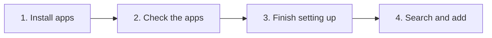

[Help centre](../README.md) · Guides

# Build a media server from nothing

This guide takes you from a server with only Starboard on it to a working media server. Reelix finds what you want,
a download app fetches it, and Jellyfin and Audiobookshelf play it. It is for people who have never set these apps
up.

Starboard's **Install apps** does most of the work: it picks the apps, writes the set-up file, starts the apps and
sets them up. You finish the few things it cannot do for you.

## Before you begin

- Starboard is installed with Docker access. If you said no to Docker access, read
  [Change what Starboard can access](../topics/change-what-starboard-can-access.md).
- A disk with enough room for your media. Films and series take a lot of space: plan for 1 TB or more.
- Optional: an account with a VPN provider, and a free TMDB key from themoviedb.org.
- To know what each app does, read [The apps Starboard works with](../basics/the-apps.md).

## The steps at a glance

1. Choose and start your apps with Install apps.
2. Check that your apps are running.
3. Finish what is still to set up.
4. Search for something and add it.

## Step 1: Choose and start your apps

Choose an install, such as **Basics**, and answer the questions about folders, your VPN, Usenet, sites to search
and your TMDB key. Follow [Install apps with Starboard](../topics/install-apps.md). To compare the installs, read
[Basics, Full install and Everything](../topics/install-types.md).

**It worked when** Install apps shows **The apps are running**.

## Step 2: Check that your apps are running

Starboard adds each new app to Starboard as it answers, and sets up Reelix, Jellyfin, Audiobookshelf, qBittorrent
and the others for you. Go to **System**, then **Apps**, then **Apps**.

**It worked when** each new app is on the **Apps** page and responding. If one is missing after 30 minutes, read
[Search for apps already on your server](../topics/search-for-new-apps.md).

## Step 3: Finish what is still to set up

Anything Starboard could not do by itself, such as a guided step for Tdarr, is listed under 'Still to set up' on
your dashboard. Follow [Finish what is still to set up](../topics/finish-setting-up.md). To download from Usenet,
also read [Choose a Usenet provider and add it](../topics/choose-a-usenet-provider.md).

**It worked when** 'Still to set up' has nothing left in it.

## Step 4: Search for something and add it

Follow [Search for and add films, series, music and books](../topics/search-and-add.md). Then watch it arrive
in **Activity**, **Downloads**.

## What next

- [Set up your dashboard after installing](set-up-your-dashboard.md) for categories, design and alerts.
- [Download only at certain hours](../topics/set-download-hours.md).
- [Update your apps](../topics/update-your-apps.md).

<!-- footer: download rights -->

---

**Download only what you have the right to.** Use the download apps only for files you have the right to download,
such as open-source software, works in the public domain and your own backups. Downloading films, series, music or
books without the copyright holder's permission is against the law in the UK and most other countries. Starboard
does not host or provide any files, and you are responsible for what you download.

<!-- /footer -->
