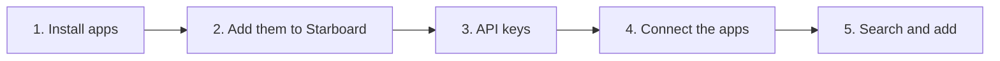

[Help centre](../README.md) · Guides

# Build a media server from nothing

This guide takes you from a server with only Starboard on it to a working set of media apps: a player such as
Jellyfin, the apps that find and organise films, series, music and books, and a download app. It is for
people who have never set these apps up. It takes an afternoon, most of it connecting the apps to each other.

Starboard's **Install apps** page does the hard parts: it explains each app, picks sensible folders, writes
the set-up file and starts the apps. Then it tells you how to connect them, with the exact addresses.

## Before you begin

- Starboard is installed with Docker access. If you said No to Docker access, see
  [Change what Starboard can access](../topics/change-what-starboard-can-access.md).
- A disk with enough room for your media. Films and series take a lot of space: plan for 1 TB or more.
- Read [The apps Starboard works with](../basics/the-apps.md) to know what each app does.

## The steps at a glance

1. Choose and start your apps with Install apps.
2. Add the new apps to Starboard.
3. Give each app its API key.
4. Connect the apps to each other, following Install apps.
5. Search for something and add it.

## Step 1: Choose and start your apps

Choose what you want, such as Movies, TV and Watching, and Install apps chooses the apps and folders. Follow
[Install apps with Starboard](../topics/install-apps.md).

**It worked when** Install apps says each app has started.

## Step 2: Add the new apps to Starboard

Follow [Search for apps already on your server](../topics/search-for-new-apps.md). Starboard finds the apps you
just started.

## Step 3: Give each app its API key

Each new app makes its own key the first time it starts. Follow
[Find an app's API key](../topics/find-an-api-key.md) and add each key with
[Change or remove an app](../topics/change-or-remove-an-app.md).

## Step 4: Connect the apps to each other

The apps need to know about each other: Sonarr and Radarr need your download app and your indexer manager,
and your player needs your media folders. Install apps lists each connection with the addresses and folders to
type in. Work through that list in [Install apps with Starboard](../topics/install-apps.md).

**It worked when** each app's own settings page shows its connections as working, usually with a green
tick.

## Step 5: Search for something and add it

Follow [Search for and add films, series, music and books](../topics/search-and-add.md). Then watch it arrive
on the **Downloads** page.

## What next

- [Set up your dashboard after installing](set-up-your-dashboard.md) for categories, design and alerts.
- [Download only at certain hours](../topics/set-download-hours.md).
- [Update your apps](../topics/update-your-apps.md).

<!-- footer: download rights -->

---

**Download only what you have the right to.** Use the download apps only for files you have the right to download,
such as open-source software, works in the public domain and your own backups. Downloading films, series, music or
books without the copyright holder's permission is against the law in the UK and most other countries. Starboard
does not host or provide any files, and you are responsible for what you download.

<!-- /footer -->
