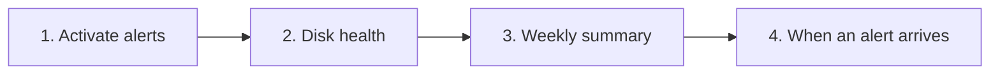

[Help centre](../README.md) · Guides

# Get told when something goes wrong

This guide sets Starboard up to message your phone when an app stops answering, a disk has a problem or is
nearly full, a download is stuck or a backup fails. It is for anyone who wants to stop checking the dashboard
by hand. It takes about 20 minutes.

## Before you begin

- Your apps are in Starboard: [Set up your dashboard after installing](set-up-your-dashboard.md).
- A way to receive alerts on your phone. ntfy is the simplest: a free app, with nothing to set up on the
  server.

## The steps at a glance

1. Activate alerts and send a test message.
2. Activate disk health checks.
3. Get a weekly summary.
4. Know where to look when an alert arrives.

## Step 1: Activate alerts and send a test message

Choose where alerts go and which ones you want, then send a test. Follow
[Activate alerts](../topics/activate-alerts.md).

**It worked when** the test message arrives on your phone.

## Step 2: Activate disk health checks

Disk health reads each drive's own warnings, often weeks before a drive fails. It needs one installer
question answered Yes. Follow [Check your disks' health](../topics/check-disk-health.md).

## Step 3: Get a weekly summary

A short message once a week says how everything has been, even when nothing went wrong. Follow
[Get a weekly summary](../topics/weekly-summary.md).

## Step 4: Know where to look when an alert arrives

- An app stopped answering: [An app shows as not responding](../topics/app-not-responding.md).
- A disk has a problem or is getting full: [Check your disks' health](../topics/check-disk-health.md) and
  [Check free space and what is using it](../topics/check-storage.md).
- Something else: [Read the log and report a problem](../topics/read-the-log.md).

## What next

- [Back up the whole server](../topics/back-up-the-server.md), so a failed backup can alert you too.

<!-- footer: download rights -->

---

**Download only what you have the right to.** Use the download apps only for files you have the right to download,
such as open-source software, works in the public domain and your own backups. Downloading films, series, music or
books without the copyright holder's permission is against the law in the UK and most other countries. Starboard
does not host or provide any files, and you are responsible for what you download.

<!-- /footer -->
