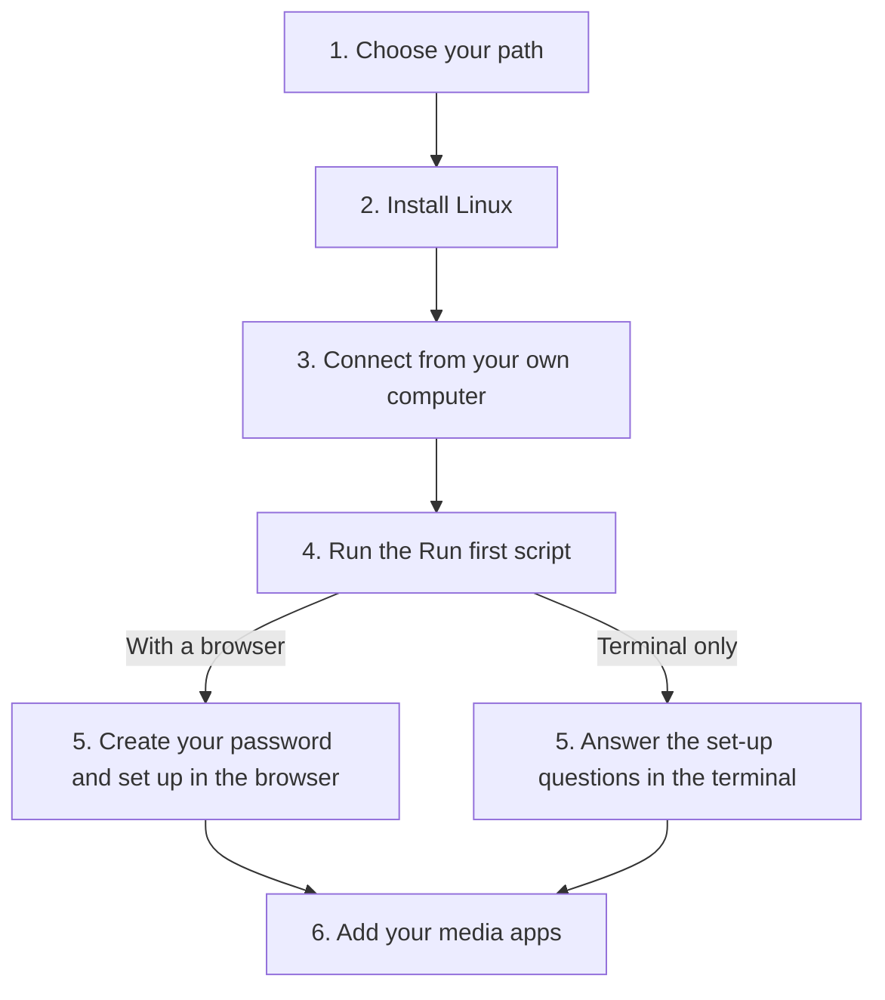

[Help centre](../README.md) · Guides

# Get Starboard up and running, from a bare computer

This guide takes you from a computer with nothing on it to a working media server. You install Linux, then run
one script, the Run first script, which sets up everything else. It is for anyone, including people who have never
used a terminal. It takes an afternoon, most of it waiting for downloads.

After the Run first script the guide splits into two paths. Both end in the same place:

- **With a browser:** you finish set-up in Starboard's set-up guide, on the server or on a phone or laptop.
- **Terminal only:** you answer the same questions in the terminal. For a server with no desktop and nothing else
  to finish on.

## Before you begin

- A computer to use as the server, big enough for what you want. Check
  [What you need to run Starboard](../topics/what-you-need.md).
- A USB stick of 8 GB or more, and another computer to prepare it. For a Raspberry Pi, a microSD card instead.
- A disk for your media: plan for 1 TB or more for films and series.
- If the terminal is new to you, read [The terminal: typing commands](../basics/the-terminal.md) first.
- Want a helper beside you? [Ask an AI assistant to help you set up](../topics/ask-an-ai-for-help.md) has a prompt
  to copy into one.

## The steps at a glance

1. Choose your path.
2. Install Linux.
3. Connect from your own computer (only for a server with no desktop).
4. Run the Run first script. It installs Docker and starts Starboard's installer.
5. With a browser: create your password and set up in the browser. Terminal only: answer the set-up questions in
   the terminal.
6. Add your media apps.

The flowchart shows the same steps as the list above: steps 1 to 4 are the same for everyone, step 5 is either
the browser or the terminal, and both lead to step 6.

## Step 1: Choose your path

Choose **with a browser** if the server has a desktop, or if you have a phone or laptop on the same network.
Choose **terminal only** if the server has no desktop and you have nothing else to finish on. Your choice decides
which Linux to install in Step 2. The Run first script suggests the right path for the computer, and you can still
open Starboard in a browser later.

## Step 2: Install Linux

Install Linux Mint 22.3 (recommended) to set up in a browser on the server itself, or Debian 13 or Ubuntu Server
26.04 with no desktop for a lighter server. Follow [Install Linux on a computer](../topics/install-linux.md). For a Raspberry Pi,
follow [Prepare a Raspberry Pi](../topics/prepare-a-raspberry-pi.md) instead. Then check the server is online, and
connect it by cable or Wi-Fi if it is not: follow [Connect to the internet, by cable or Wi-Fi](../topics/connect-to-the-internet.md).

**It worked when** the computer starts Linux by itself, you can sign in, and `ping -c 3 debian.org` shows replies.

## Step 3: Connect from your own computer

A server with no desktop is easier to use from your own computer, where you can copy and paste commands. Follow
[Connect to your server from another computer](../topics/connect-with-ssh.md). If the server has a desktop, skip
this step and open its terminal.

**It worked when** your terminal shows the server's name at the start of the line.

## Step 4: Run the Run first script

One command checks the computer, installs Docker and anything else that is missing, downloads Starboard and starts
its installer. It asks before it changes anything, and offers an accessible mode for software that reads text
aloud. Follow [Set up everything with the Run first script](../topics/run-first.md).

**It worked when** the installer prints "Starboard is running".

## Step 5, with a browser: create your password and set up

On a computer with a desktop, the set-up page opens by itself with the setup code filled in. With no desktop, open
the address the installer printed on a phone or another computer, and enter the setup code. Choose your password:
follow [Create your password and sign in](../topics/create-your-password.md). Starboard's set-up guide then asks what
you want to watch, listen to and read.

**It worked when** Starboard opens its dashboard.

## Step 5, terminal only: answer the set-up questions

The installer asks every question in the terminal: your password, your apps and your download hours. Press Enter
for the recommended answer, **b** to go back and **?** for help. Follow
[Set up Starboard in the terminal, with no browser](../topics/set-up-in-the-terminal.md).

**It worked when** the installer prints the addresses to open Starboard from any device later.

## Step 6: Add your media apps

Choose what you want, such as films, series and audiobooks, and Starboard installs the apps and tells you how
to connect them. If you chose your apps in Step 5, they are already running: go on to connecting them. Follow
[Build a media server from nothing](build-a-media-server-from-nothing.md).

**It worked when** you search for something, add it and see it arrive on the **Downloads** page.

## What next

- [Set up your dashboard after installing](set-up-your-dashboard.md): categories, design and alerts.
- [Use Starboard away from home safely](use-starboard-away-from-home.md).
- Keep it current with [Update Starboard](../topics/update-starboard.md).
- Something not right? [Send feedback about a page](../topics/send-feedback.md).

<!-- footer: download rights -->

---

**Download only what you have the right to.** Use the download apps only for files you have the right to download,
such as open-source software, works in the public domain and your own backups. Downloading films, series, music or
books without the copyright holder's permission is against the law in the UK and most other countries. Starboard
does not host or provide any files, and you are responsible for what you download.

<!-- /footer -->
