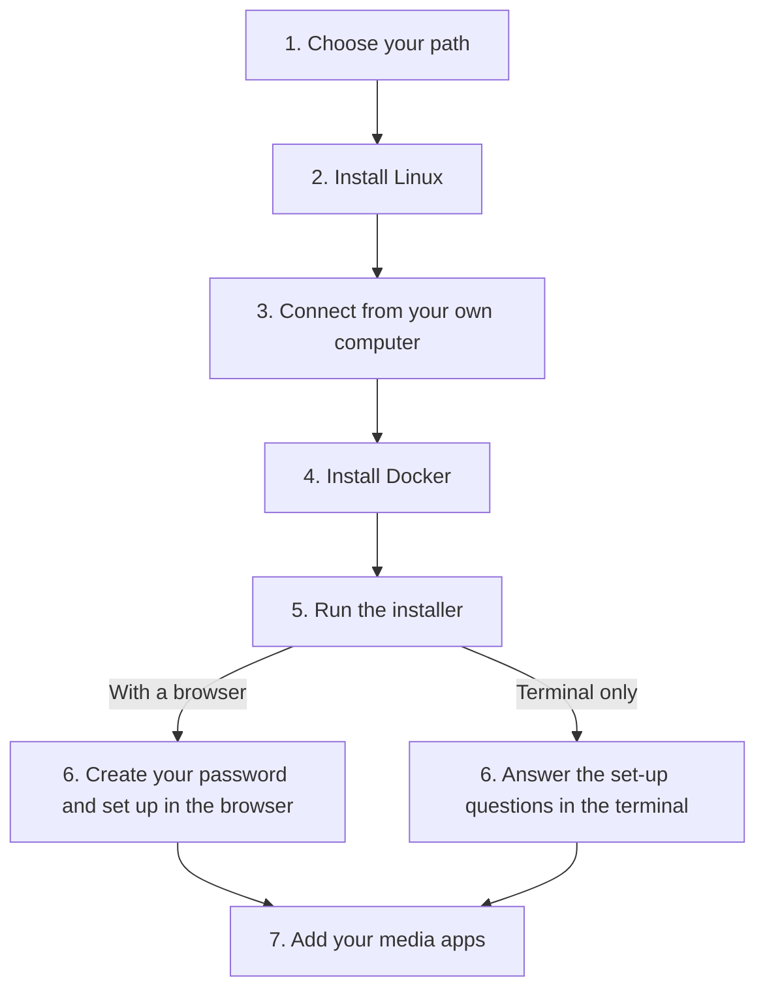

[Help centre](../README.md) · Guides

# Get Starboard up and running, from a bare computer

This guide takes you from a computer with nothing on it to a working media server: Linux, then Docker, then
Starboard and your apps. It is for anyone, including people who have never used a terminal. It takes an
afternoon, most of it waiting for downloads.

After Docker the guide splits into two paths. Both end in the same place:

- **With a browser:** you finish set-up in Starboard's set-up guide, on the server or on a phone or laptop.
- **Terminal only:** you answer the same questions in the terminal. For a server with no desktop and nothing else
  to finish on.

## Before you begin

- A computer to use as the server, big enough for what you want. Check
  [What you need to run Starboard](../topics/what-you-need.md).
- A USB stick of 8 GB or more, and another computer to prepare it. For a Raspberry Pi, a microSD card instead.
- A disk for your media: plan for 1 TB or more for films and series.
- If the terminal is new to you, read [The terminal: typing commands](../basics/the-terminal.md) first.
- Want a helper beside you? [Ask an AI assistant to help you set up](../topics/ask-an-ai-for-help.md) has a prompt
  to copy into one.

## The steps at a glance

1. Choose your path.
2. Install Linux.
3. Connect from your own computer (terminal only, or a server with no desktop).
4. Install Docker.
5. Run the installer.
6. With a browser: create your password, then set up in the browser. Terminal only: answer the set-up
   questions in the terminal.
7. Add your media apps.

The flowchart shows the same steps as the list above: steps 1 to 5 are the same for everyone, step 6 is either
the browser or the terminal, and both lead to step 7.

## Step 1: Choose your path

Choose **with a browser** if the server has a desktop, or if you have a phone or laptop on the same network.
Choose **terminal only** if the server has no desktop and you have nothing else to finish on. Your choice decides
which Linux to install in Step 2, and you can still open Starboard in a browser later.

## Step 2: Install Linux

Install Debian 13 without a desktop for the lightest server, or Linux Mint or Ubuntu Desktop to set up in a
browser on the server itself. Follow [Install Linux on a computer](../topics/install-linux.md). For a Raspberry Pi,
follow [Prepare a Raspberry Pi](../topics/prepare-a-raspberry-pi.md) instead.

**It worked when** the computer starts Linux by itself and you can sign in.

## Step 3: Connect from your own computer

A server with no desktop is easier to use from your own computer, where you can copy and paste commands. Follow
[Connect to your server from another computer](../topics/connect-with-ssh.md). If you set up on a desktop on the
server itself, skip this step and open its terminal.

**It worked when** your terminal shows the server's name at the start of the line.

## Step 4: Install Docker

Docker runs Starboard and each app in its own sealed box, so they cannot change the rest of the computer. Follow
[Install Docker](../topics/install-docker.md), including signing out and back in at the end.

**It worked when** `docker compose version` prints a version number instead of an error.

## Step 5: Run the installer

The installer downloads Starboard, asks what it may access, and starts it. Answer yes to Docker access, so Starboard
can start your apps for you. Follow [Install Starboard with the installer](../topics/install-with-the-installer.md)
up to the step that starts the installer. On the terminal-only path, start it as
[Set up Starboard in the terminal, with no browser](../topics/set-up-in-the-terminal.md) says.

**It worked when** the installer prints the addresses and a setup code or, on the terminal-only path, the first
set-up question follows.

## Step 6, with a browser: create your password and set up

Open the first address the installer printed, enter the setup code and choose your password: follow
[Create your password and sign in](../topics/create-your-password.md). If you lost the code, follow
[Find the setup code](../topics/find-the-setup-code.md). Starboard's set-up guide then asks what you want to
watch, listen to and read. To finish on your phone, follow
[Open Starboard from a phone or another computer](../topics/open-from-another-device.md).

**It worked when** Starboard opens its dashboard.

## Step 6, terminal only: answer the set-up questions

The installer asks every question in the terminal: your password, your apps and your download hours. Press Enter
for the recommended answer, **b** to go back and **?** for help. Follow
[Set up Starboard in the terminal, with no browser](../topics/set-up-in-the-terminal.md).

**It worked when** the installer prints the addresses to open Starboard from any device later.

## Step 7: Add your media apps

Choose what you want, such as films, series and audiobooks, and Starboard installs the apps and tells you how
to connect them. If you chose your apps in Step 6, they are already running: go on to connecting them. Follow
[Build a media server from nothing](build-a-media-server-from-nothing.md).

**It worked when** you search for something, add it and see it arrive on the **Downloads** page.

## What next

- [Set up your dashboard after installing](set-up-your-dashboard.md): categories, design and alerts.
- [Use Starboard away from home safely](use-starboard-away-from-home.md).
- Keep it current with [Update Starboard](../topics/update-starboard.md).
- Something not right? [Send feedback about a page](../topics/send-feedback.md).
