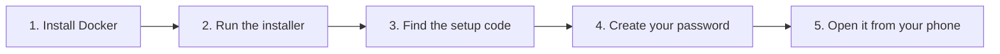

[Help centre](../README.md) · Guides

# Install Starboard on a Linux computer

This guide takes you from a Linux computer with nothing on it to Starboard open in your browser, with your
own password. It is for anyone, including people who have never used a terminal. It takes about 30 minutes,
most of it waiting for downloads.

It works on Ubuntu, Linux Mint, Debian and Fedora. Starboard's installer has been tested on clean copies of
Ubuntu 24.04, Debian 12 and Fedora 42.

## Before you begin

- A computer running Linux that can stay powered on. Check it is big enough in
  [What you need to run Starboard](../topics/what-you-need.md).
- The computer is connected to your home network, by cable or Wi-Fi.
- You know the password you use to sign in to that computer. The terminal asks for it.
- If the terminal is new to you, read [The terminal: typing commands](../basics/the-terminal.md) first. It
  takes five minutes and makes every step below easier.

## The steps at a glance

1. Install Docker, which runs Starboard.
2. Install Starboard with the installer.
3. Find the setup code.
4. Create your password and sign in.
5. Open Starboard from your phone or another computer.

## Step 1: Install Docker

Docker is the program that runs Starboard in its own sealed box, so it cannot change the rest of your
computer. You install it once. Follow [Install Docker](../topics/install-docker.md), including signing out
and back in at the end.

**It worked when** `docker compose version` prints a version number instead of an error.

## Step 2: Install Starboard with the installer

The installer downloads Starboard, asks what it may access on your computer, and starts it. Every question
has a safe answer: if you are unsure, answer No, and you can change it later. Follow
[Install Starboard with the installer](../topics/install-with-the-installer.md).

**It worked when** the installer finishes by printing two addresses and a setup code.

## Step 3: Find the setup code

The setup code proves that the person choosing the password is the person who installed Starboard. The
installer prints it, and it stays the same until you choose a password. If you closed the terminal, follow
[Find the setup code](../topics/find-the-setup-code.md).

## Step 4: Create your password and sign in

Open the first address the installer printed, enter the setup code, and choose a password of at least 10
characters. Follow [Create your password and sign in](../topics/create-your-password.md).

**It worked when** Starboard opens its set-up guide.

## Step 5: Open Starboard from your phone or another computer

Starboard is now running on this computer. To use it from your phone or laptop, open the second address the
installer printed while the phone is on the same Wi-Fi. Follow
[Open Starboard from a phone or another computer](../topics/open-from-another-device.md).

## What next

- [Set up your dashboard after installing](set-up-your-dashboard.md): add your apps and make it yours.
- No media apps yet? [Build a media server from nothing](build-a-media-server-from-nothing.md).
- Keep it current with [Update Starboard](../topics/update-starboard.md).
