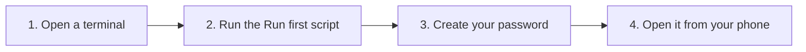

[Help centre](../README.md) · Guides

# Install Starboard on a Linux computer

This guide takes you from a Linux computer to Starboard open in your browser, with your own password. It is for
anyone, including people who have never used a terminal. It takes about 30 minutes, most of it waiting for
downloads.

It works on Linux Mint 22.3 (recommended), Debian 13 and Ubuntu Server 26.04, or a later version of each. No Linux
yet? Follow [Get Starboard up and running, from a bare computer](get-up-and-running.md). For a Raspberry Pi,
follow [Install Starboard on a Raspberry Pi](install-on-a-raspberry-pi.md).

## Before you begin

- A computer running Linux that can stay powered on. Check it is big enough in
  [The four systems](../topics/what-you-need.md#the-four-systems).
- The computer is connected to your home network, by cable or Wi-Fi.
- You know the password you use to sign in to that computer. The terminal asks for it.
- If the terminal is new to you, read [The terminal: typing commands](../basics/the-terminal.md) first.

## The steps at a glance

1. Open a terminal on the computer, or connect to it.
2. Run the Run first script, which installs Docker and Starboard.
3. Create your password and finish setting up.
4. Open Starboard from your phone or another computer.

## Step 1: Open a terminal

On Linux Mint, open **Terminal** from **Menu**. On a server with no desktop, sign in to it, or connect from your
own computer with [Connect to your server from another computer](../topics/connect-with-ssh.md).

**It worked when** the terminal shows a line ending in `$`, ready for a command.

## Step 2: Run the Run first script

One command checks the computer, installs Docker and anything else missing, downloads Starboard and starts its
installer. Follow the page for your system: [Start Starboard on Linux Mint](../topics/start-on-linux-mint.md#steps),
[on Debian](../topics/start-on-debian.md#steps) or [on Ubuntu Server](../topics/start-on-ubuntu-server.md#steps).
Each step is explained in [Set up everything with the Run first script](../topics/run-first.md#steps).

**It worked when** the installer says "Starboard is running".

## Step 3: Create your password and finish setting up

With a desktop, the set-up page opens by itself with the setup code filled in. With no desktop, open the address it
shows on a phone or another computer and enter the setup code. Follow
[Create your password and sign in](../topics/create-your-password.md). In the terminal instead, follow
[Set up Starboard in the terminal, with no browser](../topics/set-up-in-the-terminal.md).

**It worked when** Starboard opens its dashboard.

## Step 4: Open Starboard from your phone or another computer

To use Starboard from your phone or laptop, open the server's address with `:8095`, while the phone is on the same
Wi-Fi. Follow [Open Starboard from a phone or another computer](../topics/open-from-another-device.md).

## What next

- [Set up your dashboard after installing](set-up-your-dashboard.md): add your apps and make it yours.
- No media apps yet? [Build a media server from nothing](build-a-media-server-from-nothing.md).
- To install by hand instead, follow [Install Docker](../topics/install-docker.md), then
  [Install Starboard with the installer](../topics/install-with-the-installer.md).
- Keep it current with [Update Starboard](../topics/update-starboard.md).

<!-- footer: download rights -->

---

**Download only what you have the right to.** Use the download apps only for files you have the right to download,
such as open-source software, works in the public domain and your own backups. Downloading films, series, music or
books without the copyright holder's permission is against the law in the UK and most other countries. Starboard
does not host or provide any files, and you are responsible for what you download.

<!-- /footer -->
