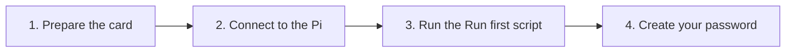

[Help centre](../README.md) · Guides

# Install Starboard on a Raspberry Pi

This guide takes you from a new Raspberry Pi to Starboard open in your browser, with your own password. It is for
anyone, including people who have never set up a Raspberry Pi. It takes about an hour, most of it waiting for
downloads.

## Before you begin

- A Raspberry Pi 4 with 4 GB of memory or more for a whole media server; a Raspberry Pi 5 with 8 GB is
  recommended. Read [Raspberry Pi and other small devices](../topics/what-you-need.md#raspberry-pi-and-other-small-devices).
- A microSD card of 32 GB or more, the official power supply for your Pi, and a way to connect it to your home
  network.
- Another computer with a card reader, to prepare the card.
- If the terminal is new to you, read [The terminal: typing commands](../basics/the-terminal.md) first.

## The steps at a glance

1. Prepare the Raspberry Pi's memory card.
2. Connect to the Pi from your computer.
3. Run the Run first script, which installs Docker and Starboard.
4. Create your password and finish setting up.

## Step 1: Prepare the Raspberry Pi's memory card

Raspberry Pi Imager puts Raspberry Pi OS (64-bit) on the card. It also sets your user name, Wi-Fi and remote access
before the Pi first starts. Follow [Prepare a Raspberry Pi](../topics/prepare-a-raspberry-pi.md#steps).

**It worked when** the Pi has started with the card in it and its green light has stopped flashing.

## Step 2: Connect to the Pi from your computer

You do the rest from your own computer, with commands that run on the Pi. Follow
[Connect to your server from another computer](../topics/connect-with-ssh.md). With a monitor and the desktop on the
Pi, open its **Terminal** instead.

**It worked when** your terminal shows the Pi's name before the cursor, for example `sam@starboard-pi`.

## Step 3: Run the Run first script

One command checks the Pi, installs Docker and anything else missing, downloads Starboard and starts its installer.
Follow [Start Starboard on Raspberry Pi OS](../topics/start-on-raspberry-pi-os.md#steps).

**It worked when** the installer says "Starboard is running".

## Step 4: Create your password and finish setting up

On your computer or phone, open `http://starboard-pi.local:8095`, with your Pi's name in place of `starboard-pi`.
Enter the setup code and choose a password: follow [Create your password and sign in](../topics/create-your-password.md).
If the name does not open, use the Pi's address instead: read
[Open Starboard from a phone or another computer](../topics/open-from-another-device.md).

**It worked when** Starboard opens its dashboard.

## What next

- [Set up your dashboard after installing](set-up-your-dashboard.md).
- On a Pi with 1 GB of memory or less, choose the **Small server** preset:
  [Make Starboard use less of your server](../topics/make-starboard-lighter.md).
- For Starboard on its own, with no media apps, the
  [ready-made image](../topics/install-from-the-ready-made-image.md) needs no building.
- Keep it current with [Update Starboard](../topics/update-starboard.md).

<!-- footer: download rights -->

---

**Download only what you have the right to.** Use the download apps only for files you have the right to download,
such as open-source software, works in the public domain and your own backups. Downloading films, series, music or
books without the copyright holder's permission is against the law in the UK and most other countries. Starboard
does not host or provide any files, and you are responsible for what you download.

<!-- /footer -->
