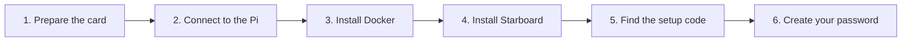

[Help centre](../README.md) · Guides

# Install Starboard on a Raspberry Pi

This guide takes you from a new Raspberry Pi to Starboard open in your browser, with your own password. It is
for anyone, including people who have never set up a Raspberry Pi. It takes about an hour, most of it waiting
for downloads.

Starboard is small enough for a Raspberry Pi. It uses the ready-made image here, so the Pi does not have to
build anything.

## Before you begin

- A Raspberry Pi that is big enough. Check [What you need to run Starboard](../topics/what-you-need.md): in
  short, any Raspberry Pi from the Pi 3 or Zero 2 W onwards.
- A microSD card of 16 GB or more, a power supply for your Pi, and a way to connect it to your home network.
- Another computer with a card reader, to prepare the card.
- If the terminal is new to you, read [The terminal: typing commands](../basics/the-terminal.md) first.

## The steps at a glance

1. Prepare the Raspberry Pi's memory card.
2. Connect to the Pi from your computer.
3. Install Docker.
4. Install Starboard from the ready-made image.
5. Find the setup code.
6. Create your password and sign in.

## Step 1: Prepare the Raspberry Pi's memory card

Raspberry Pi Imager puts Raspberry Pi OS on the card and sets your user name, Wi-Fi and remote access before
the Pi first starts. Choose the 64-bit system if your Pi offers it. Follow
[Prepare a Raspberry Pi](../topics/prepare-a-raspberry-pi.md).

**It worked when** the Pi has started with the card in it and its green light has stopped flashing steadily.

## Step 2: Connect to the Pi from your computer

You do the rest from your own computer, typing commands that run on the Pi. Follow
[Connect to your server from another computer](../topics/connect-with-ssh.md).

**It worked when** your terminal shows the Pi's name before the cursor, for example `sam@starboard-pi`.

## Step 3: Install Docker

Docker runs Starboard in its own sealed box. Follow [Install Docker](../topics/install-docker.md) in the
terminal that is connected to the Pi. Signing out and back in means closing the connection and making it
again, as in Step 2.

**It worked when** `docker compose version` prints a version number.

## Step 4: Install Starboard from the ready-made image

The ready-made image is Starboard already built for the Raspberry Pi, so it starts in a minute or two. Follow
[Install Starboard from the ready-made image](../topics/install-from-the-ready-made-image.md).

## Step 5: Find the setup code

The setup code proves that the person choosing the password is the person who installed Starboard. Follow
[Find the setup code](../topics/find-the-setup-code.md), using the ready-made image route.

## Step 6: Create your password and sign in

On your computer or phone, open `http://<the Pi's name>.local:8095`, for example
`http://starboard-pi.local:8095`, enter the setup code and choose a password. Follow
[Create your password and sign in](../topics/create-your-password.md). If the name does not open, use the
Pi's address instead, as in [Open Starboard from a phone or another computer](../topics/open-from-another-device.md).

## What next

- [Set up your dashboard after installing](set-up-your-dashboard.md).
- On a smaller Pi, choose the **Small server** preset: [Make Starboard use less of your server](../topics/make-starboard-lighter.md).
- Keep it current with [Update Starboard](../topics/update-starboard.md).
