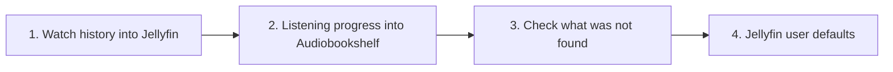

[Help centre](../README.md) · Guides

# Move from Plex to Jellyfin and Audiobookshelf

This guide moves what everyone has watched and listened to from Plex into Jellyfin and Audiobookshelf, so
nobody loses their place. It also works from Emby or another Jellyfin. It is for people who already have
Jellyfin, and Audiobookshelf for audiobooks, running with the same media as Plex. It takes about an hour,
plus waiting while the new apps scan your media.

Nothing in Plex is changed. Starboard only reads it.

## Before you begin

- Jellyfin is running, has scanned your films and series, and has an account for each person. Audiobookshelf
  too, for audiobooks.
- Both are in Starboard with their API keys: [Add an app](../topics/add-an-app.md) and
  [Find an app's API key](../topics/find-an-api-key.md). Audiobookshelf needs a key from an admin user.
- Plex still has everyone's history: a running Plex server, or a copy of its database file.

## The steps at a glance

1. Import watch history into Jellyfin.
2. Copy listening progress into Audiobookshelf.
3. Check what was not found.
4. Give every Jellyfin user the same defaults.

## Step 1: Import watch history into Jellyfin

Starboard reads what each Plex account watched and where they stopped, matches each account to a Jellyfin
user, then marks the same films and episodes in Jellyfin. Follow
[Import watch history into Jellyfin](../topics/import-watch-history.md).

**It worked when** a film you watched in Plex shows as watched in Jellyfin.

## Step 2: Copy listening progress into Audiobookshelf

Starboard reads where everyone is in each audiobook, and what they finished, and writes it into
Audiobookshelf. It never changes progress someone already has there. Follow
[Copy listening progress into Audiobookshelf](../topics/copy-listening-progress.md).

## Step 3: Check what was not found

Both pages list what Starboard could not match: usually media the new app has not scanned yet, or that has
different details. Fix those in Jellyfin or Audiobookshelf, then apply again. Starboard never counts anything
twice. With **Keep applying every hour** on, Jellyfin picks up the rest as it arrives.

## Step 4: Give every Jellyfin user the same defaults

Follow [Give every Jellyfin user the same defaults](../topics/jellyfin-user-defaults.md).

## What next

- [Set up free Live TV in Jellyfin](../topics/set-up-live-tv.md).
- When everyone is happy with Jellyfin, you can stop Plex. Keep its folder for a while, in case you need it
  again.

<!-- footer: download rights -->

---

**Download only what you have the right to.** Use the download apps only for files you have the right to download,
such as open-source software, works in the public domain and your own backups. Downloading films, series, music or
books without the copyright holder's permission is against the law in the UK and most other countries. Starboard
does not host or provide any files, and you are responsible for what you download.

<!-- /footer -->
