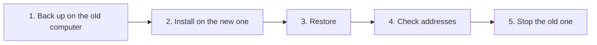

[Help centre](../README.md) · Guides

# Move Starboard to a new computer

This guide moves Starboard, with all your apps, keys, categories and settings, from one computer to another.
It is for anyone replacing or rebuilding their server. It takes about 30 minutes.

There are two ways. **A settings backup** is the simplest and works between any two installs. **Copying the
data folder** also keeps your password, history and alerts, and suits a like-for-like move.

## Before you begin

- Starboard still runs on the old computer, or you have a settings backup file from it.
- The new computer is ready for Starboard: [What you need to run Starboard](../topics/what-you-need.md).

## The steps at a glance

1. Back up Starboard's settings on the old computer.
2. Install Starboard on the new computer.
3. Restore the backup on the new computer.
4. Check your apps' addresses.
5. Stop Starboard on the old computer.

## Step 1: Back up Starboard's settings on the old computer

Follow [Back up and restore Starboard's settings](../topics/back-up-settings.md) to download the backup file.
Keep it somewhere safe: it holds your apps' API keys.

## Step 2: Install Starboard on the new computer

Follow [Install Starboard on a Linux computer](install-on-a-linux-computer.md) or
[Install Starboard on a Raspberry Pi](install-on-a-raspberry-pi.md), including creating a password.

## Step 3: Restore the backup on the new computer

Follow the restore part of [Back up and restore Starboard's settings](../topics/back-up-settings.md). A backup
from an older version of Starboard is brought up to date as it is restored. Your new password stays: a backup
never holds the password.

**It worked when** the **Apps** page shows your apps.

## Step 4: Check your apps' addresses

If your apps moved too, or the new computer reaches them differently, their addresses may need changing.
Any app that shows as not responding needs a look: follow
[An app shows as not responding](../topics/app-not-responding.md).

## Step 5: Stop Starboard on the old computer

When everything works on the new computer, follow [Remove Starboard](../topics/remove-starboard.md) on the old
one.

## Things to note

**Copying the data folder instead.** Stop Starboard on both computers, copy the whole `data` folder from the
old Starboard folder into the new one, and start Starboard again. Everything comes across, including your
password and anyone who is signed in. If you are not sure how to copy folders between computers, use the
backup instead.

## What next

- [Find out what each app is using](../topics/monitor-apps.md) on the new computer.
- [Get told when something goes wrong](get-told-when-something-goes-wrong.md).

<!-- footer: download rights -->

---

**Download only what you have the right to.** Use the download apps only for files you have the right to download,
such as open-source software, works in the public domain and your own backups. Downloading films, series, music or
books without the copyright holder's permission is against the law in the UK and most other countries. Starboard
does not host or provide any files, and you are responsible for what you download.

<!-- /footer -->
