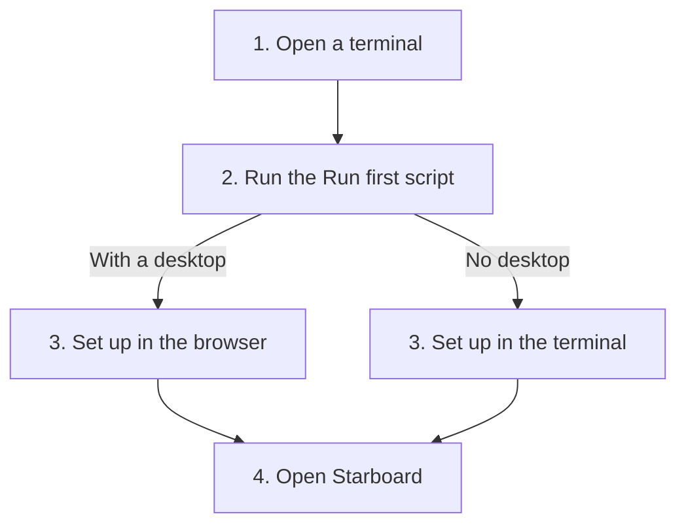

[Help centre](../README.md) · Guides

# Quick start: one command sets up everything

The quickest way to a working media server is the **Run first script**. Once Linux is on the computer, you run one
command and it does the rest: it checks the computer, installs what is missing, downloads Starboard and starts the
set-up, in your browser or in the terminal. It suits people who have set up servers before too: it checks every
step, and you can change anything afterwards.

## Before you begin

- A computer with Linux on it: Linux Mint 22.3 (recommended), Debian 13, Ubuntu Server 26.04 or Raspberry Pi OS
  (64-bit), or a later version. Each has its own page, such as
  [Start Starboard on Debian](../topics/start-on-debian.md). No Linux yet? Follow
  [Get Starboard up and running, from a bare computer](get-up-and-running.md) instead: it starts with installing
  Linux.
- The computer is connected to the internet, and you know the password you sign in to it with.
- About 15 minutes, most of it waiting for downloads.

## The steps at a glance

1. Open a terminal on the computer, or connect to it.
2. Run the Run first script.
3. Answer its questions, in the browser or in the terminal.
4. Open Starboard.



The script chooses the way for step 3 by itself.

## Step 1: Open a terminal

On a computer with a desktop, open the **Terminal** app. On a server with no desktop, sign in to it, or connect to
it from your own computer. Read [Open a terminal](../basics/the-terminal.md#open-a-terminal) if this is new.

## Step 2: Run the Run first script

Copy this command, paste it into the terminal and press Enter:

```bash
curl -fsSL https://raw.githubusercontent.com/TheMightyTRex/starboard/main/run-first.sh | bash
```

If the terminal says "Command 'curl' not found", use this one instead. A new Debian does not include curl:

```bash
wget -qO- https://raw.githubusercontent.com/TheMightyTRex/starboard/main/run-first.sh | bash
```

Enter `a` at its first question for accessible mode, which carries on through the whole set-up. The script explains
each step and asks before it installs anything. If Linux is still installing its own updates, it waits for them with
a progress bar. Read [Set up everything with the Run first script](../topics/run-first.md#steps) for each question,
and [If it does not work](../topics/run-first.md#if-it-does-not-work) if something stops.

**You know it worked when** the script says Starboard is running and shows its address.

## Step 3: Answer its questions

- **With a desktop:** the set-up opens in your browser by itself. Choose your password, then **Basics**, **Full
  install** or **Everything**: [Basics, Full install and Everything](../topics/install-types.md) explains each.
- **No desktop:** the same questions are asked in the terminal. Read
  [Set up Starboard in the terminal, with no browser](../topics/set-up-in-the-terminal.md).

**You know it worked when** the set-up says your apps are starting.

## Step 4: Open Starboard

Open the address the script showed, from the server or from a phone or laptop at home, and sign in. Your apps
appear on the **Apps** page as they start, which can take a few minutes.

## What next

- [Set up your dashboard after installing](set-up-your-dashboard.md)
- [Finish what is still to set up](../topics/finish-setting-up.md)
- [Choose a Usenet provider and add it](../topics/choose-a-usenet-provider.md), if you use Usenet
- [Use Starboard away from home safely](use-starboard-away-from-home.md)
- Already have Docker and want to do it by hand? [Install Starboard with the installer](../topics/install-with-the-installer.md).
  The Run first script does this for you, so most people never need it.

<!-- footer: download rights -->

---

**Download only what you have the right to.** Use the download apps only for files you have the right to download,
such as open-source software, works in the public domain and your own backups. Downloading films, series, music or
books without the copyright holder's permission is against the law in the UK and most other countries. Starboard
does not host or provide any files, and you are responsible for what you download.

<!-- /footer -->
