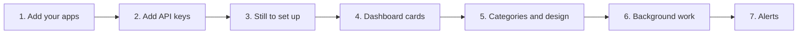

[Help centre](../README.md) · Guides

# Set up your dashboard after installing

This guide takes you from a newly installed Starboard to a dashboard that shows what you want, with every app
set up and in its place. It is for anyone who has created their password.

After your first password, Starboard opens its set-up guide, **Set up Starboard**. It finds or installs your apps,
then opens the Apps page. This guide carries on from there. You can run the set-up guide again from **Settings**,
then **General**, with **Advanced settings** active.

## Before you begin

- Starboard is installed and you can sign in. If not, start with
  [Install Starboard on a Linux computer](install-on-a-linux-computer.md).
- Your media apps are running, or you let Starboard install them. If you have none yet, follow
  [Build a media server from nothing](build-a-media-server-from-nothing.md) first.

## The steps at a glance

1. Find the apps already on your server, or add them one at a time.
2. Give each app its API key.
3. Finish what is still to set up.
4. Choose your dashboard's cards.
5. Put your apps into categories and choose a design.
6. Choose how much Starboard does in the background.
7. Activate alerts.

## Step 1: Find or add your apps

Apps Starboard installed for you are added already. If Starboard has Docker access, it can also find the apps you
run yourself. Follow [Search for apps already on your server](../topics/search-for-new-apps.md). Add anything it
does not find with [Add an app](../topics/add-an-app.md).

**It worked when** each app appears on the **Apps** page, in **System**, then **Apps**.

## Step 2: Give each app its API key

An API key lets Starboard read an app's downloads, calendar and queue. Without one, Starboard can only check
whether the app answers. Follow [Find an app's API key](../topics/find-an-api-key.md), then add the key to the
app with [Change or remove an app](../topics/change-or-remove-an-app.md#change-an-apps-details).

**It worked when** **Test connection** in the app's settings says it connected.

## Step 3: Finish what is still to set up

**Still to set up** on the dashboard and the Apps page lists what is left, such as a site for Reelix to search.
Select **Go through them** to take each one in turn. Follow
[Finish what is still to set up](../topics/finish-setting-up.md).

**It worked when** **Still to set up** goes from the dashboard.

## Step 4: Choose your dashboard's cards

The dashboard is the first page after you sign in. Choose one of its four layouts, then add, size and move cards.
Follow [Use and change the dashboard](../topics/use-the-dashboard.md).

## Step 5: Put your apps into categories and choose a design

Categories are the headings on the **Apps** page, such as Watch or Downloads. Starboard chooses one for each
app, and you can change them. Follow [Organise apps into categories](../topics/organise-categories.md).

The Apps page has five designs. Choose the default for everyone, then make text size, theme and contrast right
for you. Follow [Choose a design for the Apps page](../topics/choose-a-design.md) and
[Change text size, theme and other display settings](../topics/display-and-accessibility.md).

## Step 6: Choose how much Starboard does in the background

On a small server, such as a Raspberry Pi, choose the **Small server** preset. Follow
[Make Starboard use less of your server](../topics/make-starboard-lighter.md).

## Step 7: Activate alerts

Alerts tell your phone when an app stops answering or a disk has a problem. They are inactive until you activate
them. Follow [Activate alerts](../topics/activate-alerts.md).

## What next

- [Back up and restore Starboard's settings](../topics/back-up-settings.md), now that it holds your work.
- [Get told when something goes wrong](get-told-when-something-goes-wrong.md).
- [What is in each Settings page](../topics/find-a-setting.md).
- Using Jellyfin? [Set up free Live TV in Jellyfin](../topics/set-up-live-tv.md).

<!-- footer: download rights -->

---

**Download only what you have the right to.** Use the download apps only for files you have the right to download,
such as open-source software, works in the public domain and your own backups. Downloading films, series, music or
books without the copyright holder's permission is against the law in the UK and most other countries. Starboard
does not host or provide any files, and you are responsible for what you download.

<!-- /footer -->
