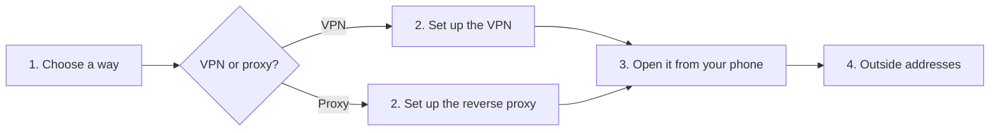

[Help centre](../README.md) · Guides

# Use Starboard away from home safely

This guide helps you open Starboard on your phone when you are out, without putting your server on the open
internet. It is for people who already use Starboard at home. How long it takes depends on the way you
choose: a VPN (virtual private network) app takes about 30 minutes.

**Never forward Starboard's port on your router to the internet.** Anyone in the world could then try to
sign in. The two safe ways are below.

## Before you begin

- Starboard works at home on your phone: [Open Starboard from a phone or another computer](../topics/open-from-another-device.md).
- **Who can open the dashboard** is set to your home network: [Choose who can open Starboard](../topics/choose-who-can-open-starboard.md).
- Your password is long and not used anywhere else: [Change your password](../topics/change-your-password.md).

## The steps at a glance

1. Choose a way: a VPN (simplest and safest) or a reverse proxy with HTTPS (for people with their own domain).
2. Set it up.
3. Open Starboard from your phone away from home.
4. Turn on the outside address for your apps.

## Step 1: Choose a way

- **A VPN** joins your phone to your home network wherever you are, so Starboard behaves exactly as it does at
  home. Nothing new is open to the internet. Tailscale and WireGuard are popular choices, and many routers have
  a VPN built in. Choose this if you are unsure.
- **A reverse proxy** puts Starboard at an address of your own, such as `starboard.example.com`, protected by
  HTTPS. It needs a domain name and more care. Choose this only if you are confident.

## Step 2: Set it up

- **VPN:** follow your VPN's own instructions to install it on the server and on your phone. Starboard needs
  no changes.
- **Reverse proxy:** follow [Put Starboard behind a reverse proxy](../topics/reverse-proxy.md).

## Step 3: Open Starboard from your phone away from home

Turn off Wi-Fi on your phone, so it uses mobile data, and open Starboard's address: the home address through
the VPN, or your own address through the proxy.

**It worked when** Starboard asks you to sign in.

## Step 4: Turn on the outside address for your apps

Each app can have an outside address, so its card opens the right link when you are away. Add it in the app's
settings: [Change or remove an app](../topics/change-or-remove-an-app.md).

## What next

- [Sign out everywhere](../topics/sign-out-everywhere.md) if you lose a phone.
- [Turn on alerts](../topics/turn-on-alerts.md), so you hear about problems wherever you are.
