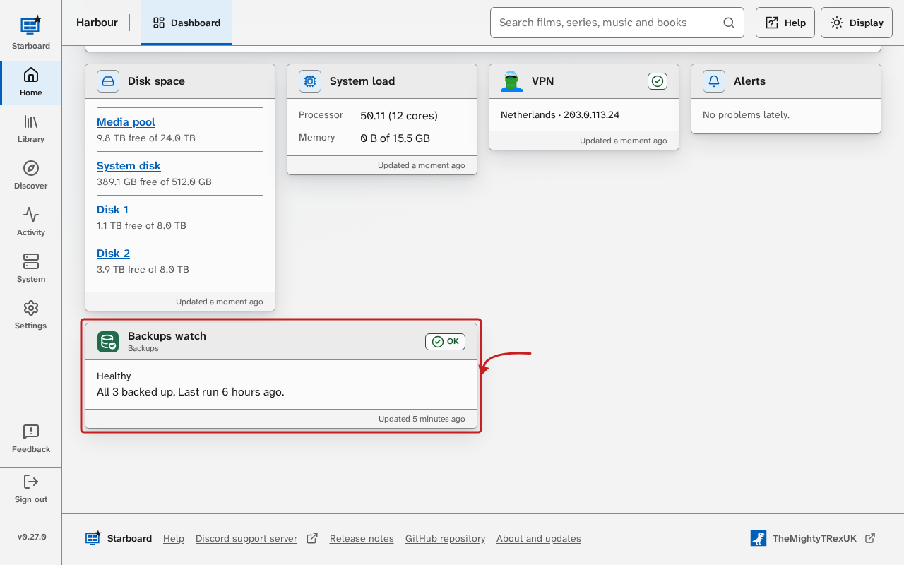
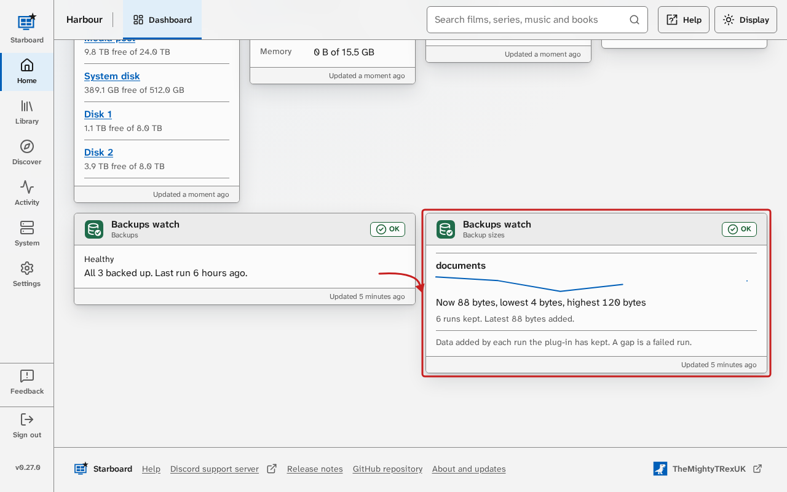
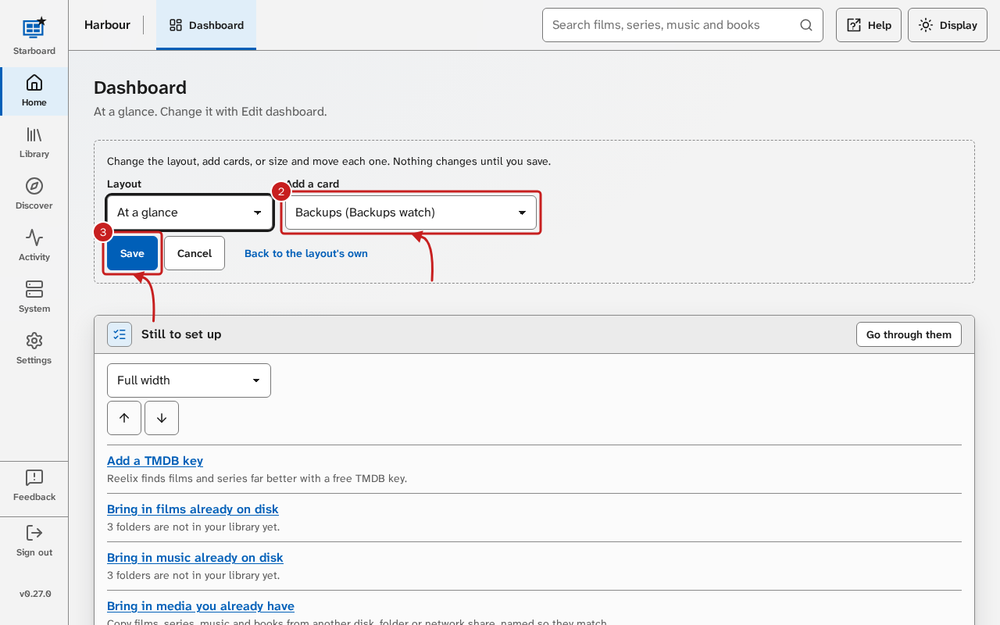

# Backups watch: Dashboard card
<!-- Mirrored from the starboard-plugins repository by tools/sync-plugin-help.py: change it there. -->

Backups watch adds 3 cards you can put on your dashboard. Each starts with a band: Backups watch's logo and name and a status in words. A footer says when it last changed. The cards only read what the plug-in kept at its last check, so opening the dashboard never wakes your backup tool.

## Backups

Shows one line: how many backups are well and when the last run was, or which ones need attention.

- **How often it updates:** once an hour while the dashboard is open. Nothing is asked while the browser tab is hidden.
- **Example:** All 3 backed up. Last run 6 hours ago.

## Backup runs

Shows each backup, up to 12: when it last ran, its size, and how many runs failed in the last 30 days. One that is overdue or failed says so first.

- **How often it updates:** once an hour while the dashboard is open.
- **Example:**
  - documents: Last run 6 hours ago, 41.2 GB, 0 failed in 30 days

## Backup sizes

Shows a small line chart for each backup, up to 8: the data each run added, as far back as the plug-in has kept. A gap is a run that failed.

- **How often it updates:** once an hour while the dashboard is open.
- **Example:** documents: 6 runs kept. Latest 88 bytes added.

## What the status says

| Status | Means |
|---|---|
| **OK** | Every backup had a good run within the hours set in **Overdue after**. |
| **Needs attention** | A backup is overdue or its last run failed. The card names it. |
| **Last check failed** | The last check could not reach the tool, but an earlier one worked. The card says why. |
| **Cannot check** | The tool has never answered. The card says why, such as that it refused the user name or password. |
| **Needs setting up** | No address is saved yet. |
| **Scheduled** | Saved, and waiting for the first check, which runs within the hour. |

## Add it to your dashboard

1. Select **Edit dashboard**.
2. In **Add a card**, choose the card. Its name ends with (Backups watch), such as **Backups (Backups watch)**.
3. Select **Save**.

Backups watch must be added and active first. Read [Install](../backups-watch/install.md).

## Find out more

- [Use and change the dashboard, in Starboard's help](../../topics/use-the-dashboard.md)
- [Settings](../backups-watch/settings.md)
- [Problems](../backups-watch/problems.md)

<!-- footer: download rights -->

---

**Download only what you have the right to.** Use the download apps only for files you have the right to download.
Examples are open-source software, works in the public domain and your own backups. Downloading films, series, music or
books without the copyright holder's permission is against the law in the UK and most other countries. Starboard
does not host or provide any files, and you are responsible for what you download.

**Need help?** Ask on the [Starboard Discord support server](https://discord.gg/xN9bf2H4vv).

<!-- /footer -->
