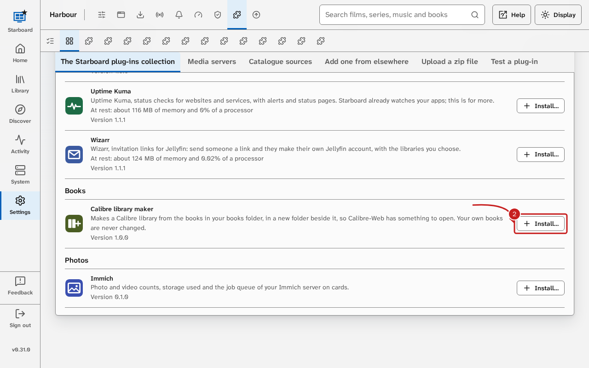
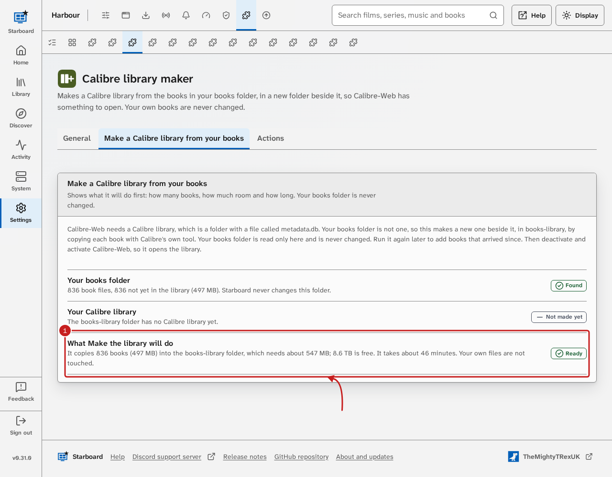
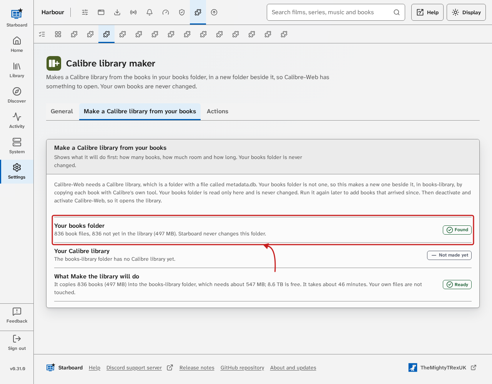
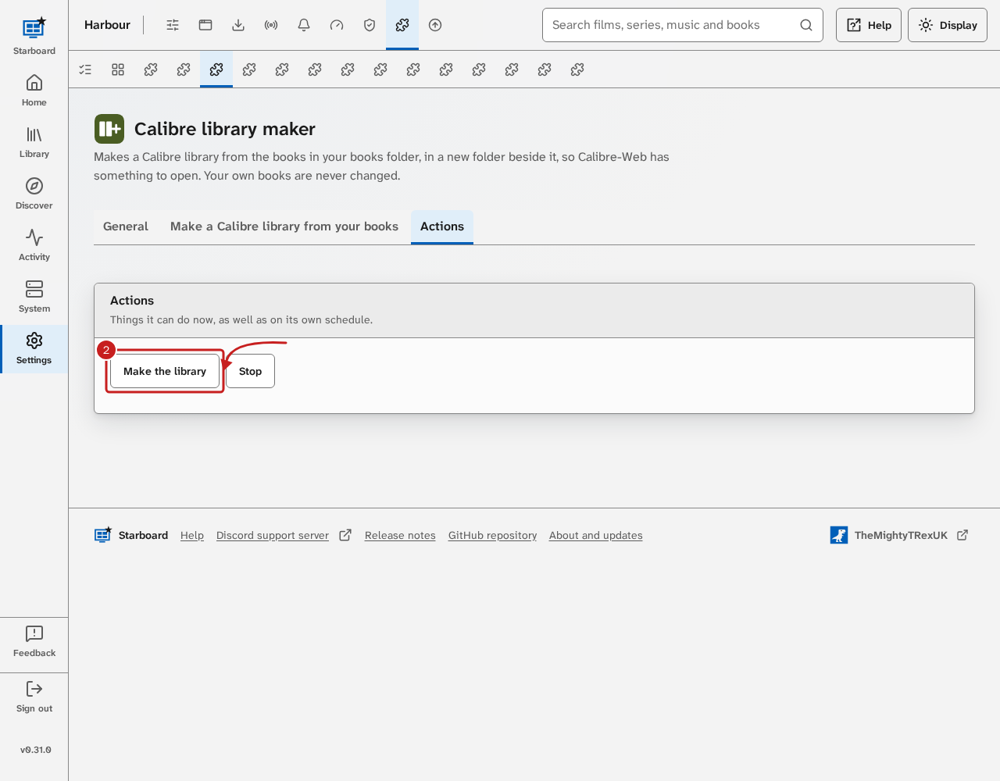

# Calibre library maker: Install
<!-- Mirrored from the starboard-plugins repository by tools/sync-plugin-help.py: change it there. -->

Add Calibre library maker from Starboard's **Catalogue**. Starboard shows what it may do and tests it before anything is added. At the end it is added and active, and it rests until you use it.

## Before you begin

- Starboard with plug-in API 1.14 or later.
- Your Starboard password. Adding and removing a plug-in ask for it.
- Books as files in the `books` folder of your media folder.
- Room for a second copy of your books, on the disk that holds your media folder. The plug-in says how much before it starts.
- About 0.7 GB for its image, which holds Calibre's tools.

## What it may do

Starboard lists these before you add it.

| What it can reach | Risk |
|---|---|
| Nothing outside its own folders: no permission is asked | Low |

What it runs:

- **main:** no way out to your home network or the internet. It can use three folders. One is its own folder in Starboard's data (`data/plugins/calibre-library`). It reads the `books` folder in your media folder, and it reads and writes the `books-library` folder in your media folder.

Like every plug-in, it runs read only, as a user that is not root, with no extra rights. Its image is pinned by digest, so what you approved is what runs.

## Memory and processor

- **main:** 320 MB of memory and 1 processor core at most, and 128 processes.
- Nothing at rest: Starboard stops it after 5 idle minutes.
- Measured on 26 November 2026: 14 MiB while it waits, up to 73 MiB while Calibre adds books, then stopped after 5 idle minutes. The image is 703 MB.

## Add it

1. Go to **Settings**, then **Plug-ins**, then **Catalogue**.
2. Find **Calibre library maker** and select **Install…**.



3. A slide-out opens with what it can read and change. Read it all.
4. Enter your Starboard password and select **Install Calibre library maker**. To stop, select **Cancel**: nothing is installed.

### Add it by its address

On the **Catalogue** page, under **Add one from elsewhere**, paste this into **The plug-in's manifest address**, then select **What it does**:

```text
https://raw.githubusercontent.com/TheMightyTRex/starboard-plugins/main/calibre-library/starboard-plugin.json
```

## Make your library

1. Go to **Settings**, then **Plug-ins**, then **Calibre library maker**.
2. Read **What Make the library will do**: the number of books, the room and the time.






3. Select **Make the library** and confirm. The page shows how far it has got, in words.



4. When it says **Done**, turn off Calibre-Web and turn it on again.

Run it again when new books arrive. Select **Stop** to end a run after the books it is adding now; run it again to carry on.

## Remove it

1. Go to **Settings**, then **Plug-ins**, then **Calibre library maker**.
2. Under **Remove**, select **Remove Calibre library maker**.
3. Choose where its folder goes, enter your Starboard password and select **Remove**.

Your books and your library are not touched.

## Find out more

- [What Calibre library maker does](../calibre-library/README.md)
- [Settings](../calibre-library/settings.md)
- [Problems](../calibre-library/problems.md)
- [Calibre-Web, your books](https://themightytrex.github.io/starboard-plugins/help/plugins/calibre-web/your-books.html)

<!-- footer: download rights -->

---

**Download only what you have the right to.** Use the download apps only for files you have the right to download.
Examples are open-source software, works in the public domain and your own backups. Downloading films, series, music or
books without the copyright holder's permission is against the law in the UK and most other countries. Starboard
does not host or provide any files, and you are responsible for what you download.

**Need help?** Ask on the [Starboard Discord support server](https://discord.gg/xN9bf2H4vv).

<!-- /footer -->
