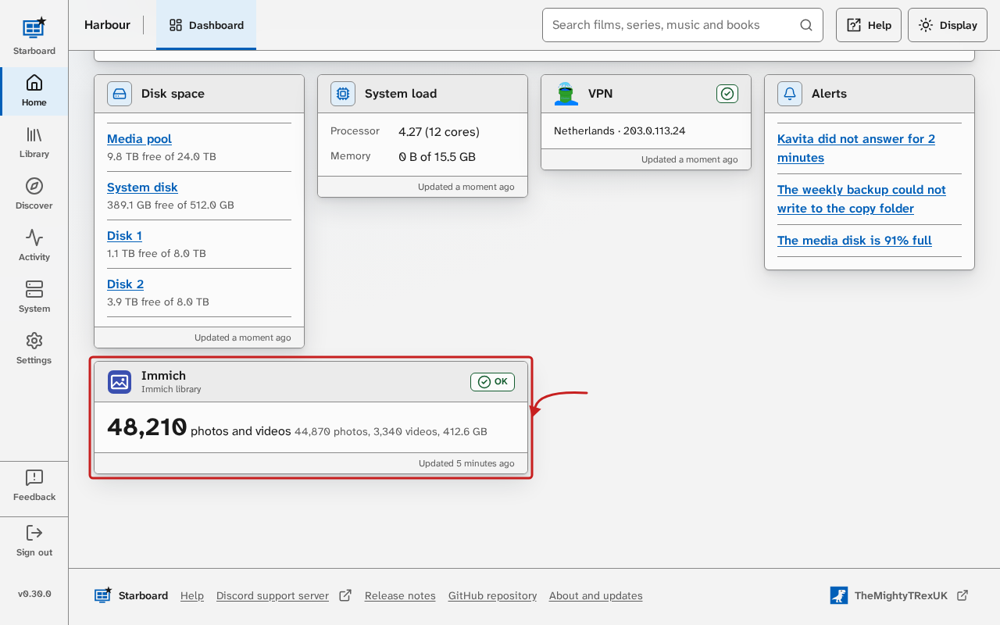
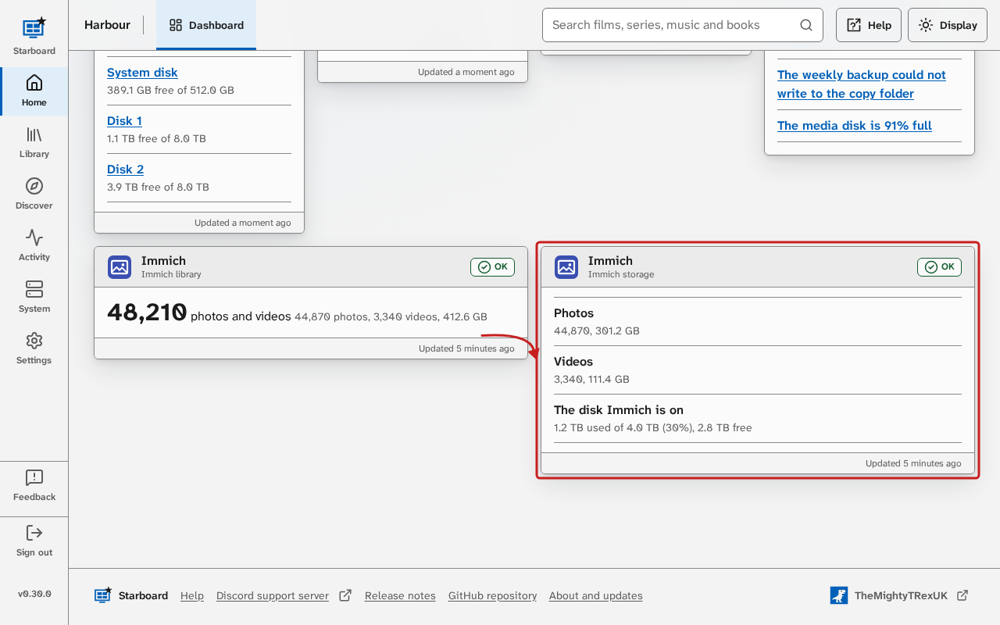
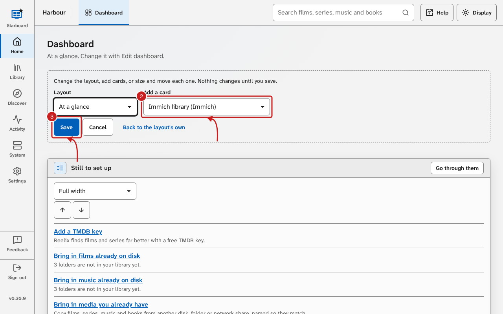

# Immich: Dashboard card
<!-- Mirrored from the starboard-plugins repository by tools/sync-plugin-help.py: change it there. -->

Immich adds 3 cards you can put on your dashboard. Each starts with a band: Immich's logo and name and a status in words. A footer says when it last changed.

## Immich library

Shows how many photos and videos Immich holds, with the split and the space they use.

- **How often it updates:** every 5 minutes while the dashboard is open. Nothing is asked while the browser tab is hidden.
- **Example:** 48,210 photos and videos. 44,870 photos, 3,340 videos, 412.6 GB.

## Immich storage

Shows where the space goes, photos and videos. Then it shows the disk Immich is on: how much is used, how full it is and how much is free. It also shows the people who use the most space.

- **How often it updates:** every 5 minutes while the dashboard is open.
- **Status:** **Nearly full** from 90% and **Full** from 98%, the same limits as Starboard's own disk card.
- **Example:**
  - Photos: 44,870, 301.2 GB
  - The disk Immich is on: 1.2 TB used of 4.0 TB (30%), 2.8 TB free

## Immich jobs

Shows what the job queues are doing: which are working, how many jobs are waiting, and how many have failed.

- **How often it updates:** every minute while the dashboard is open.
- **Example:** Working: Thumbnails, Smart search. 340 waiting.

## What the status says

| Status | Means |
|---|---|
| **OK** | The figures were read. |
| **Working** | A job queue is busy. |
| **Idle** | Nothing is waiting. |
| **Needs attention** | Jobs have failed, or the disk is nearly full. Open Immich, Administration, Jobs to retry failed jobs. |
| **Paused** | A queue with work waiting is paused. |
| **Full** | The disk is 98% full or more. |
| **Cannot read it** | Immich did not answer, or refused the key. The card says why. |
| **Needs setting up** | No address or key is saved yet. |

## Add it to your dashboard

1. Select **Edit dashboard**.
2. In **Add a card**, choose the card. Its name ends with (Immich), such as **Immich library (Immich)**.
3. Select **Save**.

Immich's plug-in must be added and active first. Read [Install](../immich/install.md).

## Find out more

- [Use and change the dashboard, in Starboard's help](../../topics/use-the-dashboard.md)
- [Settings](../immich/settings.md)
- [Problems](../immich/problems.md)

<!-- footer: download rights -->

---

**Download only what you have the right to.** Use the download apps only for files you have the right to download.
Examples are open-source software, works in the public domain and your own backups. Downloading films, series, music or
books without the copyright holder's permission is against the law in the UK and most other countries. Starboard
does not host or provide any files, and you are responsible for what you download.

**Need help?** Ask on the [Starboard Discord support server](https://discord.gg/xN9bf2H4vv).

<!-- /footer -->
