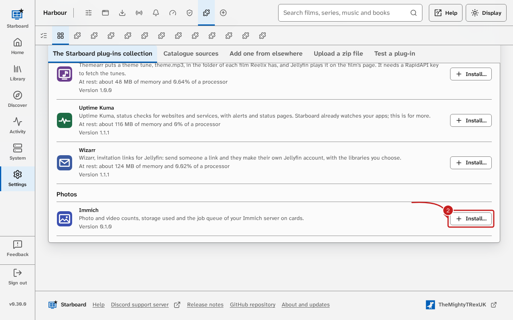
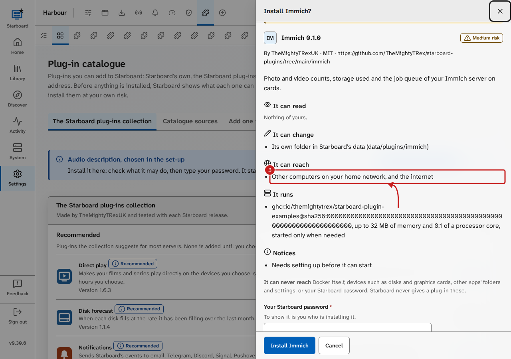
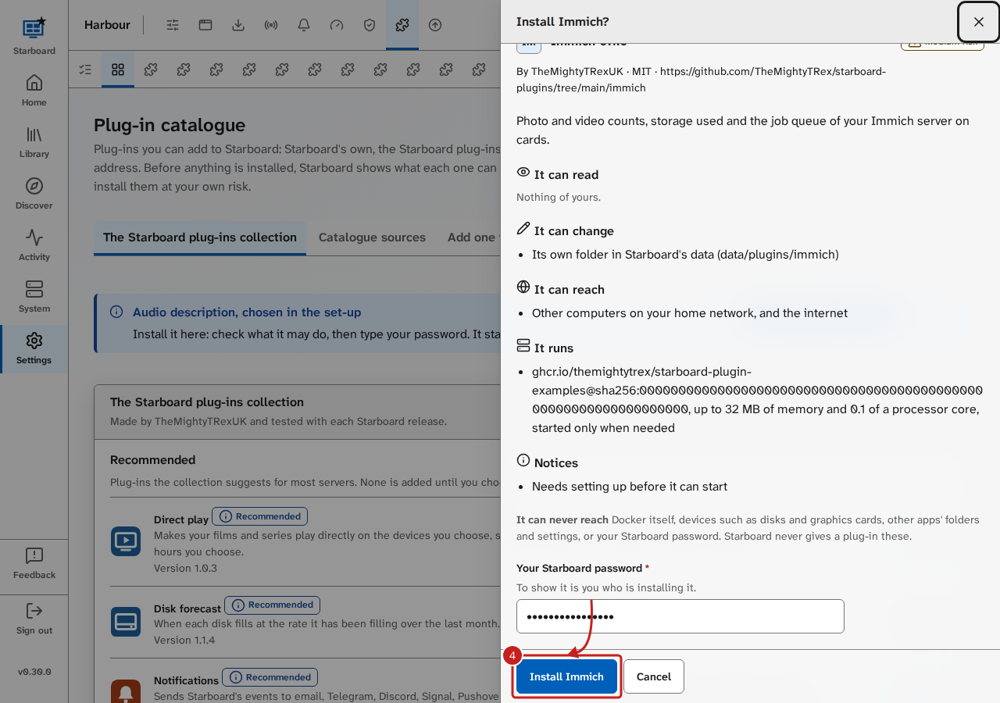

# Immich: Install
<!-- Mirrored from the starboard-plugins repository by tools/sync-plugin-help.py: change it there. -->

Add Immich from Starboard's **Catalogue**, where it is listed under **Home and appearance**. Starboard shows what it may do and tests it before anything is added. At the end, Immich is added, and it needs Immich's address and an API key before it can show anything.

## Before you begin

- Starboard with plug-in API 1.17 or later (Starboard 0.26.0 or later).
- An Immich server on your network, its address, and an API key made in Immich under **Account settings**, then **API keys**. Read [Settings](../immich/settings.md) for the permissions it needs.
- Your Starboard password. Adding and removing a plug-in ask for it.

## What it may do

Starboard lists these before you add it, each with its risk.

| Permission | Risk |
|---|---|
| Reach other computers on your home network, and the internet (`network:lan`) | Medium |

What it runs:

- **main:** reaches your home network. It can use its own folder in Starboard's data (`data/plugins/immich`). It rests after 5 minutes with nothing to do, and Starboard wakes it when a card asks.

Like every plug-in, it runs read only, as a user that is not root, with no extra rights. It only reads from Immich: it never uploads, changes or deletes a photo, album or setting.

## Memory and processor

- **main:** 32 MB of memory and 0.1 of a processor core at most, and only while a card is being asked. At rest it uses nothing: its container is stopped.

## Add it

1. Go to **Settings**, then **Plug-ins**, then **Catalogue**.
2. Under **Home and appearance**, find **Immich** and select **Install…**.



3. A slide-out opens with what it can read, change and reach. Read it all.



4. Enter your Starboard password and select **Install Immich**. To stop, select **Cancel**: nothing is installed.



5. Immich's own tab opens under **Settings**, then **Plug-ins**. Enter Immich's address and the API key, then save and select **Activate**. Read [Settings](../immich/settings.md).

### Add it by its address

On the **Catalogue** page, under **Add one from elsewhere**, paste this into **The plug-in's manifest address**. Then select **What it does** and carry on from step 3:

```text
https://raw.githubusercontent.com/TheMightyTRex/starboard-plugins/main/immich/starboard-plugin.json
```

Or run its installer, `install.py` in its folder, on any computer with Python, and give your Starboard's address.

## Remove it

1. Go to **Settings**, then **Plug-ins**, then **Immich**.
2. Under **Remove**, select **Remove Immich**.
3. Choose where its folder goes: **Keep it with Starboard's data** (in `data/plugins/.removed`) or **Move it to the holding folder**. The holding folder is listed in **System**, **Clean up**, where you can put it back or delete it for good.
4. Enter your Starboard password and select **Remove**.

Its container stops and goes, and its API key stops working. Immich and your photos are not touched.

## Find out more

- [What Immich does](../immich/README.md)
- [Settings](../immich/settings.md)
- [Problems](../immich/problems.md)
- [Add a plug-in, in Starboard's help](../../topics/add-a-plugin.md)
- [What a plug-in can change, in Starboard's help](../../basics/what-plugins-can-change.md)

<!-- footer: download rights -->

---

**Download only what you have the right to.** Use the download apps only for files you have the right to download.
Examples are open-source software, works in the public domain and your own backups. Downloading films, series, music or
books without the copyright holder's permission is against the law in the UK and most other countries. Starboard
does not host or provide any files, and you are responsible for what you download.

**Need help?** Ask on the [Starboard Discord support server](https://discord.gg/xN9bf2H4vv).

<!-- /footer -->
