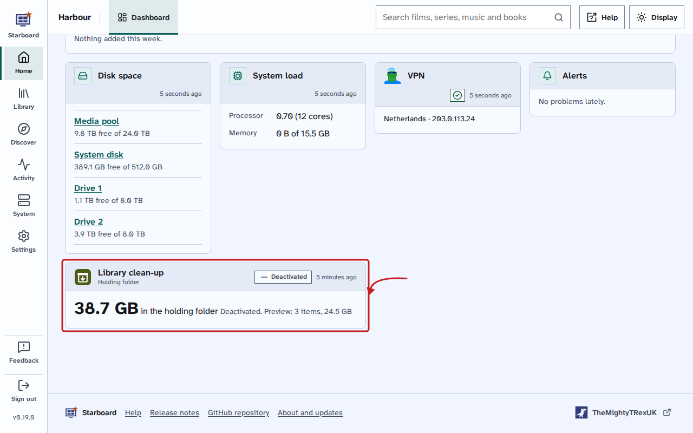
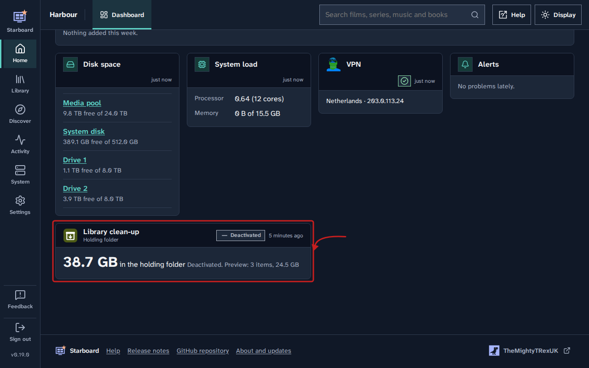
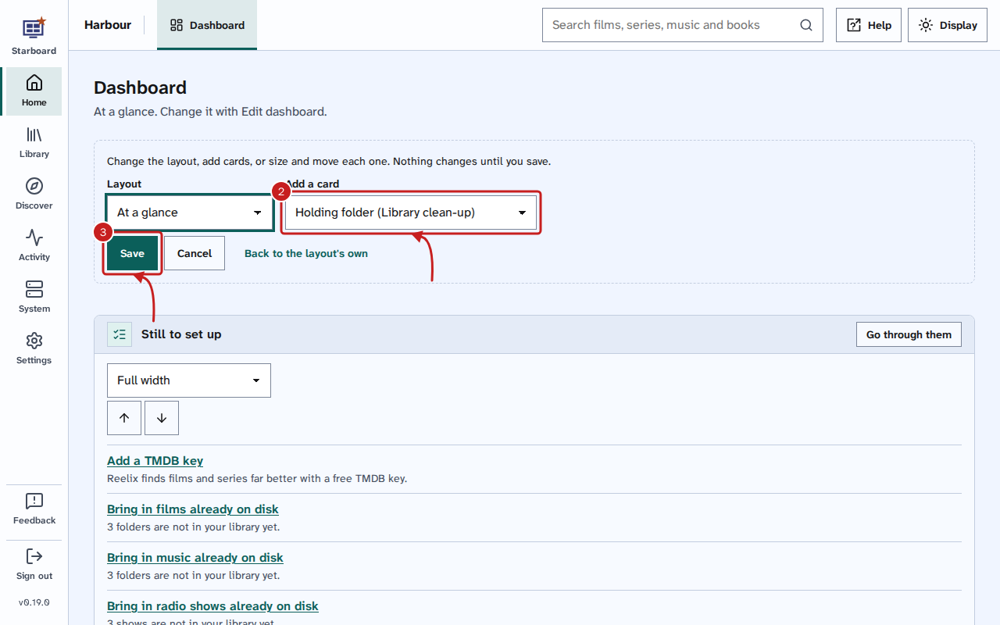

# Library clean-up: Dashboard card
<!-- Mirrored from the starboard-plugins repository by tools/sync-plugin-help.py: change it there. -->

Library clean-up adds 1 card you can put on your dashboard. Each starts with a band: Library clean-up's logo and name and a status in words. A footer says when it last changed.

## Holding folder

Shows how much is in the holding folder. Under it, how many items are held and when it checks next, what **Preview** would move while moving is off, or how far the work it is on has gone.

- **How often it updates:** every 30 seconds while it is working, and every 10 minutes the rest of the time, while the dashboard is open and in view. Nothing is asked while the browser tab is hidden.
- **Example:** 186.40 GB in the holding folder. 41 items held. Next check in quiet hours

## What the status says

| Status | Means |
|---|---|
| **Working** | It is working out **Preview** or moving items now. The band says which, "Working out Preview" or "Moving items", and the card says how far it has gone. |
| **Turned off** | **Move items each day** is off, so nothing moves. The card says what **Preview** would move, or "Open 'Preview' to find what would move". |
| **Next in quiet hours** | It moves items each day. The card says how many items are held and that it checks next in quiet hours. |
| **Problem** | The last run did not finish. The band says "Last run failed" and the card says "The last run did not finish" and why. |

## Add it to your dashboard

1. Select **Edit dashboard**.
2. In **Add a card**, choose the card. Its name ends with (Library clean-up), such as **Holding folder (Library clean-up)**.
3. Select **Save**.

   

Library clean-up must be added and active first. Read [Install](../library-cleanup/install.md).

## Find out more

- [Use and change the dashboard, in Starboard's help](../../topics/use-the-dashboard.md)
- [Settings](../library-cleanup/settings.md)
- [Problems](../library-cleanup/problems.md)

<!-- footer: download rights -->

---

**Download only what you have the right to.** Use the download apps only for files you have the right to download.
Examples are open-source software, works in the public domain and your own backups. Downloading films, series, music or
books without the copyright holder's permission is against the law in the UK and most other countries. Starboard
does not host or provide any files, and you are responsible for what you download.

**Need help?** Ask on the [Starboard Discord support server](https://discord.gg/xN9bf2H4vv).

<!-- /footer -->
