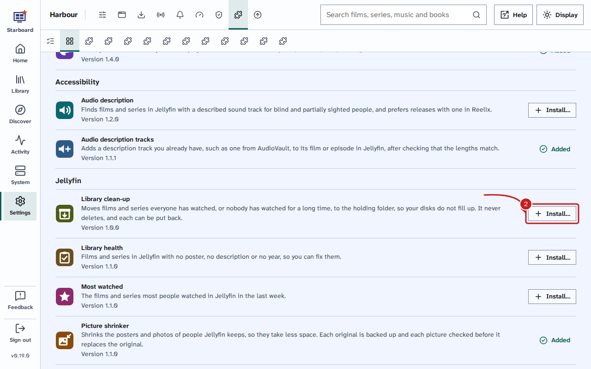
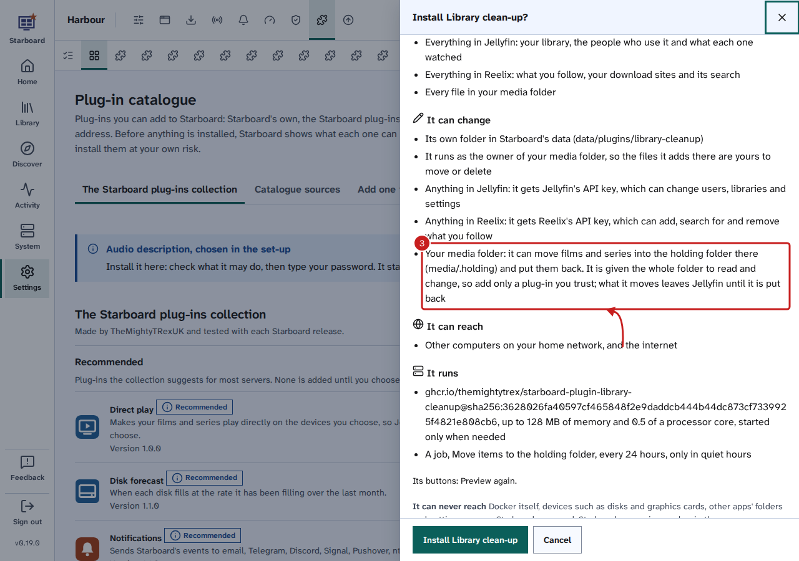
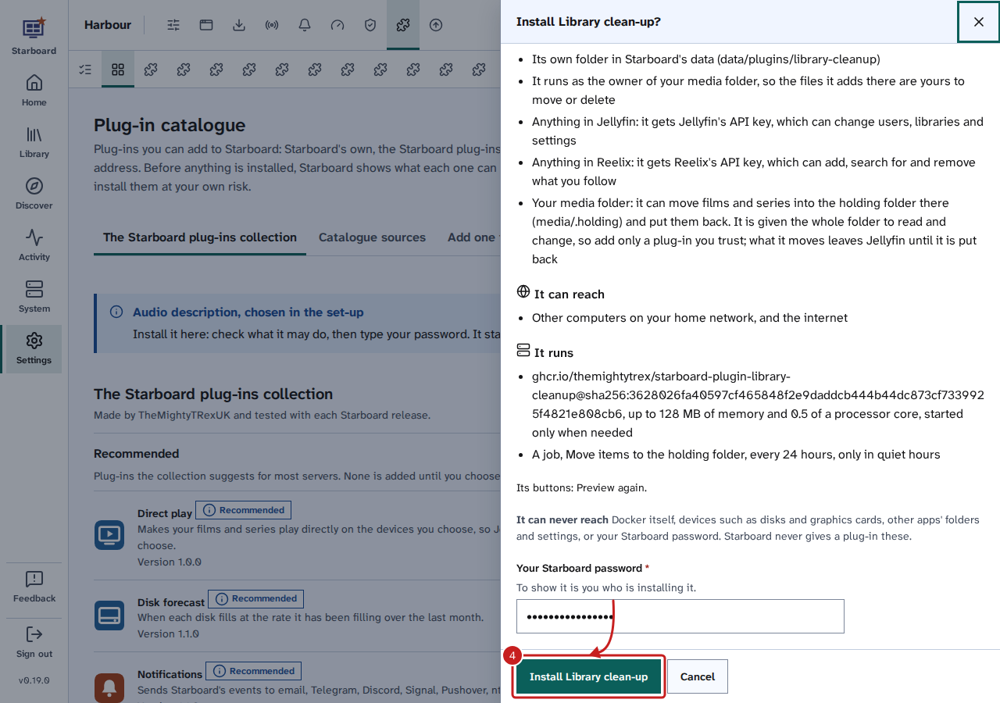
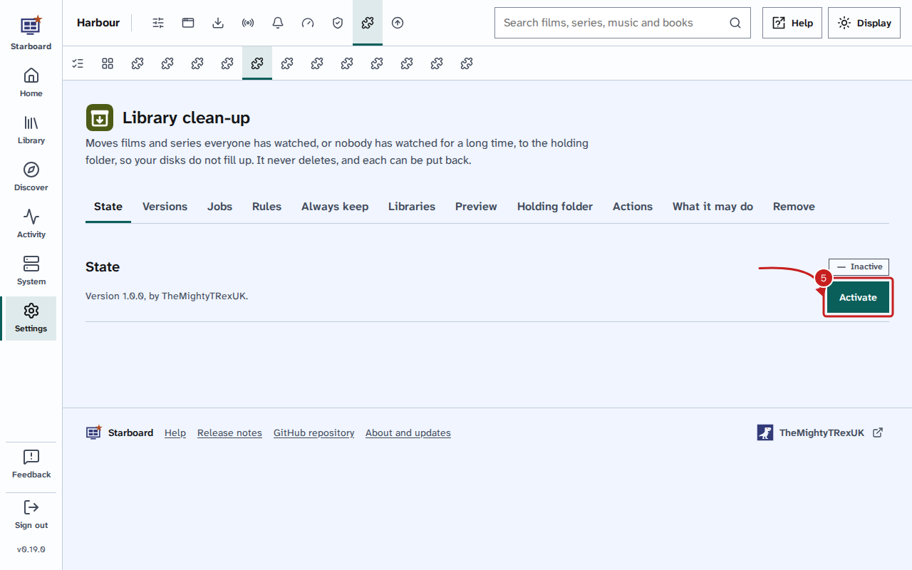

# Library clean-up: Install
<!-- Mirrored from the starboard-plugins repository by tools/sync-plugin-help.py: change it there. -->

Add Library clean-up from Starboard's **Catalogue**, where it is listed under **Jellyfin**. Starboard shows what it may do and tests it before anything is added. Starboard never adds it by itself. At the end, Library clean-up is active, nothing has moved, and its card is ready for your dashboard.

## Before you begin

- Starboard 0.19.0 or later, with plug-in API 1.15. Library clean-up 1.0.0 is its first version, so an older Starboard is not offered it: read [Updates](../library-cleanup/updates.md).
- Jellyfin added to Starboard, in **Settings**, then **Apps**. Library clean-up reads what each person watched from it.
- Reelix, so what moves is not downloaded again. Without Reelix it still moves items, but Reelix cannot be told to stop following them.
- Your films and series in Starboard's media folder. The holding folder is made inside it, at `media/.holding/library-cleanup`.
- Your Starboard password. Adding and removing a plug-in ask for it.

## What it may do

Starboard lists these before you add it, each with its risk. Its risk is high.

| Permission | Risk |
|---|---|
| Read and change your media folder, to move films and series into the holding folder there and put them back (`library:holding`) | High |
| Use Jellyfin's API key, kept by Starboard, to read what each person watched, their favourites, Continue watching and collections, and to tell Jellyfin what moved (`jellyfin:key`) | High |
| Use Reelix's API key, kept by Starboard, to stop following what moves and follow it again on **Put back** (`reelix:key`) | High |
| Reach other computers on your home network, where Jellyfin and Reelix answer (`network:lan`) | Medium |

What it runs:

- **main:** reaches your home network. It can use its own folder in Starboard's data (`data/plugins/library-cleanup`) and the whole media folder, to read and change, at `/media`. It runs as the owner of your media folder, so moved folders keep their owner. It rests after 15 minutes with nothing to do, and Starboard wakes it when it is needed.

It is given the whole media folder, so add it only if you trust it. Its code has no call that deletes a file or a folder, and the collection's tests check that.

Like every plug-in, it runs read only, as a user that is not root, with no extra rights. Its image is pinned by digest, so what you approved is what runs.

## Memory and processor

- **main:** 128 MB of memory and 0.5 of a processor core at most.

Measured:

- 22.21 MiB at rest in the smoke test, on 15 November 2026.
- On made-up data (3,000 films and 300 series for 3 people), measured on 15 November 2026: about 14 MB at rest, 31 MB at its busiest while it worked out **Preview** and moved 200 items, and 28 MB after. 0% of a processor at rest.

## Add it

1. Go to **Settings**, then **Plug-ins**, then **Catalogue**.
2. Under **Jellyfin**, find **Library clean-up** and select **Install…**.

   

3. A slide-out opens with what it can read, change and reach. Read it all. Under **It can change**, the line about your media folder says what it may do there.

   

4. Enter your Starboard password and select **Install Library clean-up**. To stop, select **Cancel**: nothing is installed.

   

5. Library clean-up's own tab opens under **Settings**, then **Plug-ins**, and Starboard activates it: its **State**, in **General**, says **Active**. If it needs settings first, it says what to enter: save them, then select **Activate**.

   

6. Check the rules, **Libraries** and **Always keep**. If someone never watches, such as a guest account, add their Jellyfin user name to **People to leave out**. Read [Settings](../library-cleanup/settings.md).
7. Open **Preview**. It lists what the rules would move now, and the space each frees. Nothing moves from **Preview**.
8. When **Preview** lists only what you are happy to move, activate **Move items each day** in **Rules**.
9. Add its card to your dashboard. Read [Dashboard card](../library-cleanup/dashboard-card.md).

To move items straight away, once **Move items each day** is activated, go to **System**, then **Jobs**, and select **Run now** beside **Move items to the holding folder**.

### Add it by its address

On the **Catalogue** page, under **Add one from elsewhere**, paste this into **The plug-in's manifest address**, then select **What it does** and carry on from step 3:

```text
https://raw.githubusercontent.com/TheMightyTRex/starboard-plugins/main/library-cleanup/starboard-plugin.json
```

Or run its installer, `install.py` in its folder, on any computer with Python, and give your Starboard's address.

## Remove it

1. First, put back anything you want to keep in your library: open **Holding folder** on its tab and select **Put back** beside each one.
2. Go to **Settings**, then **Plug-ins**, then **Library clean-up**.
3. Under **Remove**, select **Remove Library clean-up**.
4. Choose where its folder goes: **Keep it with Starboard's data** (in `data/plugins/.removed`) or **Move it to the holding folder**, listed in **System**, **Clean up**, where you can put it back or delete it for good.
5. Enter your Starboard password and select **Remove**.

Its containers stop and go, and its API key stops working. Nothing is deleted. What it moved stays in `media/.holding/library-cleanup`. To return a folder after it is removed, move it back to where it was yourself, then choose **Follow** for it in Starboard's **Library** so Reelix follows it again.

To stop it for a while instead, deactivate **Move items each day**, or select **Deactivate** on its tab: its settings, its folder and what is in the holding folder are kept.

## Find out more

- [What Library clean-up does](../library-cleanup/README.md)
- [Settings](../library-cleanup/settings.md)
- [Problems](../library-cleanup/problems.md)
- [Add a plug-in, in Starboard's help](../../topics/add-a-plugin.md)
- [What a plug-in can change, in Starboard's help](../../basics/what-plugins-can-change.md)

<!-- footer: download rights -->

---

**Download only what you have the right to.** Use the download apps only for files you have the right to download,
such as open-source software, works in the public domain and your own backups. Downloading films, series, music or
books without the copyright holder's permission is against the law in the UK and most other countries. Starboard
does not host or provide any files, and you are responsible for what you download.

<!-- /footer -->
