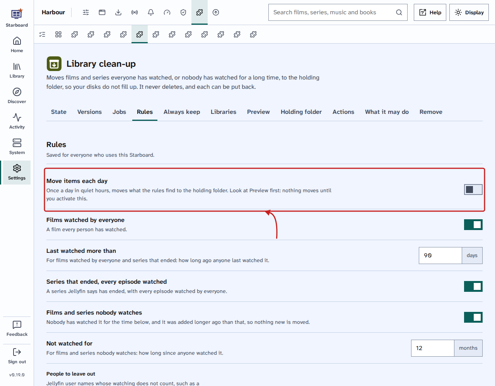
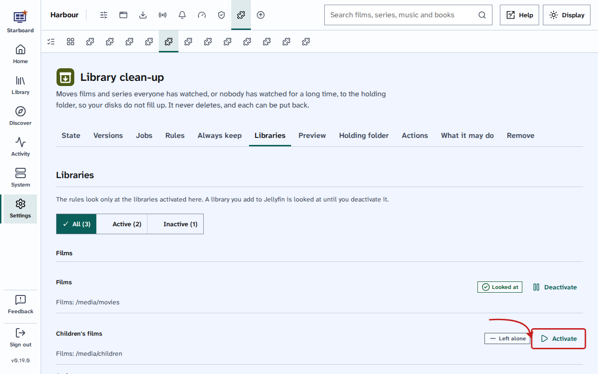
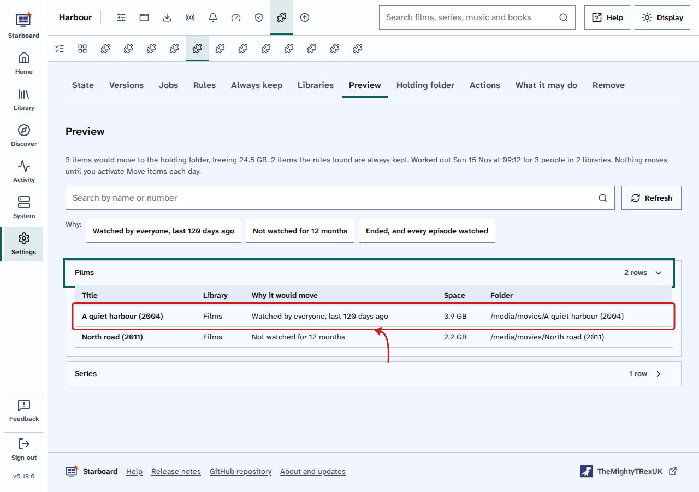
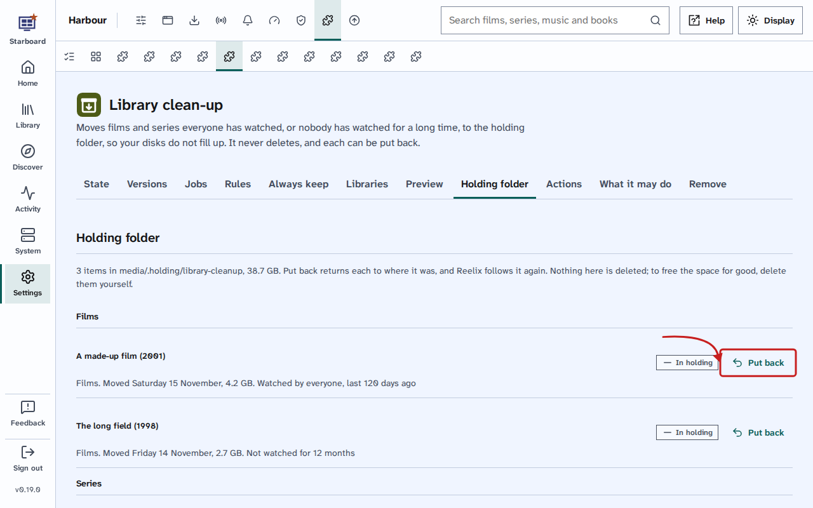

# Library clean-up: Settings
<!-- Mirrored from the starboard-plugins repository by tools/sync-plugin-help.py: change it there. -->

Library clean-up's settings are on its own tab: go to **Settings**, then **Plug-ins**, then **Library clean-up**. Starboard draws them and keeps them; secrets are never shown again once saved.

## Rules

| Setting | What it does | Default |
|---|---|---|
| **Move items each day** | Once a day in quiet hours, moves what the rules find to the holding folder. Check **Preview** first: nothing moves until you activate this. Activated or deactivated. | Deactivated |
| **Films watched by everyone** | A film every person has watched, and the last time anyone watched it was longer ago than **Last watched more than**. Activated or deactivated. | Activated |
| **Last watched more than** | For films watched by everyone and series that ended: how long ago anyone last watched it. A number from 7 to 3,650 days. | 90 days |
| **Series that ended, every episode watched** | A series Jellyfin says has ended, with every episode watched by everyone, the last longer ago than **Last watched more than**. Activated or deactivated. | Activated |
| **Films and series nobody watches** | Nobody has watched it for the time in **Not watched for**, and it was added longer ago than that, so nothing new is moved. Activated or deactivated. | Activated |
| **Not watched for** | For films and series nobody watches: how long since anyone watched it. A number from 1 to 120 months. | 12 months |
| **People to leave out** | Jellyfin user names whose watching does not count, such as a guest account. Everyone else who can sign in to Jellyfin counts. | Nobody |

## Libraries

| Setting | What it does | Default |
|---|---|---|
| **Libraries** | A page of its own that lists each film and series library in Jellyfin. Choose **Deactivate** for a library the rules should leave alone, such as a children's library. It then says **Left alone**; **Activate** brings it back. | Every library activated |

## Always keep

| Setting | What it does | Default |
|---|---|---|
| **Favourites** | Anything someone has marked as a favourite in Jellyfin stays. Activated or deactivated. | Activated |
| **Something someone is part way through** | A film or series in anyone's **Continue watching**, or a series someone has started, stays. Activated or deactivated. | Activated |
| **Films in a collection** | A film in one of Jellyfin's collections, such as a film series you keep together, stays. Activated or deactivated. | Activated |
| **Keep tag** | Anything with this tag in Jellyfin stays. Change the word, or leave it empty to use no tag. | `keep` |

## Preview and Holding folder

| Setting | What it does | Default |
|---|---|---|
| **Preview** | A page of its own that lists every film and series the rules would move now, with why and how much space each frees, and the total at the top. It is worked out in the background when you open it, when a setting changes, after six hours, or with **Preview again**. Nothing moves from it. | Not a setting |
| **Holding folder** | A page of its own that lists everything Library clean-up moved, newest first, with when, why and its size, and a **Put back** button beside each. | Not a setting |

## Buttons

These are on Library clean-up's tab.

- **Preview again** works out **Preview** again straight away, in the background. The page updates by itself.
- **Put back**, beside an item on **Holding folder**, returns it to the same folder. Reelix follows it again exactly as before (the same episodes), and Jellyfin is told, so it is back in your library within a minute. If something else is in its place now, it stays in the holding folder and the page says so.
- **Run now** in **System**, then **Jobs**, beside **Move items to the holding folder**, runs the move straight away, only when **Move items each day** is activated.

## Things to note

- To keep a film for good, add the keep tag to it in Jellyfin: open the film, choose **Edit metadata**, and add `keep` under **Tags**.
- "Everyone" means each person who can sign in to Jellyfin. If someone never watches, add them to **People to leave out**, or **Films watched by everyone** never finds anything.
- A run moves up to 200 items, within 50 minutes; the next run carries on.
- An item moves to `media/.holding/library-cleanup`, keeping the folders it was in: `media/movies/A Film (2001)` goes to `media/.holding/library-cleanup/movies/A Film (2001)`. A film with no folder of its own moves with its subtitles and the other files that share its name.
- A move is a rename inside the media folder, so it is instant and needs no free space. A move that would have to copy is not made, and something with the same name already in the holding folder is never overwritten.
- It never deletes. The space is still used until you delete a folder in `media/.holding/library-cleanup` yourself, with your computer's file manager or a terminal.
- Settings are kept when you update or deactivate it, and when you remove it they stay in its folder.

## Find out more

- [Install](../library-cleanup/install.md)
- [Dashboard card](../library-cleanup/dashboard-card.md)
- [Problems](../library-cleanup/problems.md)

<!-- footer: download rights -->

---

**Download only what you have the right to.** Use the download apps only for files you have the right to download,
such as open-source software, works in the public domain and your own backups. Downloading films, series, music or
books without the copyright holder's permission is against the law in the UK and most other countries. Starboard
does not host or provide any files, and you are responsible for what you download.

<!-- /footer -->
