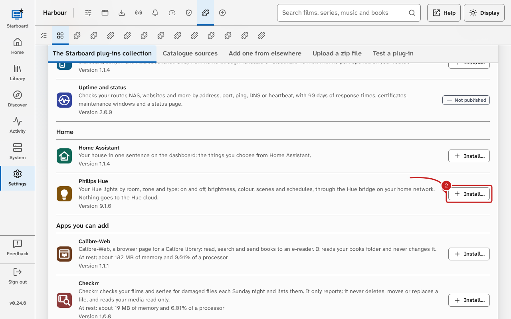
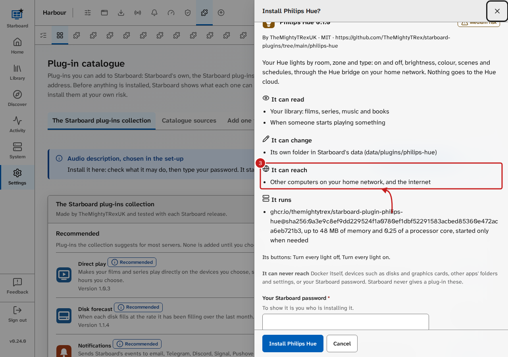
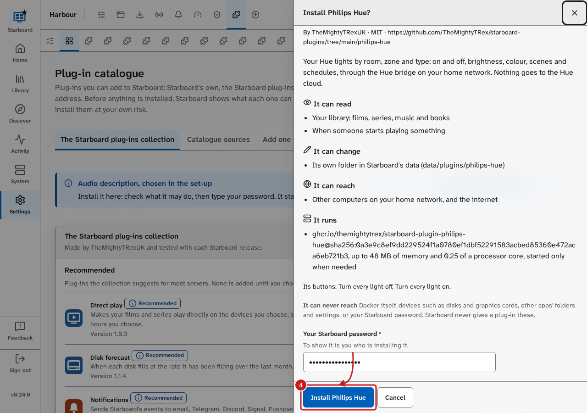
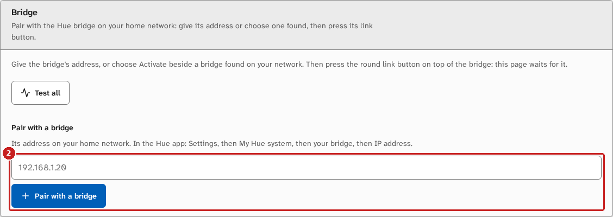
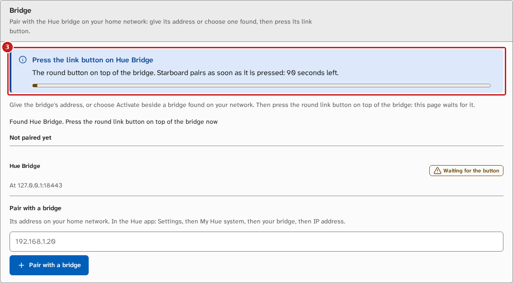
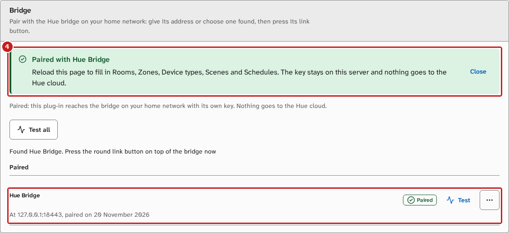

# Philips Hue: Install
<!-- Mirrored from the starboard-plugins repository by tools/sync-plugin-help.py: change it there. -->

Add Philips Hue from Starboard's **Catalogue**, where it is listed under **Home**. Then pair it with the Hue bridge on your home network by pressing the bridge's link button. It talks only to the bridge: nothing goes to the Hue cloud, and it needs no Hue account.

## Before you begin

- Starboard with plug-in API 1.16 or later (Starboard 0.23.0). An older Starboard is not offered it.
- Your Starboard password. Adding and removing a plug-in ask for it.
- A Philips Hue bridge on the same home network as Starboard, with your lights, rooms and zones already set up in the Hue app. The bridge needs its newer API (CLIP v2): a bridge kept up to date in the Hue app has it.
- You can reach the bridge to press the round link button on top of it while you pair.

## What it may do

Starboard lists these before you add it, each with its risk.

| Permission | Risk |
|---|---|
| Reach other computers on your home network, and the internet (`network:lan`) | Medium |
| Your films, series and books (the media folder, read only, and the library) (`media:read`) | Medium |

It uses `network:lan` only to reach the bridge. It asks for `media:read` only so Starboard sends it the **When someone starts playing something** event, for **When something plays**. It reads no files, and it never asks Jellyfin or Reelix anything.

What it runs:

- **main:** reaches the Hue bridge on your home network over HTTPS. It can use its own folder in Starboard's data (`data/plugins/philips-hue`). There it keeps the bridge's address, the key the bridge gave it and the bridge's certificate fingerprint.

Like every plug-in, it runs read only, as a user that is not root, with no extra rights. Its image is pinned by digest once GitHub has built it, so what you approved is what runs.

## Memory and processor

- **main:** 48 MB of memory and a quarter of a processor core at most.
- It rests when nothing asks it anything, and Starboard starts it again when you open its tab, a card asks or something starts playing. It rests again after 15 minutes with nothing to do.
- Measured on 20 November 2026 against a made-up bridge with 8 lights in 4 rooms and 2 zones, it used 15.4 MB at start. It used 16.6 MB after 160 page loads, schedules and switches. It uses 0% of a processor at rest, and nothing while it rests.

## Add it

1. Go to **Settings**, then **Plug-ins**, then **Catalogue**.
2. Under **Home**, find **Philips Hue** and select **Install…**.

   

3. A slide-out opens with what it can read, change and reach. Read it all.

   

4. Enter your Starboard password and select **Install Philips Hue**. To stop, select **Cancel**: nothing is installed.

   

5. Philips Hue's own tab opens under **Settings**, then **Plug-ins**, and Starboard turns it on: its **State**, in **General**, says **Active**.

### Add it by its address

On the **Catalogue** page, under **Add one from elsewhere**, paste this into **The plug-in's manifest address**, then select **What it does** and carry on from step 3:

```text
https://raw.githubusercontent.com/TheMightyTRex/starboard-plugins/main/philips-hue/starboard-plugin.json
```

Or run its installer, `install.py` in its folder, on any computer with Python, and give your Starboard's address.

## Pair it with your bridge

1. Go to **Settings**, then **Plug-ins**, then **Philips Hue**, then **Bridge**.
2. In **Pair with a bridge**, enter the bridge's address, such as `192.168.1.20`, and select **Pair with a bridge**. The address is in the Hue app: **Settings**, then **My Hue system**, then your bridge, then **IP address**. A bridge found on your network is listed under **Found on your network**: select **Turn on** beside it instead.

   

3. Press the round link button on top of the bridge. The page says **Press the link button on** and the bridge's name, with a bar and the seconds left. It waits 90 seconds and pairs as soon as you press the button.

   

4. The page says **Paired with** and the bridge's name, and the bridge is listed under **Paired**. Reload the page to fill in **Rooms**, **Zones**, **Device types**, **Scenes** and **Schedules**.

   

If you did not press the button in time, the page says **The link button was not pressed in time**. Select **Turn on** beside the bridge and press the button again.

Then put its cards on your dashboard. Read [Dashboard card](../philips-hue/dashboard-card.md).

## Remove it

1. Go to **Settings**, then **Plug-ins**, then **Philips Hue**.
2. Under **Remove**, select **Remove Philips Hue**.
3. Choose where its folder goes: **Keep it with Starboard's data** (in `data/plugins/.removed`) or **Move it to the holding folder**, listed in **System**, **Clean up**.
4. Enter your Starboard password and select **Remove**.

Its container stops and its API key stops working. Nothing is deleted. Your lights, scenes and the schedules it made stay on the bridge and keep running. If you no longer want those schedules, remove them first on **Schedules**. The Hue app lists it among the bridge's connected apps as `starboard#philips-hue`, where you can remove its key too. To stop it for a while instead, select **Turn off** on its tab.

## Find out more

- [What Philips Hue does](../philips-hue/README.md)
- [Settings](../philips-hue/settings.md)
- [Problems](../philips-hue/problems.md)
- [Add a plug-in, in Starboard's help](../../topics/add-a-plugin.md)
- [What a plug-in can change, in Starboard's help](../../basics/what-plugins-can-change.md)

<!-- footer: download rights -->

---

**Download only what you have the right to.** Use the download apps only for files you have the right to download.
Examples are open-source software, works in the public domain and your own backups. Downloading films, series, music or
books without the copyright holder's permission is against the law in the UK and most other countries. Starboard
does not host or provide any files, and you are responsible for what you download.

**Need help?** Ask on the [Starboard Discord support server](https://discord.gg/xN9bf2H4vv).

<!-- /footer -->
