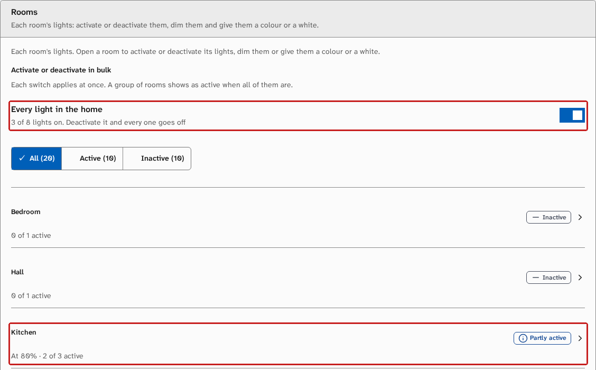
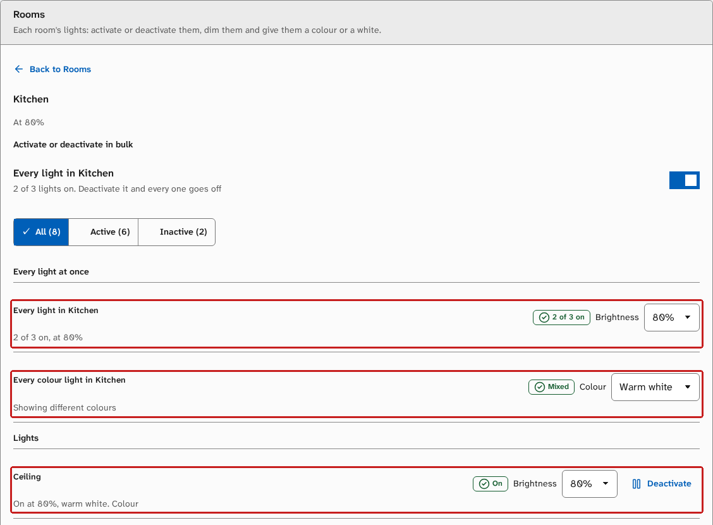
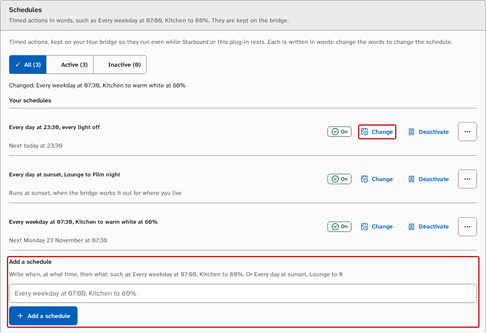
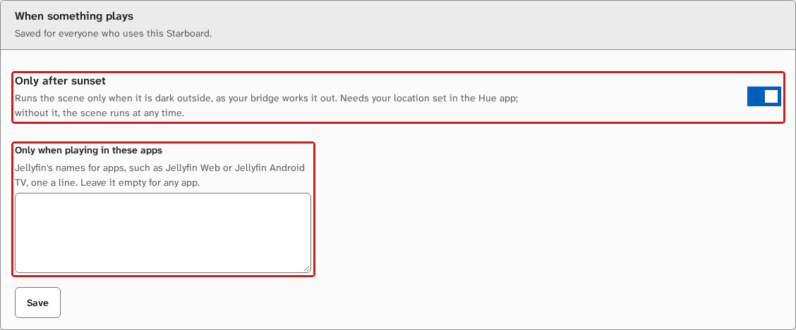

# Philips Hue: Settings
<!-- Mirrored from the starboard-plugins repository by tools/sync-plugin-help.py: change it there. -->

Philips Hue's settings are on its own tab: go to **Settings**, then **Plug-ins**, then **Philips Hue**. It has seven sections: **Bridge**, **Rooms**, **Zones**, **Device types**, **Scenes**, **Schedules** and **When something plays**. Every change goes straight to the bridge on your home network, and each says what it did, such as "Ceiling is at 40%".

## Bridge

Pairs the plug-in with your Hue bridge. Read [Install](../philips-hue/install.md) for the steps.

- **Pair with a bridge** takes the bridge's address, such as `192.168.1.20`. A bridge found on your network is listed under **Found on your network**, with **Turn on** beside it.
- Once paired, the bridge's row says **Paired**, its address and the day it was paired. **Test** checks that it answers and says how many lights, rooms and zones it has. **Remove**, in the row's **More** menu, forgets the bridge and its key here: its lights, scenes and schedules stay on the bridge.

## Rooms, Zones and Device types

The same lights grouped three ways:

- **Rooms:** the rooms you made in the Hue app. Lights in no room are under **Not in a room**.
- **Zones:** the zones you made in the Hue app, such as Downstairs. A light can be in several zones.
- **Device types:** what each light is: **Bulbs**, **Candle bulbs**, **Spot lights**, **Light strips**, **Lamps**, **Ceiling lights**, **Outdoor lights**, **Smart plugs** and **Other lights**.

Each tab starts with **Turn on or off in bulk**. It has a switch for **Every light in the home**. It also has one for every light in each room, zone or type, with how many are on. Turn off a switch and every light in it goes off; turn it on and they all come on. Then open a room, zone or type by its name: it lists its lights.

| Row | What it does |
|---|---|
| **Every light in** the room or zone, or **of this type** | **Brightness** for every light in it at once, from **Off** to 100% |
| **Every colour light in** the room, or **Every white ambiance light** | **Colour** for every light in it that can show one. Says **Mixed** when they show different colours |
| Each light | **Turn on** or **Turn off**, and its **Brightness**. Its detail says its state in words, such as "On at 80%, warm white", and what it is: **Colour**, **White ambiance**, **White** or **Smart plug** |
| Each light's colour | **Colour**: a white or a colour by its name |

- **Brightness** is **Off**, 1%, or 10% to 100% in steps of 10.
- **Colour** for a colour light: **Warm white**, **Soft white**, **Neutral white**, **Cool white**, **Daylight**, **Red**, **Orange**, **Yellow**, **Green**, **Blue**, **Purple** and **Pink**. A white ambiance light shows the five whites. A white light and a smart plug have no colour.
- Choosing a brightness or a colour also turns on the light.
- A light the bridge cannot reach says **Not reachable**. Its switch is kept, as in the Hue app: the bridge acts on it when it is back.

## Scenes

Each room's and zone's scenes, as made in the Hue app. Open a room or zone by its name. **Turn on** shows a scene, and its row says **In use**; **Turn off** turns that room's lights off. The plug-in does not make or change scenes: do that in the Hue app.

## Schedules

Timed actions written in words, kept on the bridge, so they run while Starboard or this plug-in rests. Enter one in **Add a schedule** and select **Add a schedule**. Each is written as when, at what time, then what:

| Example | What it does |
|---|---|
| `Every weekday at 07:00, Kitchen to 80%` | Monday to Friday at 7 in the morning, the Kitchen at 80% |
| `Every Monday, Wednesday and Friday at sunset, Lounge to Relax` | Shows the Lounge's scene Relax at sunset on those days |
| `Every weekend at 09:00, Bedroom to warm white at 40%` | A white or a colour, with a brightness if you like |
| `Every day at 23:30, every light off` | Every light in the home off each night |
| `Once on 24 December at 18:00, Hall on` | Runs once. `Tomorrow at 06:30, Porch on` does too |

- **When:** `Every day`, `Every weekday`, `Every weekend`, days by name (`Every Monday and Friday`), or `Once on` a date, `Today` or `Tomorrow`.
- **Time:** hours and minutes, such as `07:00` or `18:30`, or `7am` and `6:30pm`, or `sunrise` or `sunset`. Sunrise and sunset need a schedule that repeats, and your location set in the Hue app.
- **What:** after the comma, give a room, a zone, a light or `every light`. Then give `on`, `off`, `to 80%`, `to` a white or a colour, or `to` the name of a room's or zone's scene.

Each row says when it next runs. **Change** opens the schedule in words, so you can change it. **Turn off** stops it until you turn it on again. **Remove**, in the row's **More** menu, removes it from the bridge. A schedule that runs once is removed by the bridge after it runs. If the words cannot be read, the box says what to change, such as "Give the time as hours and minutes".

Schedules made in the Hue app or another app are listed under **Made in another app**, to read only: change them there.

## When something plays

**Scene when something plays** lists each room's and zone's scenes. Turn one on, and when someone starts playing something in Jellyfin, the plug-in shows that scene. Only one is chosen at a time; turn it off to stop. The intro says when it last ran, and for what.

| Setting | What it does | Default |
|---|---|---|
| **Only after sunset** | Runs the scene only when it is dark outside, as your bridge works it out. Needs your location set in the Hue app; without it, the scene runs at any time | Active |
| **Only when playing in these apps** | Jellyfin's names for apps, such as Jellyfin Web or Jellyfin Android TV, one a line. Part of a name is enough. Leave it empty for any app | Empty |

Starboard checks what is playing every 5 minutes, so the lights can change up to 5 minutes after something starts.

## Things to note

- **Local only:** everything goes to the bridge on your home network over HTTPS. Nothing goes to the Hue cloud, and Hue's discovery website is never used.
- **Rooms, zones and scenes** come from the Hue app. Make or rename them there; this plug-in shows them a few seconds later.
- **Schedules** use the bridge's version 1 schedules, because its newer API has none, and rules on its daylight sensor for sunrise and sunset. In the Hue app, each is named `Starboard` and the start of its words.
- Settings are kept when you update or turn it off.

## Find out more

- [Install](../philips-hue/install.md)
- [Dashboard card](../philips-hue/dashboard-card.md)
- [Problems](../philips-hue/problems.md)

<!-- footer: download rights -->

---

**Download only what you have the right to.** Use the download apps only for files you have the right to download.
Examples are open-source software, works in the public domain and your own backups. Downloading films, series, music or
books without the copyright holder's permission is against the law in the UK and most other countries. Starboard
does not host or provide any files, and you are responsible for what you download.

**Need help?** Ask on the [Starboard Discord support server](https://discord.gg/xN9bf2H4vv).

<!-- /footer -->
