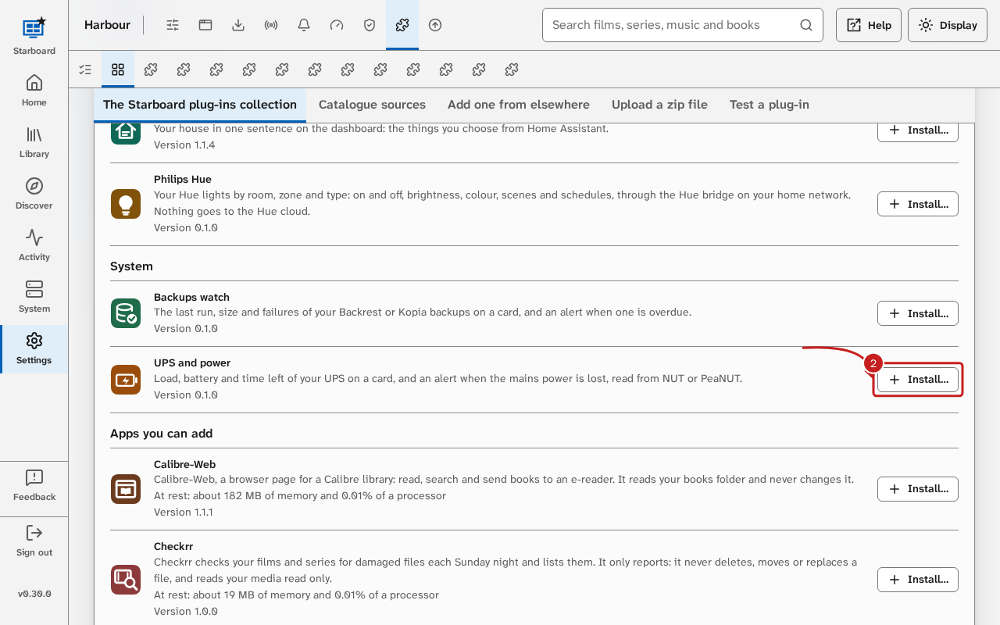
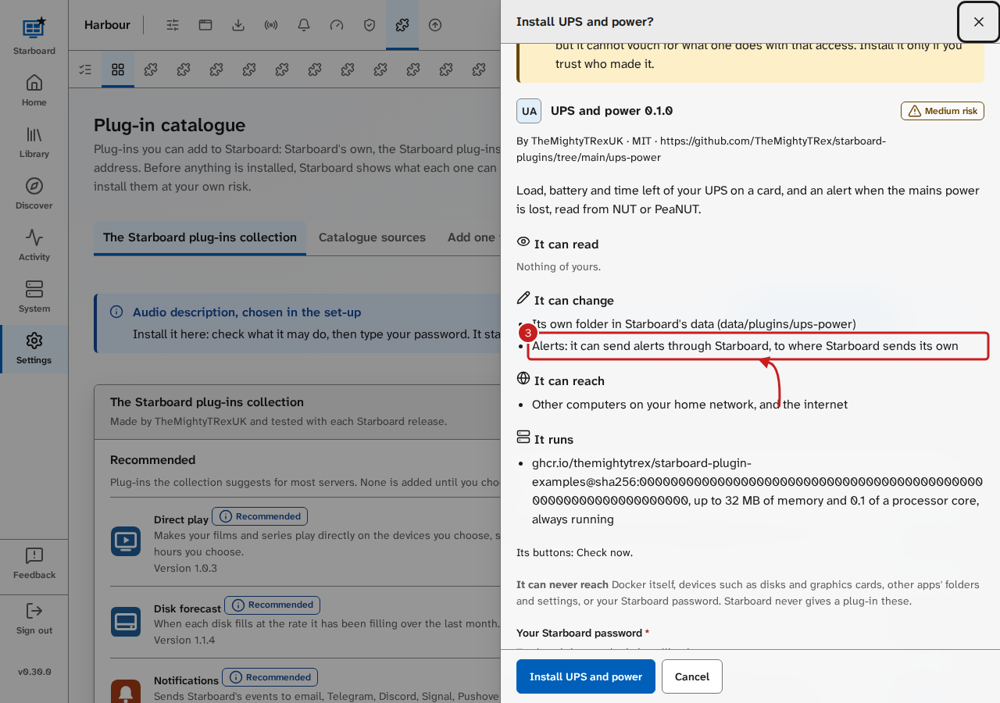
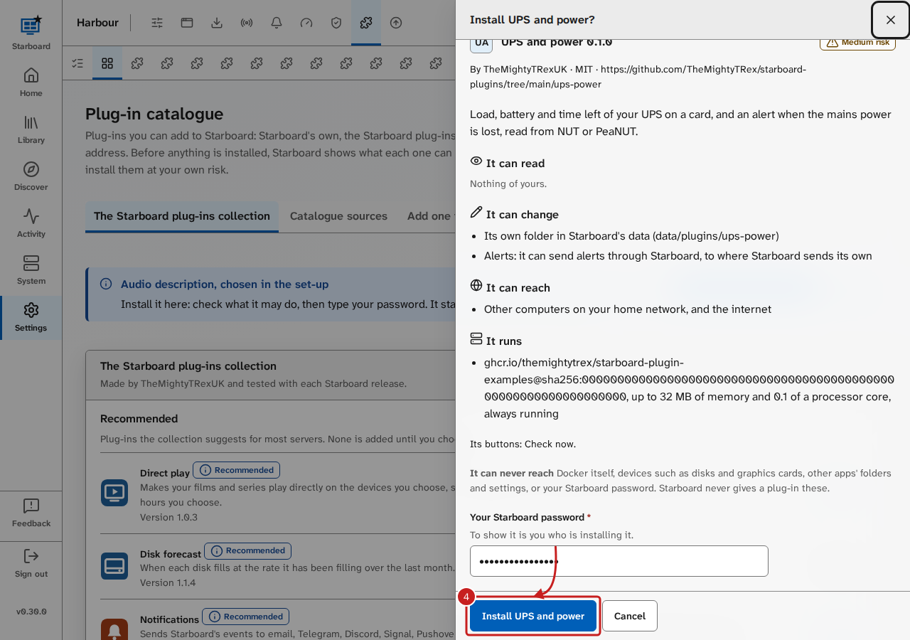

# UPS and power: Install
<!-- Mirrored from the starboard-plugins repository by tools/sync-plugin-help.py: change it there. -->

Add UPS and power from Starboard's **Catalogue**, where it is listed under **System**. Starboard shows what it may do and tests it before anything is added. At the end, UPS and power is added, and it needs the UPS's address before it can show anything.

## Before you begin

- Starboard with plug-in API 1.17 or later (Starboard 0.26.0 or later).
- A UPS that NUT (the Network UPS Tools server) reads, or PeaNUT running in front of NUT, and its address. Read [Settings](../ups-power/settings.md) for what to enter.
- Your Starboard password. Adding and removing a plug-in ask for it.

## What it may do

Starboard lists these before you add it, each with its risk.

| Permission | Risk |
|---|---|
| Reach other computers on your home network, and the internet (`network:lan`) | Medium |
| Send alerts through Starboard (`alerts:send`) | Low |

What it runs:

- **main:** reaches your home network. It can use its own folder in Starboard's data (`data/plugins/ups-power`). It keeps running, because it asks the UPS once a minute so it can alert you when the mains power is lost.

Like every plug-in, it runs read only, as a user that is not root, with no extra rights. It only reads from NUT or PeaNUT: it never changes a UPS setting, runs a command or shuts anything down.

## Memory and processor

- **main:** 32 MB of memory and 0.1 of a processor core at most. It asks the UPS once a minute (one short connection to NUT, or one request to PeaNUT) and keeps a short history in its folder.

## Add it

1. Go to **Settings**, then **Plug-ins**, then **Catalogue**.
2. Under **System**, find **UPS and power** and select **Install…**.



3. A slide-out opens with what it can read, change and reach. Read it all.



4. Enter your Starboard password and select **Install UPS and power**. To stop, select **Cancel**: nothing is installed.



5. UPS and power's own tab opens under **Settings**, then **Plug-ins**. Choose how to read the UPS and enter its address, then save and select **Activate**. Read [Settings](../ups-power/settings.md).

### Add it by its address

On the **Catalogue** page, under **Add one from elsewhere**, paste this into **The plug-in's manifest address**. Then select **What it does** and carry on from step 3:

```text
https://raw.githubusercontent.com/TheMightyTRex/starboard-plugins/main/ups-power/starboard-plugin.json
```

Or run its installer, `install.py` in its folder, on any computer with Python, and give your Starboard's address.

## Remove it

1. Go to **Settings**, then **Plug-ins**, then **UPS and power**.
2. Under **Remove**, select **Remove UPS and power**.
3. Choose where its folder goes: **Keep it with Starboard's data** (in `data/plugins/.removed`) or **Move it to the holding folder**. The holding folder is listed in **System**, **Clean up**, where you can put it back or delete it for good.
4. Enter your Starboard password and select **Remove**.

Its container stops and goes, and its API key stops working. Your UPS and NUT are not touched.

## Find out more

- [What UPS and power does](../ups-power/README.md)
- [Settings](../ups-power/settings.md)
- [Problems](../ups-power/problems.md)
- [Add a plug-in, in Starboard's help](../../topics/add-a-plugin.md)
- [What a plug-in can change, in Starboard's help](../../basics/what-plugins-can-change.md)

<!-- footer: download rights -->

---

**Download only what you have the right to.** Use the download apps only for files you have the right to download.
Examples are open-source software, works in the public domain and your own backups. Downloading films, series, music or
books without the copyright holder's permission is against the law in the UK and most other countries. Starboard
does not host or provide any files, and you are responsible for what you download.

**Need help?** Ask on the [Starboard Discord support server](https://discord.gg/xN9bf2H4vv).

<!-- /footer -->
