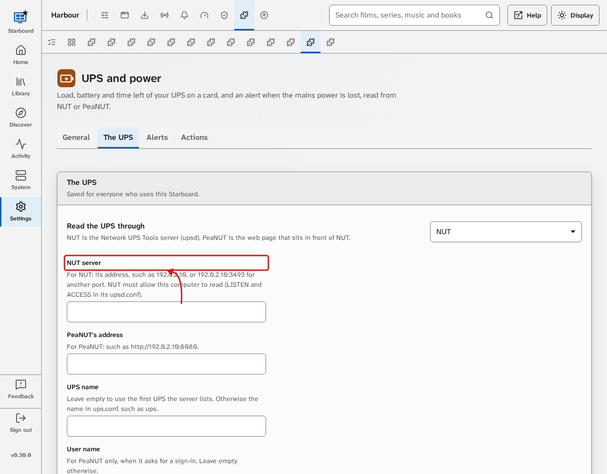
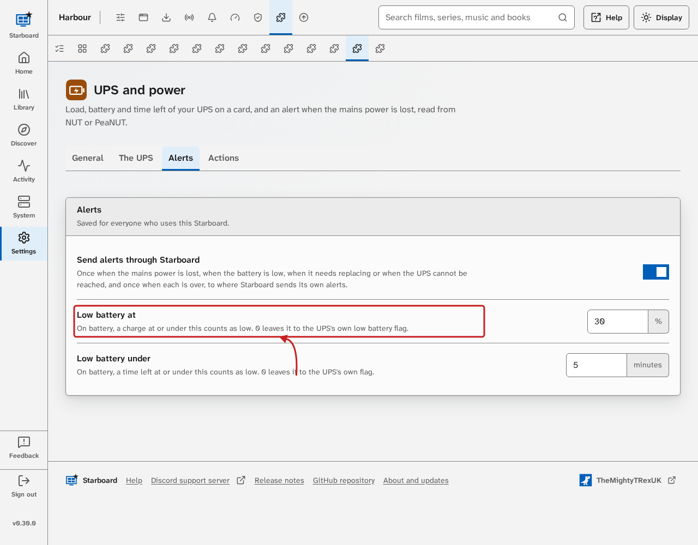

# UPS and power: Settings
<!-- Mirrored from the starboard-plugins repository by tools/sync-plugin-help.py: change it there. -->

The settings for UPS and power are on its own tab: go to **Settings**, then **Plug-ins**, then **UPS and power**. Starboard draws them and keeps them; secrets are never shown again once saved.

## The UPS

| Setting | What it does | Default |
|---|---|---|
| **Read the UPS through** | NUT is the Network UPS Tools server (upsd). PeaNUT is the web page that sits in front of NUT. One of: NUT, PeaNUT. | NUT |
| **NUT server** | For NUT: its address, such as 192.0.2.10, or 192.0.2.10:3493 for another port. NUT must allow this computer to read (LISTEN and ACCESS in its upsd.conf). Words. | Empty |
| **PeaNUT's address** | For PeaNUT: such as http://192.0.2.10:8080. A web address. | Empty |
| **UPS name** | Leave empty to use the first UPS the server lists. Otherwise the name in ups.conf, such as ups. Words. | Empty |
| **User name** | For PeaNUT only, when it asks for a sign-in. Leave empty otherwise. Words. | Empty |
| **Password** | PeaNUT's password. Kept secret by Starboard: it is never shown again. | Empty |

## Alerts

| Setting | What it does | Default |
|---|---|---|
| **Send alerts through Starboard** | Once when the mains power is lost, when the battery is low, when it needs replacing or when the UPS cannot be reached, and once when each is over, to where Starboard sends its own alerts. Turned on or off. | Turned on |
| **Low battery at** | On battery, a charge at or under this counts as low, from 0 to 99. 0 leaves it to the UPS's own low battery flag. | 30 % |
| **Low battery under** | On battery, a time left at or under this counts as low, from 0 to 600 minutes. 0 leaves it to the UPS's own flag. | 5 minutes |

## Buttons

- **Check now** asks the UPS straight away, instead of waiting for the next minute. It says whether the UPS is on mains power or on battery, and its charge.

## Good to know

- It asks once a minute. A power cut that ends within a minute may pass unnoticed.
- NUT's own `upsmon` is what shuts a server down when the battery runs out. This plug-in only tells you.
- Alerts need Starboard to take them from plug-ins, and that is on when Starboard's alerts are on in **Settings**, then **Alerts**.
- An alert for the UPS being out of reach is sent after three minutes without an answer, not at the first missed one.

## Find out more

- [Dashboard card](../ups-power/dashboard-card.md)
- [Problems](../ups-power/problems.md)

<!-- footer: download rights -->

---

**Download only what you have the right to.** Use the download apps only for files you have the right to download.
Examples are open-source software, works in the public domain and your own backups. Downloading films, series, music or
books without the copyright holder's permission is against the law in the UK and most other countries. Starboard
does not host or provide any files, and you are responsible for what you download.

**Need help?** Ask on the [Starboard Discord support server](https://discord.gg/xN9bf2H4vv).

<!-- /footer -->
