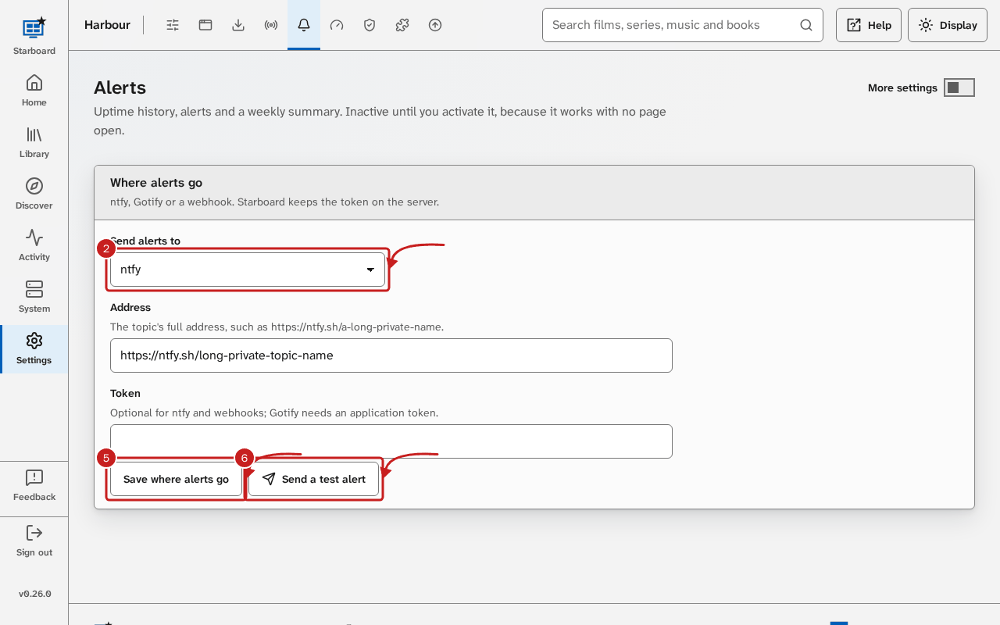
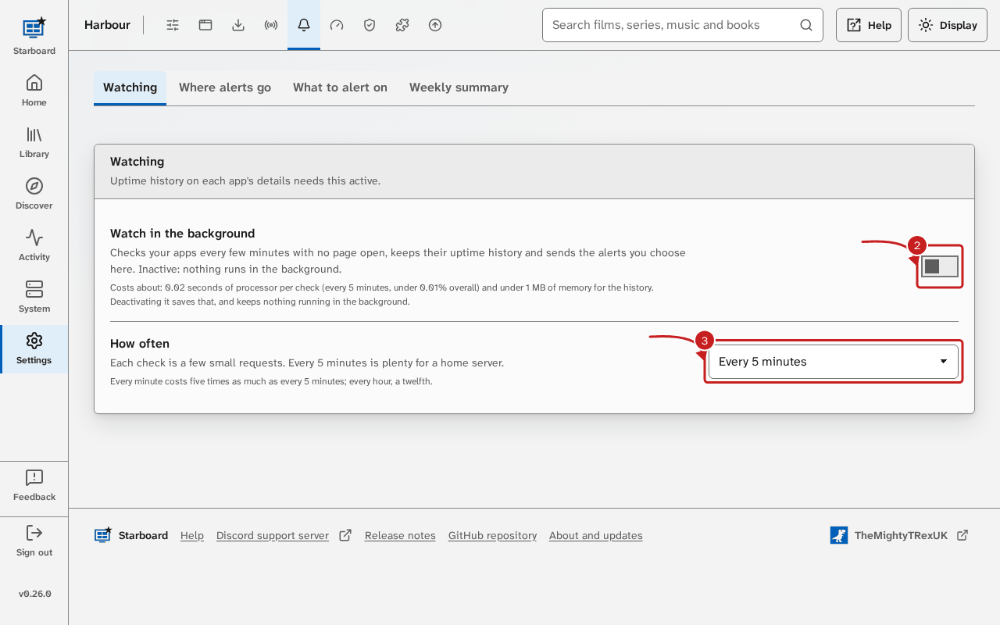
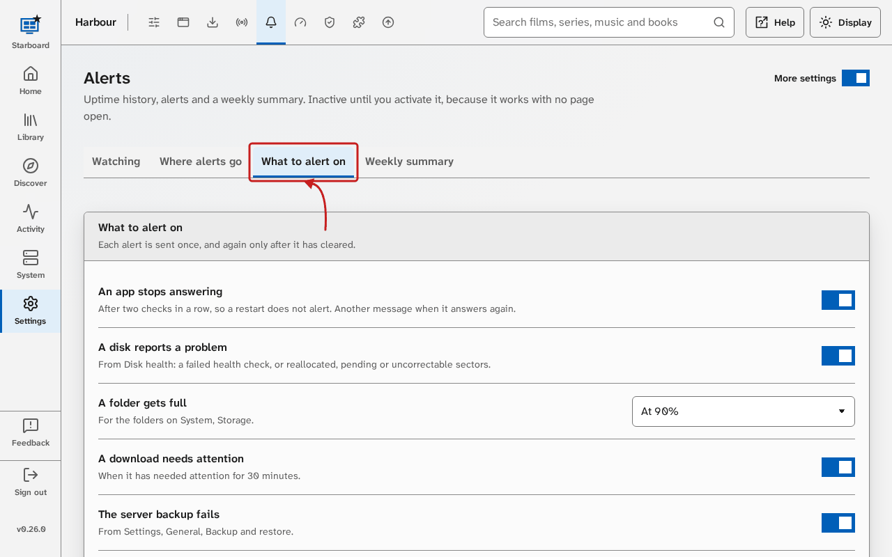

[Help centre](../README.md) · Alerts · how-to
<!-- help: use / alerts -->

# Activate alerts

Starboard can send a message to your phone when an app stops answering, a disk has a problem or fills up, a
download is stuck, a backup fails or a certificate runs out. Alerts are inactive until you activate watching.

## Before you begin

Choose where alerts go. Starboard can send them to one of these:

- **ntfy:** a free phone app that receives messages. Install ntfy on your phone and subscribe to a topic. A
  topic is a name; choose a long one that nobody could guess.
- **Gotify:** a message server you run yourself. You need its address and an application token from Gotify.
- **A webhook:** any service that accepts a message sent as JSON. Starboard sends a title, a message, a level
  and the source.

## Steps

### Choose where alerts go

1. Go to **Settings**, then **Alerts**.
2. Under **Where alerts go**, in **Send alerts to**, choose **ntfy**, **Gotify** or **A webhook (JSON)**.
3. In **Address**, enter the full address. For ntfy, that is the topic's address, such as
   `https://ntfy.sh/` followed by your topic's name.
4. In **Token**, paste the token if you have one. Gotify needs an application token. For ntfy and webhooks it
   is optional.
5. Select **Save where alerts go**. Starboard shows the time it saved, such as "Saved at 16:31".
6. Select **Send a test alert**. Starboard shows "Test alert sent. Check that it arrived."

   

7. Check your phone. The test message says that alerts from Starboard reach you there.

### Activate watching

The rest of the Alerts page is under **More settings**.

1. On the same page, activate **More settings**.
2. Under **Watching**, activate **Watch in the background**. Starboard now checks your apps with no page open.
3. In **How often**, choose how often it checks. **Every 5 minutes** is plenty for a home server.

   

### Choose what to alert on

Under **What to alert on**, each alert is active unless you deactivate it. Each change applies at once.

- **An app stops answering:** after two checks in a row, so a restart does not alert. Another message comes
  when it answers again.
- **A disk reports a problem:** from Disk health, when a disk fails its health check or counts damaged areas.
  Read [Check your disks' health](check-disk-health.md).
- **A folder gets full:** choose **At 80%**, **At 85%**, **At 90%**, **At 95%** or **Off**, for the folders on
  System, Storage. Read [Check free space and what is using it](check-storage.md).
- **A download needs attention:** when it has needed attention for 30 minutes.
- **The server backup fails:** from Settings, General, Backup and restore. Read
  [Back up the whole server](back-up-the-server.md).
- **A certificate runs out soon:** for apps with an outside `https://` address. Choose **7 days before**,
  **14 days before**, **30 days before** or **Off**. Starboard checks once a day.

## Things to note

- Each alert is sent once, and again only after the problem has cleared and come back.
- Starboard keeps the token on the server and never shows it again. To keep the saved token when you change the
  address, leave **Token** empty.
- Watching also keeps each app's uptime history, shown in the app's details.
- Watching costs very little. Read [Make Starboard use less of your server](make-starboard-lighter.md#background-work).
- Anyone who knows your ntfy topic's name can read its messages, so keep the name long and private.
- An API key can never change where alerts go. Only someone signed in to Starboard can.

## If it does not work

- **Not sent** and a message: Starboard could not reach the address. Check the address and token, select
  **Save where alerts go**, then send another test.
- **No alerts arrive, but the test works:** check that **Watch in the background** is active, under
  **More settings**. Then check the alert you want is active under **What to alert on**.
- **A disk or folder alert never comes:** Disk health or the Storage folders may not be set up. Read
  [Check your disks' health](check-disk-health.md) and [Check free space and what is using it](check-storage.md).

## Find out more

- [Get a weekly summary](weekly-summary.md)
- [Get told when something goes wrong](../guides/get-told-when-something-goes-wrong.md)
- [An app shows as not responding](app-not-responding.md)

<!-- footer: download rights -->

---

**Download only what you have the right to.** Use the download apps only for files you have the right to download,
such as open-source software, works in the public domain and your own backups. Downloading films, series, music or
books without the copyright holder's permission is against the law in the UK and most other countries. Starboard
does not host or provide any files, and you are responsible for what you download.

**Need help?** Ask on the [Starboard Discord support server](https://discord.gg/xN9bf2H4vv).

<!-- /footer -->
