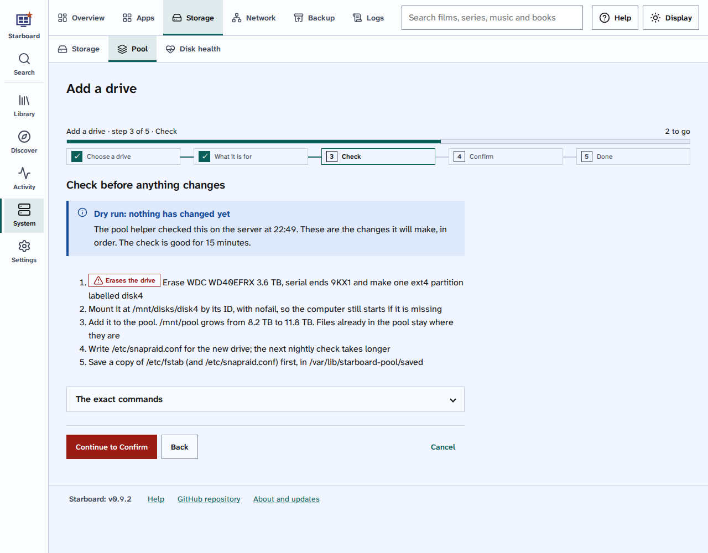

[Help centre](../README.md) · Your server · how-to

# Add a drive to the pool

A pool joins several drives into one folder, `/mnt/pool`, so your films, series and books have one place however
many drives you have. This adds a drive to the pool, or makes the pool from your first drive.

## Before you begin

- The pool helper is set up. Run `./install.sh` again and answer Yes to **Set up Drive pools?** The installer asks
  for your computer's password, because changing drives needs administrator rights. You type it in the terminal
  yourself.
- The computer has mergerfs, rsync and gdisk. On Debian, Ubuntu and Linux Mint, this command installs them:

  ```bash
  sudo apt install mergerfs rsync gdisk
  ```

- The new drive is plugged in. Note the last 4 characters of its serial number, from the label on the drive.
- Have your Starboard password ready: every change to the drives asks for it again.
- If the drive has files you want, copy them somewhere else first unless you are keeping them.

Read [What a drive pool is](../basics/what-is-a-drive-pool.md) if the idea is new.

## Steps

1. Go to **System**, then **Storage**, then **Pool**.
2. Select **Add a drive**.
3. **Choose a drive:** select the drive. Check the end of its serial number against the label on the drive.
   Starboard never offers the system drive, or a drive used by another pool, RAID or LVM.
4. Select **Continue to What it is for**.
5. Under **Use it**, select **Add it to the pool**. For a backup drive instead, read
   [Use a drive as a backup drive](use-a-drive-as-a-backup-drive.md).
6. Under **What is on it now**, select one:
   - **Keep its files:** its files appear in the pool as they are. Only offered when the drive has files.
   - **Erase it and prepare it (ext4):** everything on the drive is erased.
7. Select **Continue to Check**. The pool helper checks the plan on the server. Nothing has changed yet.
8. Read **Check before anything changes**. It lists every change, in order. To see the commands, select
   **The exact commands**.
9. Select **Continue to Confirm**.
10. If the drive is being erased, type the last 4 characters of its serial number.
11. Type your Starboard password.
12. Select **Add the drive**, or **Erase and add to the pool**.
13. Wait while each step is ticked off. When it says **Finished**, select **Back to Pool**.



## Things to note

- **The check is good for 15 minutes.** After that, or if the drive changed in the meantime, the helper stops
  with nothing changed, and you check again.
- **Files already in the pool stay where they are.** New files go to the drive with the most free space, so a new
  drive fills first. To even the drives out now, read [Balance the files](balance-the-files.md).
- **ext4** is used for erased drives because it copes best when the power goes off unexpectedly.
- **The first drive** makes the pool. Starboard also makes Docker wait for the pool when the computer starts, and
  locks the empty folder under it, so the apps never run against an empty folder.
- Before it changes anything, the helper saves a copy of `/etc/fstab` in `/var/lib/starboard-pool/saved`. It
  changes only its own lines there, between `# starboard-pool begin` and `# starboard-pool end`.
- A pool made outside Starboard is shown on the Pool page, but Starboard does not change it.
- **In the terminal:** `./install.sh --terminal` asks the same questions in its **Your drives** step. Read
  [Set up in the terminal](set-up-in-the-terminal.md).

## If it does not work

- **The pool helper is not set up:** answer Yes to **Set up Drive pools?** in `./install.sh`.
- **My drive is not listed:** it may be the system drive, part of RAID or LVM, or already in the pool. Check
  **Other drives** on the Pool page, which says why each drive is not offered. A drive with no stable name in
  `/dev/disk/by-id` is not offered either; some USB cases do not give one.
- **The drive changed since the check:** something else used the drive. Select **Back**, then check again.
- **Install these first:** the message names the programs to install. Install them, then try again.
- **/etc/fstab already mounts this drive:** take that line out of `/etc/fstab` first, or keep the drive's files
  instead of erasing it.

## Find out more

- [What a drive pool is](../basics/what-is-a-drive-pool.md)
- [Balance the files](balance-the-files.md)
- [Use a drive as a backup drive](use-a-drive-as-a-backup-drive.md)
- [Check your disks' health](check-disk-health.md)

<!-- footer: download rights -->

---

**Download only what you have the right to.** Use the download apps only for files you have the right to download,
such as open-source software, works in the public domain and your own backups. Downloading films, series, music or
books without the copyright holder's permission is against the law in the UK and most other countries. Starboard
does not host or provide any files, and you are responsible for what you download.

<!-- /footer -->
