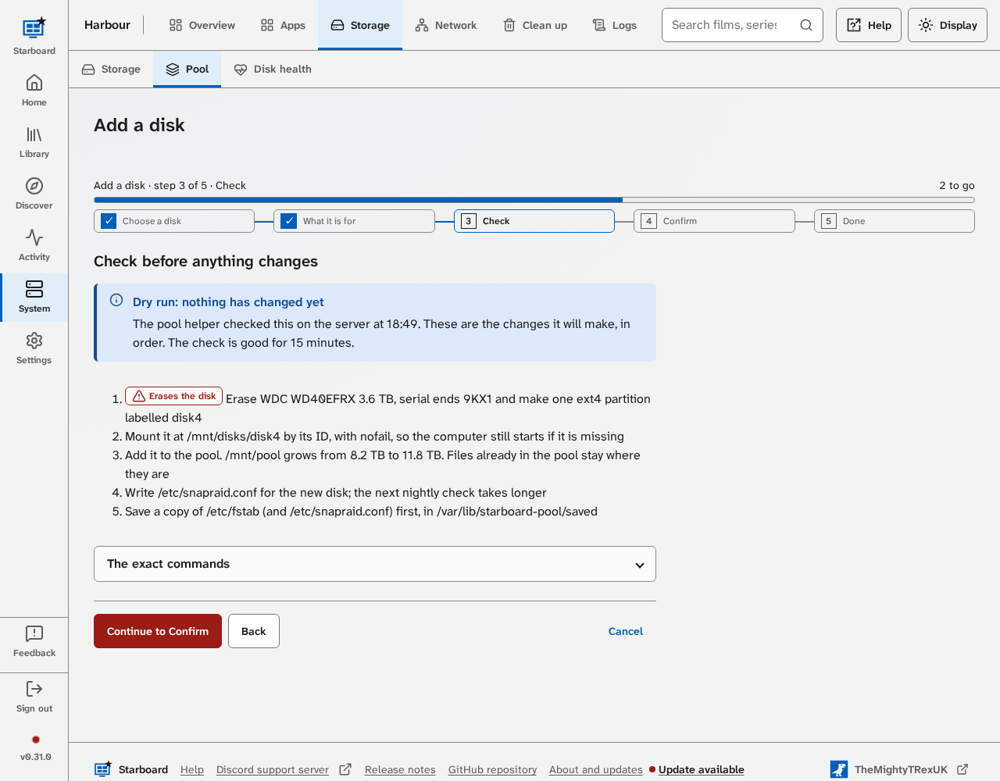

[Help centre](../README.md) · Your server · how-to
<!-- help: use / server -->

# Add a disk to the pool

Add a disk to the pool so its space joins `/mnt/pool`, or make the pool from your first disk. If the idea is
new, read [What a disk pool is](../basics/what-is-a-drive-pool.md).

## Before you begin

- The pool helper is set up. Run `./install.sh` again and answer Yes to **Set up Disk pools?** The installer asks
  for your computer's password, because changing disks needs administrator rights. You enter it in the terminal
  yourself.
- The computer has mergerfs, rsync and gdisk. On Debian, Ubuntu and Linux Mint, this command installs them:

  ```bash
  sudo apt install mergerfs rsync gdisk
  ```

- The new disk is plugged in. Note the last 4 characters of its serial number, from the label on the disk.
- Have your Starboard password ready. Every change to the disks asks for it again.
- If the disk has files you want and you are going to erase it, copy them somewhere else first.
- The page erases only a blank disk: one with no partitions and no files. To erase a disk that has anything on
  it, you finish in a terminal on the server. Read [Erase a disk that has files](#erase-a-disk-that-has-files).

## Steps

1. Go to **System**, then **Storage**, then **Pool**.
2. Select **Add a disk**.
3. **Choose a disk:** select the disk. Check the end of its serial number against the label on the disk.
4. Select **Continue to What it is for**.
5. Under **Use it**, select **Add it to the pool (recommended)**. For a backup disk instead, read
   [Use a disk as a backup disk](use-a-drive-as-a-backup-drive.md).
6. Under **What is on it now**, select one:
   - **Keep its files:** its files appear in the pool as they are. Only offered when the disk has files.
   - **Erase it and prepare it (ext4):** everything on the disk is erased.
7. Select **Continue to Check**. The pool helper checks the plan on the server. Nothing has changed yet.
8. Read **Check before anything changes**. It lists every change, in order. To read the commands, select
   **The exact commands**.
9. Select **Continue to Confirm**. If the check says **Erase this disk in a terminal**, follow
   [Erase a disk that has files](#erase-a-disk-that-has-files) instead.
10. If the disk is being erased, enter the last 4 characters of its serial number.
11. In **Enter your password**, enter your Starboard password.
12. Select **Add the disk**, or **Erase and add to the pool**.
13. Wait while each step is ticked off. When it says **Finished**, select **Back to Pool**.



## Erase a disk that has files

Starboard's page erases only a disk that the pool helper finds blank itself, with no partition table, no file
system and nothing mounted. A disk with anything on it is erased only when you ask in a terminal on the server,
because there the computer's own password, through sudo, shows that a person asked. Starboard's password cannot
show that: any program running on the server as Starboard's user could send the same request as the page.

1. Copy anything you want to keep from the disk somewhere else.
2. Follow the steps to **Check before anything changes**. The check says **Erase this disk in a terminal** and
   gives a command, such as `sudo starboard-pool apply 1a2b3c4d5e6f --confirm /dev/disk/by-id/ata-...=9KX1`.
3. Within 15 minutes, open a terminal on the server, enter that command, then enter the computer's password when
   sudo asks.
4. The helper lists each step as it does it. Go back to **System**, then **Storage**, then **Pool**: the disk is in
   the pool, or under **Backup disks**.

The check runs out after 15 minutes. To make a new one in the terminal, enter
`sudo starboard-pool plan add DISK --as pool --erase`, with the disk's name from `sudo starboard-pool drives`,
then the `apply` command it gives. `./install.sh --terminal` can also erase a disk in its **Your disks** step.

## Things to note

- **The check is good for 15 minutes.** After that, or if the disk changed in the meantime, the helper stops
  with nothing changed, and you check again.
- **Files already in the pool stay where they are.** New files go to the disk with the most free space, so a new
  disk fills first. To even the disks out now, read [Balance the files](balance-the-files.md).
- **The first disk** makes the pool. Starboard also makes Docker wait for the pool when the computer starts, so
  the apps never run against an empty folder.
- Before it changes anything, the helper saves a copy of `/etc/fstab` in `/var/lib/starboard-pool/saved`. It
  changes only its own lines there, between `# starboard-pool begin` and `# starboard-pool end`.
- A pool made outside Starboard is shown on the Pool page, but Starboard does not change it.
- **In the terminal:** `./install.sh --terminal` asks the same questions in its **Your disks** step. Read
  [Set up in the terminal](set-up-in-the-terminal.md).

## If it does not work

- **The pool helper is not set up:** answer Yes to **Set up Disk pools?** in `./install.sh`.
- **My disk is not listed:** **Other disks** on the Pool page says why each disk is not offered. Starboard
  never offers the system disk, a disk in another pool, RAID or LVM, or a disk with no stable name in
  `/dev/disk/by-id`. Some USB cases do not give one.
- **The disk changed since the check:** something else used the disk. Select **Back**, then check again.
- **Install these first:** the message names the programs to install. Install them, then try again.
- **Not blank, so Starboard's page cannot erase it:** the disk has a partition table, a file system or a mount.
  Follow [Erase a disk that has files](#erase-a-disk-that-has-files), or keep its files instead.
- **/etc/fstab already mounts this disk:** take that line out of `/etc/fstab` first, or keep the disk's files
  instead of erasing it.

## Find out more

- [What a disk pool is](../basics/what-is-a-drive-pool.md)
- [Balance the files](balance-the-files.md)
- [Use a disk as a backup disk](use-a-drive-as-a-backup-drive.md)
- [Check your disks' health](check-disk-health.md)

<!-- footer: download rights -->

---

**Download only what you have the right to.** Use the download apps only for files you have the right to download,
such as open-source software, works in the public domain and your own backups. Downloading films, series, music or
books without the copyright holder's permission is against the law in the UK and most other countries. Starboard
does not host or provide any files, and you are responsible for what you download.

<!-- /footer -->
