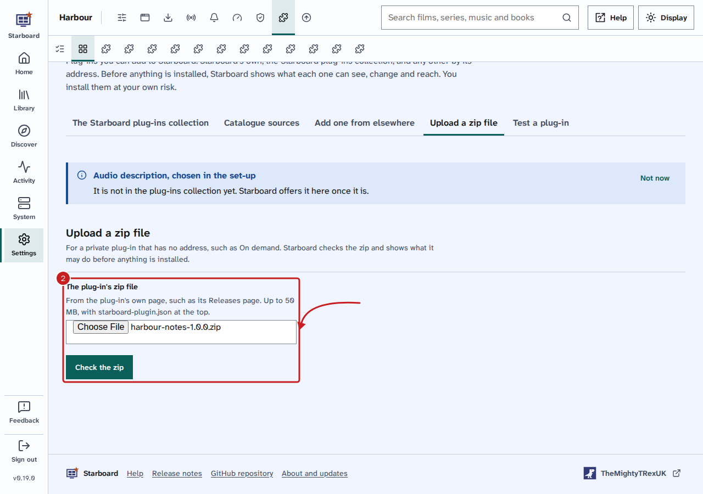
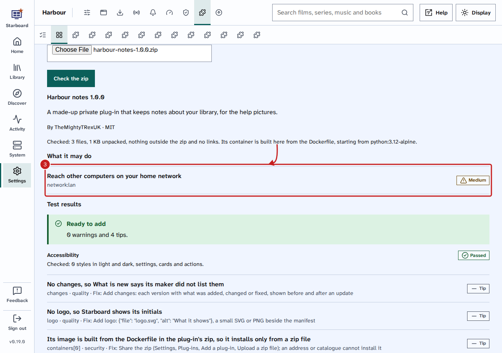
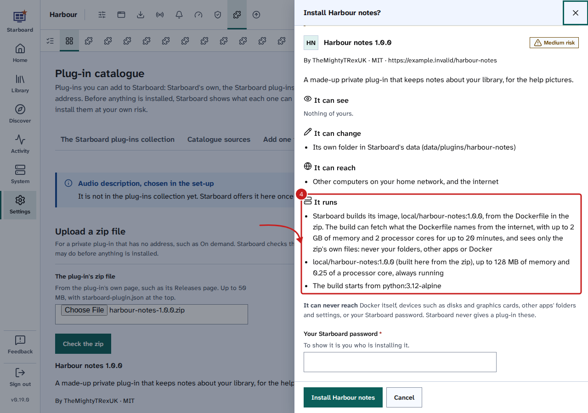
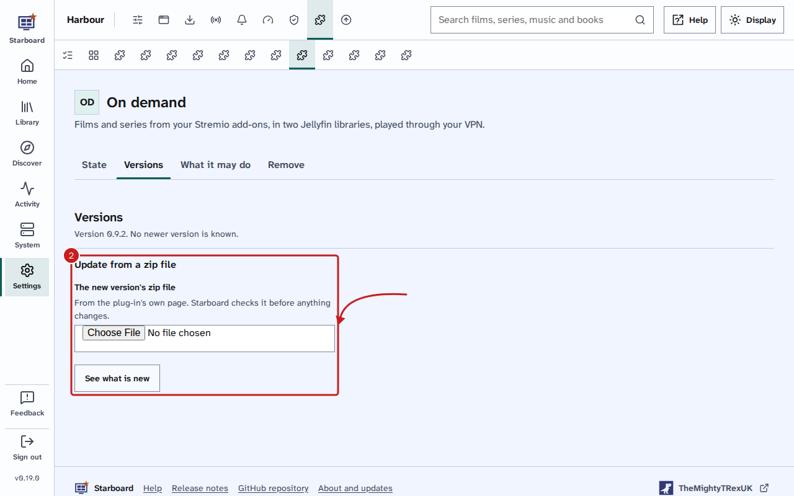

[Help centre](../README.md) · Plug-ins · how-to
<!-- help: plugins / adding -->

# Add a plug-in from a zip file

Add a private plug-in, such as On demand, from the zip file its maker gives you. Starboard checks the zip, shows what
the plug-in may do and builds its container on your server. At the end, the plug-in is installed and ready to
activate.

## Before you begin

- You have the plug-in's zip file on the computer you use Starboard from, such as `starboard-on-demand-0.9.2.zip`
  from the Releases page of the plug-in's repository. Only use a zip from someone you trust.
- You know your Starboard password. Installing asks for it.
- Starboard has access to Docker, which builds the plug-in's container. Read
  [Change what Starboard can access](change-what-starboard-can-access.md).

## Steps

1. Go to **Settings**, then **Plug-ins**, then **Catalogue**.
2. Under **Upload a zip file**, choose the zip in **The plug-in's zip file**, then select **Check the zip**.
   Starboard checks the zip before it shows anything. It says how many files it holds, and the image the build starts
   from when the plug-in builds its own container.

   

3. Read **What it may do** and the **Test results**. When the test finds an error, the plug-in cannot be installed:
   its maker needs to fix it. **Ready to add** means it passed.

   

4. Select **Install** and the plug-in's name, such as **Install Harbour notes…**. A slide-out lists what it **can
   see**, what it **can change**, what it **can reach** and what it **runs**, including the build. Read it all.

   
5. To go ahead, enter your Starboard password and select **Install** and the plug-in's name. To stop, select
   **Cancel**: nothing is installed.
6. A window shows each step: **Checking the zip**, **Building its container from the zip** and **Installing**. The
   build can take a few minutes the first time, while it fetches what the plug-in needs.
7. When it finishes, the plug-in's own page opens. Select **Activate**.

### Update it from a newer zip

1. Go to the plug-in's own page, under **Settings**, then **Plug-ins**.
2. Select the **Versions** tab. In **Update from a zip file**, choose the new version's zip in **The new version's zip
   file**, then select **See what is new**.

   

3. Read what is new and anything the new version asks for, enter your Starboard password, then select **Update**
   and its name.
4. A window shows each step, starting with the build. If the new version does not start or answer, Starboard goes
   back to the version before by itself.

To go back later, select **Roll back to** and the version before, under **Versions**. Nothing is downloaded: the version before is still on your
server. Read [Update a plug-in and roll it back](update-a-plugin.md).

## Things to note

- **What Starboard checks in the zip:** up to 50 MB, unpacking to at most 200 MB in at most 2,000 files;
  `starboard-plugin.json` at the top; no links, no names that point outside the zip, nothing encrypted.
- **What the build may do:** fetch what the plug-in's `Dockerfile` names from the internet, with up to 2 GB of memory
  and 2 processor cores, for up to 20 minutes. It never sees your folders, your other apps or Docker itself. Once
  built, the plug-in runs locked down like any other.
- Starboard keeps the zip of the version you have and the one before, beside the plug-in, so it can build the
  container again if it goes missing.
- A plug-in that builds its own container can only be added from its zip, never from an address or a catalogue.

## If it does not work

- **"That is not a zip file"** or **"The zip is damaged":** download the zip again from the plug-in's page.
- **"starboard-plugin.json must be at the top of the zip":** the zip was made from the folder above the plug-in.
  Ask its maker for a zip made with the plug-in's own tool, such as On demand's `tools/make-zip.sh`.
- **"The build failed"** with the last lines of the build: often the internet dropped while it fetched what the
  plug-in needs. Try again. If it fails the same way, send the lines to the plug-in's maker.
- **"The build took longer than 20 minutes":** the server was too busy. Try again when it is quieter.
- **"Another zip is being installed":** wait for the first one to finish.

## Find out more

- [Add a plug-in](add-a-plugin.md)
- [Update a plug-in and roll it back](update-a-plugin.md)
- [What a plug-in can change](../basics/what-plugins-can-change.md)
- [Built from a zip file](../developers/plugin-manifest-reference.md#built-from-a-zip-file), for plug-in makers

<!-- footer: download rights -->

---

**Download only what you have the right to.** Use the download apps only for files you have the right to download,
such as open-source software, works in the public domain and your own backups. Downloading films, series, music or
books without the copyright holder's permission is against the law in the UK and most other countries. Starboard
does not host or provide any files, and you are responsible for what you download.

<!-- /footer -->
